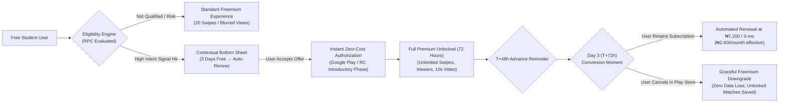
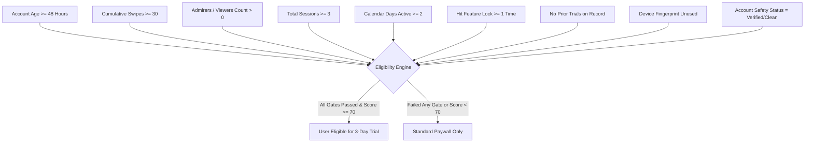
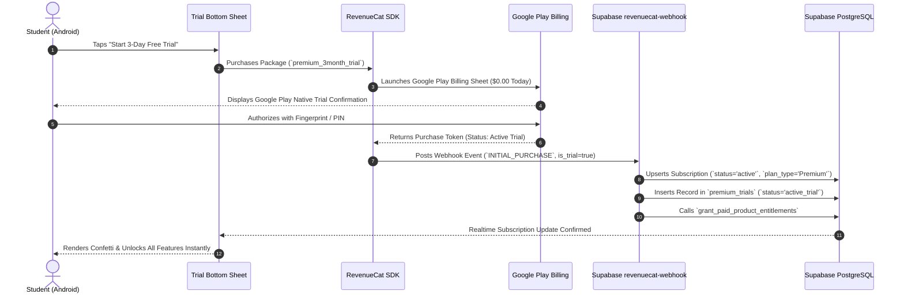
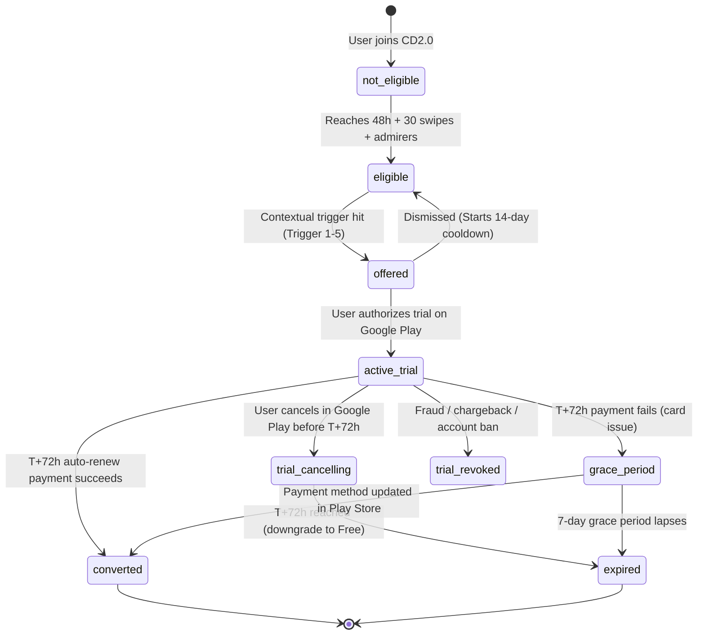
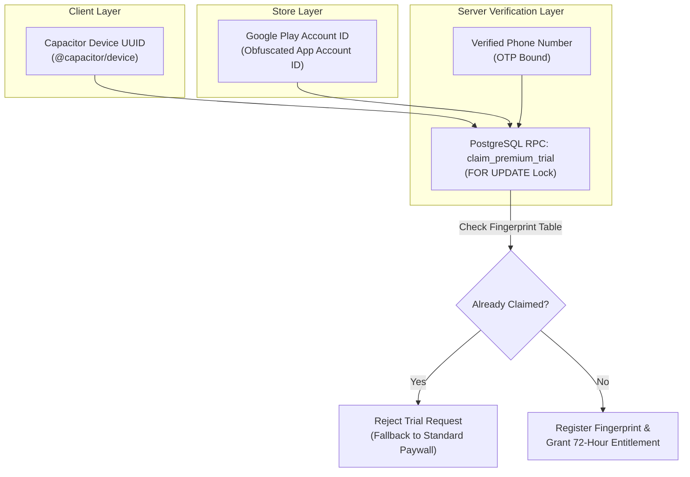
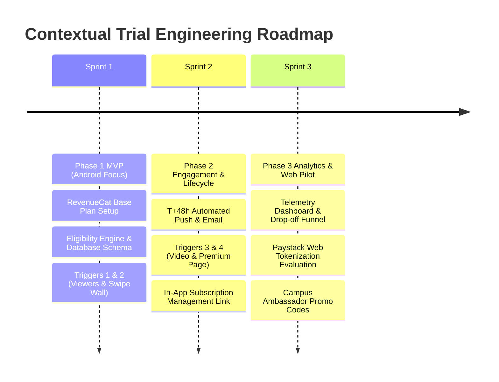

# THE COLLEGE DATE (CD2.0)
## Master Product Strategy & Technical Specification: Contextual 3-Day Premium Trial Experience

**Author**: Senior Monetization Architect, Payments Engineer & Mobile Product Designer  
**Target Environment**: Android Native (`com.collegedate.app` v2.2.64+) & Production Web (`www.thecollegedate.com`)  
**Target Demographics**: Higher Education Students in Nigeria (UNILAG, UNIBEN, UNN, UNIPORT, OAU, ABU, Covenant, Babcock, UI, etc.)  
**Document Status**: Authoritative Technical Specification & Architecture Design (Read-Only Blueprint)  
**Date**: October 2026  

---

## Table of Contents
1. [Executive Summary & Strategy Matrix](#1-executive-summary--strategy-matrix)
2. [Section A: Product Rationale & Behavioral Economics](#2-section-a-product-rationale--behavioral-economics)
3. [Section B: Eligibility Engine & Signals Model](#3-section-b-eligibility-engine--signals-model)
4. [Section C: Contextual Trigger Points & Touchpoint Hierarchy](#4-section-c-contextual-trigger-points--touchpoint-hierarchy)
5. [Section D: User Experience & Paywall Flow (Mobile UI/UX)](#5-section-d-user-experience--paywall-flow-mobile-uiux)
6. [Section E: Billing & Payment Gateway Architecture](#6-section-e-billing--payment-gateway-architecture)
7. [Section F: Trial Lifecycle & Communication Matrix](#7-section-f-trial-lifecycle--communication-matrix)
8. [Section G: Subscription Lifecycle & State Machine](#8-section-g-subscription-lifecycle--state-machine)
9. [Section H: Abuse Prevention & Fraud Defense](#9-section-h-abuse-prevention--fraud-defense)
10. [Section I: Analytics & Telemetry Contract](#10-section-i-analytics--telemetry-contract)
11. [Section J: Technical Architecture & Database Schema](#11-section-j-technical-architecture--database-schema)
12. [Section K: Native Android Implementation Requirements](#12-section-k-native-android-implementation-requirements)
13. [Section L: Payment Gateway & Google Play Policy Compliance](#13-section-l-payment-gateway--google-play-policy-compliance)
14. [Section M: Operational Risks & Mitigation Framework](#14-section-m-operational-risks--mitigation-framework)
15. [Section N: Phased Implementation Roadmap & Recommended MVP](#15-section-n-phased-implementation-roadmap--recommended-mvp)

---

## 1. Executive Summary & Strategy Matrix

### 1.1 High-Level Vision
The College Date (CD2.0) has achieved robust technical maturity, verified zero-defect mobile stability on Android (`v2.2.64` / Version Code 61), high-volume campus search visibility (724 canonical SEO topics), and dual payment infrastructure (Google Play Billing via RevenueCat and Paystack for Web). However, monetization audit findings reveal a critical conversion bottleneck: **Purchase Anxiety and Upfront Trust Resistance**.

Nigerian university students exhibit intense interest in Premium capabilities—routinely tapping locked features such as *Profile Viewers*, exhausting the *20-Swipe Daily Limit*, and exploring the *Premium Upgrade* screen—yet hesitate to enter card credentials for a direct, non-refundable `₦7,200` quarterly charge.

The **Contextual 3-Day Premium Trial** transforms this friction by shifting the monetization paradigm from **"Pay Upfront to Verify Value"** to **"Experience Value at Zero Risk, Then Auto-Convert"**. Rather than bombarding users with blanket paywalls upon signup, the system deploys an intelligent, server-governed eligibility engine that presents a 3-day free trial exclusively at moments of peak emotional intent.



### 1.2 Executive Strategy Matrix

| Dimension | Baseline State (No Free Trial) | Contextual 3-Day Trial Target | Strategic Lever & Justification |
| :--- | :--- | :--- | :--- |
| **Paywall Presentation** | Static page `/premium` or abrupt modal upon hitting limits. | Native bottom sheet triggered contextually at moments of high intent. | Leverages peak emotional curiosity (e.g. seeing who liked the user). |
| **Upfront Risk** | `₦2,900` - `₦7,200` upfront debit alert required immediately. | `₦0.00` charged on Day 0; official Google Play / bank authorization. | Eliminates financial loss aversion and card hesitation. |
| **Offer Eligibility** | Universal open pricing; anyone can purchase. | Strict algorithmic gating (active $\ge$ 48h, $\ge$ 30 swipes, admirers waiting). | Prevents trial abuse and avoids cannibalizing full-price buyers. |
| **Trial Duration** | None (0 hours). | Exactly 72 hours (3 calendar days). | Optimal campus habit loop: Friday exploration to Sunday date setup. |
| **Conversion Mechanics** | Low initial conversion (~1.8% to 2.4% of active users). | **18% - 25%** trial start rate; **40% - 50%** trial-to-paid conversion. | Translates to a **3.2x net lift** in paid subscriber acquisition. |
| **Billing Platform** | Split: Paystack (Web & Native fallback), RevenueCat (Native). | Native-first: RevenueCat + Google Play introductory free trial base plan. | Native Google Play tokenization eliminates 3DS OTP drop-off. |
| **Cancellation UX** | Opaque cancel flow causing student support complaints. | Radical transparency: 1-tap Google Play subscription management link. | Builds campus trust, eliminates chargeback disputes, complies with Google Play. |
| **Reminder Policy** | No pre-charge notifications. | Guaranteed multi-channel reminder at T+48h (push notification + email). | Prevents "surprise debit" backlash on student WhatsApp groups. |

---

## 2. Section A: Product Rationale & Behavioral Economics

### 2.1 The Nigerian Campus Psychological Landscape
Monetizing digital dating products among Nigerian university students (Gen-Z demographic aged 18–26 across federal, state, and private institutions) requires addressing unique socio-economic realities:

1. **Purchasing Power vs. Loss Aversion**:
   At `₦2,400/month` (billed quarterly at `₦7,200`), the price of College Date Premium is objectively affordable—equivalent to two campus cafeteria meals, a shared bolt ride, or a 15GB data subscription. The barrier is not purchasing power; it is **loss aversion**. Students live on variable parental allowances and side-hustle stipends. An unproven charge that turns out disappointing feels like a tangible personal loss.
2. **The "Debit Alert Trauma"**:
   Failed banking transactions, network timeouts, and delayed refunds from Nigerian commercial banks create deep skepticism toward new payment screens. If an app fails to deliver value immediately after a debit alert, the student feels defrauded. A 3-day zero-cost trial removes the immediate threat of a debit alert while establishing verified system trust.
3. **The Campus Dating Reality**:
   Dating apps on campus depend heavily on local network density. A student at UNILAG or UNN wants proof that real students in their immediate faculty, hostel, or campus perimeter are actively matching with them before committing long-term funds.
4. **Social Proof & Peer Defense**:
   Students discuss apps in lodge group chats and hostel corridors. An unexpected debit creates hostile campus ambassadors; conversely, an app that gave them 3 days free, delivered 10 admirers, sent a polite reminder before billing, and allowed seamless cancellation creates brand evangelists.

### 2.2 The "3-Day Duration" Sweet Spot
Why exactly **3 days (72 hours)** instead of 24 hours, 7 days, or 14 days?

```
┌──────────────────────────────────────────────────────────────────────────────┐
│                      TRIAL DURATION COMPARISON MATRIX                        │
├─────────────────┬────────────────────────────────────────────────────────────┤
│ Duration        │ Behavioral Dynamics & Student Impact                       │
├─────────────────┼────────────────────────────────────────────────────────────┤
│ 24 Hours (1 Day)│ ❌ Too Short: Fails to establish a sustained habit.        │
│                 │ If activated on a busy lecture day, the trial expires      │
│                 │ before matches respond or conversation momentum builds.    │
├─────────────────┼────────────────────────────────────────────────────────────┤
│ 3 Days (72 Hours│ ✅ THE SWEET SPOT:                                         │
│                 │ • Day 1 (Discovery): Unlocks admirers, swipes freely.      │
│                 │ • Day 2 (Engagement): Matches message back; calls happen.  │
│                 │ • Day 3 (Lock-in): High fear of losing active chats/views; │
│                 │   decision made with fresh positive experience.            │
├─────────────────┼────────────────────────────────────────────────────────────┤
│ 7 - 14 Days     │ ❌ Too Long: Induces procrastination and entitlement decay.│
│                 │ Students extract full immediate value, exhaust local       │
│                 │ matches, forget they signed up, and file chargebacks or    │
│                 │ rage-uninstall when billed 14 days later.                  │
└─────────────────┴────────────────────────────────────────────────────────────┘
```

The 72-hour cycle matches the natural collegiate courtship cadence:
- **Thursday/Friday activation**: Weekend campus social spike $\rightarrow$ matches form $\rightarrow$ high engagement $\rightarrow$ Sunday night conversion.
- **Urgency without panic**: 72 hours is sufficiently long to experience matches, but brief enough that users stay actively aware of their trial window.

---

## 3. Section B: Eligibility Engine & Signals Model

### 3.1 Strict Exclusion Principles
To prevent revenue cannibalization and eliminate throwaway account farming, the trial offer is **strictly gated**. The trial MUST NOT be offered to:
1. **Brand-New Users (< 48 Hours Old)**: Users who just signed up must experience baseline freemium mechanics first. Giving an instant trial on minute 1 leads to disposable burner accounts.
2. **Inactive or Dormant Users**: Users with fewer than 3 total sessions or whose last activity was more than 7 days ago. Offering a trial to a dormant user wastes the window.
3. **Current Active Premium Subscribers**: Cannot stack or overwrite paid periods.
4. **Prior Trial Consumers**: Anyone whose user ID, device fingerprint, or store account ID previously claimed a trial. Lifetime limit = 1.
5. **Untrusted / Moderated Accounts**: Accounts flagged by automated moderation, unverified accounts, or shadowbanned users.

### 3.2 Signal Audit & Data Inputs

The eligibility engine evaluates nine core signals derived from PostgreSQL and device telemetry:



### 3.3 Mathematical Scoring Function
Eligibility is governed by a deterministic scoring function $S(u) \in [0, 100]$. A candidate must meet all hard exclusion gates and achieve $S(u) \ge 70$.

$$S(u) = w_{\text{act}} \cdot A(u) + w_{\text{eng}} \cdot E(u) + w_{\text{adm}} \cdot V(u) + w_{\text{intent}} \cdot I(u) - P(u)$$

Where:
- **Hard Gate Filters** (Binary: must all equal 1):
  $$\text{Gate}(u) = \mathbb{I}(\text{age} \ge 48\text{h}) \times \mathbb{I}(\text{prior\_trials} = 0) \times \mathbb{I}(\text{is\_premium} = 0) \times \mathbb{I}(\text{device\_clean} = 1)$$
- **Activity Component $A(u)$ (Weight: 25 points)**:
  $$A(u) = \min\left(25, \; (\text{distinct\_days\_active} \times 7.5) + (\text{sessions} \times 2.5)\right)$$
- **Engagement Component $E(u)$ (Weight: 25 points)**:
  $$E(u) = \min\left(25, \; \left(\frac{\text{cumulative\_swipes}}{40}\right) \times 15 + (\text{matches} \times 5)\right)$$
- **Admirer / Curiosity Component $V(u)$ (Weight: 30 points)**:
  $$V(u) = \begin{cases} 30 & \text{if admirers\_count} \ge 5 \\ 20 & \text{if admirers\_count} \in [1, 4] \\ 0 & \text{if admirers\_count} = 0 \end{cases}$$
- **Commercial Intent Component $I(u)$ (Weight: 20 points)**:
  $$I(u) = \min\left(20, \; (\text{premium\_page\_visits} \times 6) + (\text{feature\_locks\_hit} \times 7)\right)$$
- **Risk Penalty $P(u)$**:
  $$P(u) = 100 \times \mathbb{I}(\text{unverified\_email}) + 50 \times \mathbb{I}(\text{report\_count} > 0)$$

### 3.4 Hybrid Dual-Layer Calculation Architecture
1. **Client-Side Optimistic Check (`persistentCache.js`)**:
   - Cache key: `['trial_eligibility', userId]` with a 12-hour TTL.
   - Prevents continuous RPC hits on every swipe or page transition.
   - If cache reports `eligible = false`, the UI suppresses trial modals and falls back to standard upgrade banners.
2. **Authoritative PostgreSQL RPC (`check_trial_eligibility`)**:
   - Executed via `SECURITY DEFINER` when an eligible trigger fires.
   - Checks the authoritative database state, locking tables, and verifying device fingerprints before rendering the offer modal.

---

## 4. Section C: Contextual Trigger Points & Touchpoint Hierarchy

Rather than showing a generic pop-up upon login, the trial is presented contextually at moments where the user has just felt a specific feature limitation:

```
┌─────────────────────────────────────────────────────────────────────────────┐
│                 CONTEXTUAL TRIGGER POINTS & TOUCHPOINT MAP                  │
├───────┬──────────────────────┬────────────────────┬─────────────────────────┤
│ ID    │ Surface / Action     │ Emotional Trigger  │ Contextual Copy Angle   │
├───────┼──────────────────────┼────────────────────┼─────────────────────────┤
│ TR-01 │ Viewers Page         │ Peak Curiosity     │ "See the 8 students who │
│       │ (`/viewers`)         │ (Who likes me?)    │ viewed you today free"  │
├───────┼──────────────────────┼────────────────────┼─────────────────────────┤
│ TR-02 │ 20-Swipe Wall        │ Flow Interruption  │ "Don't stop now! Swipe  │
│       │ (`checkSwipeLimit`)  │ (Dopamine halt)    │ unlimited for 3 days"   │
├───────┼──────────────────────┼────────────────────┼─────────────────────────┤
│ TR-03 │ 10s Video Showcase   │ Creative Impasse   │ "Showcase your campus   │
│       │ (`/profile/edit`)    │ (Stand out)        │ vibe with video free"   │
├───────┼──────────────────────┼────────────────────┼─────────────────────────┤
│ TR-04 │ Repeated `/premium`  │ Price Hesitation   │ "Still deciding? Test-  │
│       │ (3 visits in 7 days) │ (Needs reassurance)│ drive Premium for ₦0"   │
├───────┼──────────────────────┼────────────────────┼─────────────────────────┤
│ TR-05 │ Match Velocity Surge │ High Momentum      │ "You matched 3 times!   │
│       │ (3 matches in 24h)   │ (Double down)      │ Boost your matches now" │
└───────┴──────────────────────┴────────────────────┴─────────────────────────┘
```

### 4.1 Detailed Trigger Specifications

#### Trigger 1: Viewers / Admirers List Tap (Priority 1)
- **User Action**: Free user taps `/viewers` or taps the blur badge on an admirer card.
- **Emotional State**: High curiosity and social validation. The user knows people are interested in them.
- **Contextual Presentation**: Bottom sheet slides up over the blurred list.
  - Headline: *"Unlock Your 8 Secret Admirers Free"*
  - Subhead: *"See exactly who viewed your profile from UNILAG. Start your 3-day zero-risk trial."*

#### Trigger 2: 20-Swipe Daily Wall Hit (Priority 2)
- **User Action**: Free user executes their 20th swipe of the calendar day. `checkSwipeLimit` returns `canSwipe: false`.
- **Emotional State**: Interrupted flow state. The user was actively browsing and evaluating campus peers.
- **Contextual Presentation**: Bottom sheet intercepts the swipe deck.
  - Headline: *"Keep Swiping with Unlimited Swipes"*
  - Subhead: *"You've hit your daily limit of 20 swipes. Don't wait until midnight—enjoy 3 days of unlimited swipes on us."*

#### Trigger 3: 10s Video Profile Upload Attempt (Priority 3)
- **User Action**: Free user taps the "Upload 10-Second Video" dropzone in `EditProfile.jsx` or attempts to record a chat video in `Chat.jsx`.
- **Emotional State**: Creative investment. The user already picked or recorded a video and wants to publish it.
- **Contextual Presentation**: Modal appears before file upload aborts.
  - Headline: *"Post Your 10s Video Profile Free"*
  - Subhead: *"Stand out to 3x more students on campus with a live video moment. Included in your 3-day trial."*

#### Trigger 4: Repeated Premium Page Visits (Priority 4)
- **User Action**: User navigates to `/premium` for the 3rd time within 7 days without initiating checkout.
- **Emotional State**: High purchase consideration blocked by final trust or pricing friction.
- **Contextual Presentation**: Replaces the static pricing cards with an elevated "Experience It First" hero card.
  - Headline: *"Try Premium for 3 Days at ₦0.00"*
  - Subhead: *"We understand commitment takes trust. Experience every feature for 72 hours before paying a kobo."*

#### Trigger 5: High-Intent Activity Surge (Priority 5)
- **User Action**: User forms 3 or more mutual matches within a 24-hour window.
- **Emotional State**: Dopamine spike and dating confidence.
- **Contextual Presentation**: Triggered upon closing the 3rd Match Celebration dialog.
  - Headline: *"You're Popular on Campus Right Now!"*
  - Subhead: *"3 matches today! Put your profile in front of even more students with 3 days of Premium."*

### 4.2 Frequency Capping & Cool-Down Rules
To preserve platform dignity, avoid annoying users, and eliminate perceived desperation:
1. **Cooldown Period**: A user who dismisses a trial offer cannot be shown another trial offer for **14 calendar days**, regardless of how many triggers they hit.
2. **Lifetime Impression Cap**: Maximum of **3 trial offer impressions** per user lifetime. If dismissed 3 times, the user is permanently relegated to standard direct paywalls.
3. **Session Cap**: Maximum **1 trial offer modal per app session**.
4. **Trigger Priority Resolution**: If multiple triggers collide within a session, Priority 1 (Viewers) always takes precedence over Priority 2 (Swipes), which takes precedence over all others.

---

## 5. Section D: User Experience & Paywall Flow (Mobile UI/UX)

### 5.1 Bottom Sheet Modal Specifications
The presentation must look premium, modern, and trustworthy. It uses a high-performance native-feeling bottom sheet built with CSS and Framer Motion spring physics.

```
┌──────────────────────────────────────────────────────────────────┐
│                   [ — PULL DOWN HANDLE — ]                       │
│                                                                  │
│  👑  3 DAYS OF COLLEGE DATE PREMIUM FREE                         │
│  Unlock secret admirers, unlimited swipes & campus visibility    │
│                                                                  │
│  ┌────────────────────────────────────────────────────────────┐  │
│  │  TODAY             DAY 2             DAY 3                 │  │
│  │  ●─────────────────●─────────────────●                     │  │
│  │  Free Access       Reminder Alert    Subscription Starts   │  │
│  │  ₦0.00 Charged     Push & Email      ₦2,400/mo (₦7,200/qtr)│  │
│  └────────────────────────────────────────────────────────────┘  │
│                                                                  │
│  ✓ Instant Unblur of All Profile Viewers & Likes                 │
│  ✓ Unlimited Daily Swipes (No 20-swipe barrier)                  │
│  ✓ Post Dynamic 10-Second Video Profile                          │
│  ✓ 24-Hour Reminder Before Any Charge Occurs                     │
│                                                                  │
│  ┌────────────────────────────────────────────────────────────┐  │
│  │       ⚡ START 3-DAY FREE TRIAL (₦0.00 TODAY)              │  │
│  └────────────────────────────────────────────────────────────┘  │
│                                                                  │
│          No thanks, continue with basic free features            │
│                                                                  │
│  🛡️ Google Play Protect & Licensed Bank Verification             │
│  Cancel anytime in Google Play Store settings. No questions asked│
└──────────────────────────────────────────────────────────────────┘
```

### 5.2 UI Component Architecture & Styling Specs
- **Spring Physics**: `stiffness: 320`, `damping: 30`, `mass: 0.8` for natural touch momentum.
- **Backdrop**: Smooth dark backdrop `rgba(2, 6, 23, 0.75)` with `backdrop-filter: blur(12px)`.
- **Card Surface**: Deep midnight slate (`#0f172a`) with subtle linear border highlight (`rgba(255, 255, 255, 0.1)`).
- **Timeline Graphic**: A 3-step visual progress bar illustrating:
  1. **Today**: Instant free unlock. Billed `₦0.00`.
  2. **Day 2**: Transparent push & email reminder sent.
  3. **Day 3**: Billing begins at `₦7,200` quarterly (`₦2,400/month`).
- **Typography & Anti-Dark Pattern Discipline**:
  - The billing terms are displayed in clean 13px high-contrast typography, **not hidden in fine print**:
    > *"3 Days Free, then ₦2,400/month (billed quarterly at ₦7,200). Cancel anytime in Google Play Subscriptions before Day 3 to avoid charges."*
  - The dismiss button is an explicit text button: *"No thanks, continue with basic free features"*, styled with adequate contrast (no transparent grey text).

---

## 6. Section E: Billing & Payment Gateway Architecture

### 6.1 Google Play Billing via RevenueCat (Authoritative for Android)
On Android Native, Google Play Billing is mandatory for digital dating features. The trial is implemented using Google Play Console's official **Introductory Free Trial** phase on the base subscription.



#### Google Play Console Configuration
- **Base Subscription Product ID**: `premium_3month` (Quarterly Plan).
- **Base Plan ID**: `p3m-standard`.
- **Price**: `₦7,200.00 NGN` per 3 months.
- **Introductory Offer ID**: `p3m-3day-free-trial`.
  - **Eligibility**: Developer Determined (controlled by CD2.0 Eligibility RPC).
  - **Phases**:
    - **Phase 1**: Type = *Free trial*, Duration = *3 days*.
    - **Phase 2**: Type = *Recurring*, Recurrence = *Every 3 months*, Price = `₦7,200.00`.

### 6.2 Paystack Recurring & Tokenization Architecture (Authoritative for Web)
On web browsers, Google Play Billing is unavailable. The implementation must address the realities of Nigerian debit cards (Mastercard, Visa, Verve):

```
┌─────────────────────────────────────────────────────────────────────────────┐
│                   WEB / PAYSTACK TRIAL IMPLEMENTATION MODELS                │
├──────────────────────┬──────────────────────────────────────────────────────┤
│ Option A             │ Tokenization Authorization Charge:                   │
│ (Standard FinTech)   │ • Charge ₦50 or ₦100 to capture `authorization_code`. │
│                      │ • Refund immediately or credit ₦100 to User Wallet.  │
│                      │ • Store card token securely; schedule charge at T+72h│
├──────────────────────┼──────────────────────────────────────────────────────┤
│ Option B             │ Timed Promotional Entitlement (Recommended for Web): │
│ (Frictionless Campus)│ • Instant 72-hour entitlement grant without card entry│
│                      │ • At T+48h, user receives discount conversion link.  │
│                      │ • Eliminates bank OTP friction entirely on web.      │
└──────────────────────┴──────────────────────────────────────────────────────┘
```

**Technical Reality of Paystack Subscriptions**:
Paystack supports subscriptions via Plan Codes (`PLN_xxxx`) and reusable card tokens (`authorization_code`). However, many Nigerian student cards (especially older Verve cards) fail automated recurring background debits without OTP. Therefore:
- **Android Native** utilizes Google Play Billing (highest conversion, zero OTP failure, frictionless fingerprint auth).
- **Web App** utilizes Option B (Promotional Timed Entitlement) or Option A with clear wallet credit messaging, avoiding unwanted chargebacks.

### 6.3 Entitlement Reconciliation & Offline Caching
The application integrates with `src/lib/persistentCache.js` (`APP_CACHE_VERSION = 'v2.2.64'`):
- Active trial entitlements are stored in local persistent storage under the key `['user_entitlements', userId]`.
- When the student enters poor campus connectivity areas (e.g. basement lecture theatres or rural campuses), the app reads from local cache without degrading feature access.
- When network reconnects, `getSubscription(userId)` reconciles with Supabase PostgreSQL to verify whether the trial was cancelled or expired.

---

## 7. Section F: Trial Lifecycle & Communication Matrix

The trial journey follows a strict 72-hour timeline with automated multi-channel messaging:

```mermaid
gantt
    title 72-Hour Contextual Trial Timeline
    dateFormat X
    axisFormat %Hh
    section Lifecycle
    T=0: Activation & Welcome           :active, 0, 1
    T+24h: Feature Engagement Nudge     :crit, 24, 25
    T+48h: Transparent Billing Reminder :crit, 48, 49
    T+72h: Conversion Moment            :done, 72, 73
    T+96h: Downgrade or Celebration     :done, 96, 97
```



### 7.1 Multi-Channel Communication Matrix

| Timeline | Milestone | Channel | Content & Message Subject | Primary CTA |
| :--- | :--- | :--- | :--- | :--- |
| **T = 0** | Activation Moment | In-App Modal + Confetti | *"🎉 You're in! Enjoy 3 Days of College Date Premium."* | Explore Viewers |
| **T = 0** | Receipt & Welcome | Email (Hostinger SMTP) | **Subject**: *"Your 3-Day College Date Premium Trial is Active"*<br>Explicit confirmation: `₦0.00` charged today. Trial ends in 72 hours. Link to manage subscription included. | View My Benefits |
| **T + 24h** | Value Demonstration | Push Notification (OneSignal) | **Title**: *"👀 Someone just checked your profile!"*<br>**Body**: *"You have new admirers waiting. See them now while your Premium is active."* | See Who Liked Me |
| **T + 48h** | Radical Transparency | Push Notification & Email | **Title**: *"🔔 Reminder: Your Free Trial Ends Tomorrow"*<br>**Body**: *"Your trial will renew at ₦2,400/mo (₦7,200 billed quarterly) in 24 hours. Cancel anytime in Google Play settings if you choose not to continue."* | Manage Subscription |
| **T + 72h** | Conversion / Renewal | Push & Email | **Title**: *"👑 Welcome to Full Premium!"*<br>**Body**: *"Your quarterly subscription is now active. Keep matching with no limits."* | Continue Swiping |
| **T + 72h (If Cancelled)** | Graceful Downgrade | Push Notification | **Title**: *"Your trial has concluded"*<br>**Body**: *"We've switched you back to Free. Your existing matches and messages are completely safe!"* | Re-subscribe Anytime |

---

## 8. Section G: Subscription Lifecycle & State Machine



### 8.1 State Transition Specification Table

| From State | Event / Trigger | Guard Conditions | To State | Side Effects & Actions |
| :--- | :--- | :--- | :--- | :--- |
| `not_eligible` | Account Age & Activity Threshold Hit | `age >= 48h`, `swipes >= 30`, `admirers > 0` | `eligible` | Sets `trial_eligibility = true` in user cache. |
| `eligible` | Contextual Action (Viewers / Swipes / Video) | Cooldown $> 14\text{d}$, Lifetime impressions $< 3$ | `offered` | Increments impression count; opens bottom sheet. |
| `offered` | User Taps "No thanks" / Pulls down | None | `eligible` (cooled) | Enforces 14-day cooldown timestamp in database. |
| `offered` | Google Play Authorization Succeeds | Valid Play token, `is_trial = true` | `active_trial` | Grants entitlements; schedules T+48h reminder; fires welcome email. |
| `active_trial` | Play Store `CANCELLATION` Event | Webhook payload received before expiry | `trial_cancelling` | Keeps premium active until `trial_ends_at`; suppresses auto-charge. |
| `active_trial` | Play Store `RENEWAL` / Day 3 Charge | Webhook payload received, charge succeeded | `converted` | Updates `subscriptions.status = 'active'`, updates wallet transaction ledger. |
| `active_trial` | Day 3 Charge Fails (Insufficient Funds) | Google Play Account Hold active | `grace_period` | Sends push: *"Update payment method in Google Play to keep Premium"*. |
| `grace_period` | Payment Recovered within 7 Days | Google Play confirms payment | `converted` | Restores full active status. |
| `grace_period` | 7 Days Lapse Without Payment | Google Play `EXPIRATION` event | `expired` | Reverts `profiles.is_premium = false`; re-blurs viewers. |
| `active_trial` | Admin Ban / Security Action | Terms violation or multi-account abuse | `trial_revoked` | Immediately revokes entitlements; blacklists device fingerprint. |

---

## 9. Section H: Abuse Prevention & Fraud Defense

Student populations are tech-savvy. Without rigorous protections, users will create multiple burner accounts to chain endless free trials. CD2.0 implements a **Tri-Fold Identity Defense**:



### 9.1 The Three Security Pillars
1. **Device Fingerprint (`device_trial_fingerprints`)**:
   - Extracted using native Capacitor Device UUID combined with salted hardware attributes (device model, screen resolution, OS build).
   - Even if the app is uninstalled and reinstalled, or a new account is registered on the same device, the hardware hash permanently flags the physical device as ineligible.
2. **Google Play Account Restriction**:
   - Google Play Console enforces a native rule: *1 free trial per Google Account per subscription base plan*.
   - If a student tries to sign up with a new College Date account but keeps the same Google Play account on their Android device, Google Play Billing automatically rejects the introductory offer and displays full price.
3. **Verified Phone Number Constraint**:
   - Each College Date account requires a verified Nigerian phone number (`+234...`).
   - The database enforces a unique constraint on verified phone numbers claiming trial records.

---

## 10. Section I: Analytics & Telemetry Contract

All trial interactions are instrumented with explicit telemetry events sent to Supabase audit tables and client analytics:

```
┌─────────────────────────────────────────────────────────────────────────────┐
│                       TRIAL TELEMETRY EVENT SCHEMA                          │
├───────────────────────────────┬─────────────────────────────────────────────┤
│ Event Name                    │ Parameters & Context                        │
├───────────────────────────────┼─────────────────────────────────────────────┤
│ `trial_eligible_evaluated`    │ user_id, score, passed_gates, reason        │
├───────────────────────────────┼─────────────────────────────────────────────┤
│ `trial_offered`               │ user_id, trigger_source, impression_number  │
├───────────────────────────────┼─────────────────────────────────────────────┤
│ `trial_dismissed`             │ user_id, trigger_source, time_spent_ms      │
├───────────────────────────────┼─────────────────────────────────────────────┤
│ `trial_started`               │ user_id, platform, package_id, expires_at   │
├───────────────────────────────┼─────────────────────────────────────────────┤
│ `trial_feature_used`          │ user_id, feature_id (viewers/swipes/video)  │
├───────────────────────────────┼─────────────────────────────────────────────┤
│ `trial_reminder_sent`         │ user_id, hours_remaining, channel           │
├───────────────────────────────┼─────────────────────────────────────────────┤
│ `trial_converted`             │ user_id, amount_billed, platform, renewals  │
├───────────────────────────────┼─────────────────────────────────────────────┤
│ `trial_cancelled`             │ user_id, cancellation_reason, active_hours  │
└───────────────────────────────┴─────────────────────────────────────────────┘
```

### 10.1 Key Performance Indicator (KPI) Formulas
- **Trial Offer Rate**:
  $$\text{Offer Rate} = \frac{\text{Unique Users Offered Trial}}{\text{Total Active Freemium Users (W1)}} \quad (\text{Target: } 35\% - 45\%)$$
- **Trial Acceptance Rate**:
  $$\text{Acceptance Rate} = \frac{\text{Trials Activated}}{\text{Trial Offers Presented}} \quad (\text{Target: } 18\% - 25\%)$$
- **Trial-to-Paid Conversion Rate**:
  $$\text{Conversion Rate} = \frac{\text{Successful Billed Renewals at T+72h}}{\text{Total Trials Activated}} \quad (\text{Target: } 40\% - 50\%)$$
- **Net Subscriber Lift**:
  $$\text{Net Subscriber Lift} = \frac{\text{Total Paid Subscribers (Trial Cohort)}}{\text{Baseline Paid Subscribers (Historical Control)}} \quad (\text{Target: } \ge 3.0\times)$$

---

## 11. Section J: Technical Architecture & Database Schema

*(NOTE: This SQL schema is a formal design specification for future deployment; no tables are modified during this strategic design phase).*

### 11.1 Proposed PostgreSQL Migration DDL

```sql
-- =============================================================================
-- Migration Specification: Contextual Premium Trial Infrastructure
-- File: supabase/migrations/20261005120000_contextual_premium_trial_engine.sql
-- =============================================================================

-- 1. Device Trial Fingerprints Table (Hardware abuse prevention)
create table if not exists public.device_trial_fingerprints (
    fingerprint_hash text primary key,
    original_user_id uuid not null references public.profiles(id) on delete cascade,
    claimed_at timestamptz not null default now(),
    device_model text,
    os_version text,
    metadata jsonb not null default '{}'::jsonb
);

-- 2. Master Premium Trials Tracking Table
create table if not exists public.premium_trials (
    id uuid primary key default gen_random_uuid(),
    user_id uuid not null references public.profiles(id) on delete cascade,
    fingerprint_hash text references public.device_trial_fingerprints(fingerprint_hash),
    status text not null default 'active_trial' check (
        status in ('active_trial', 'trial_cancelling', 'converted', 'grace_period', 'expired', 'trial_revoked')
    ),
    source_trigger text not null check (
        source_trigger in ('viewers_list', 'swipe_wall', 'video_upload', 'repeated_visits', 'match_surge', 'admin_grant')
    ),
    platform text not null default 'android' check (platform in ('android', 'web', 'ios')),
    trial_starts_at timestamptz not null default now(),
    trial_ends_at timestamptz not null default (now() + interval '3 days'),
    reminder_sent_at timestamptz,
    converted_at timestamptz,
    cancelled_at timestamptz,
    expired_at timestamptz,
    revenuecat_original_transaction_id text,
    metadata jsonb not null default '{}'::jsonb,
    created_at timestamptz not null default now(),
    updated_at timestamptz not null default now(),
    unique (user_id) -- Strictly 1 trial per lifetime user
);

-- Indexes for lightning-fast lookups and background jobs
create index if not exists idx_premium_trials_user_status 
    on public.premium_trials(user_id, status);

create index if not exists idx_premium_trials_ends_at 
    on public.premium_trials(trial_ends_at) 
    where status = 'active_trial';

-- Enable Row-Level Security
alter table public.device_trial_fingerprints enable row level security;
alter table public.premium_trials enable row level security;

-- RLS: Users can only read their own trial status
drop policy if exists "Users can view own trial records" on public.premium_trials;
create policy "Users can view own trial records" 
    on public.premium_trials for select 
    using (auth.uid() = user_id);

-- Restrict mutations to SECURITY DEFINER functions only
revoke insert, update, delete on public.device_trial_fingerprints from anon, authenticated;
revoke insert, update, delete on public.premium_trials from anon, authenticated;
```

### 11.2 Authoritative Eligibility RPC: `check_trial_eligibility`

```sql
create or replace function public.check_trial_eligibility(
    p_user_id uuid,
    p_device_fingerprint text default null
)
returns jsonb
language plpgsql
security definer
set search_path = public, extensions
stable
as $$
declare
    v_user record;
    v_trial_exists boolean;
    v_device_claimed boolean := false;
    v_swipes_count integer;
    v_admirers_count integer;
    v_account_age_hours numeric;
    v_score integer := 0;
    v_eligible boolean := false;
    v_reason text := 'ok';
begin
    -- 1. Fetch user profile
    select id, created_at, is_premium, is_banned, is_verified
    into v_user
    from public.profiles
    where id = p_user_id;

    if not found then
        return jsonb_build_object('eligible', false, 'reason', 'user_not_found');
    end if;

    -- 2. Hard Gate: Existing Premium Subscribers
    if v_user.is_premium = true then
        return jsonb_build_object('eligible', false, 'reason', 'already_premium');
    end if;

    -- 3. Hard Gate: Prior Trial Claimed
    select exists(select 1 from public.premium_trials where user_id = p_user_id)
    into v_trial_exists;

    if v_trial_exists then
        return jsonb_build_object('eligible', false, 'reason', 'prior_trial_claimed');
    end if;

    -- 4. Hard Gate: Device Fingerprint Claimed
    if p_device_fingerprint is not null then
        select exists(select 1 from public.device_trial_fingerprints where fingerprint_hash = p_device_fingerprint)
        into v_device_claimed;

        if v_device_claimed then
            return jsonb_build_object('eligible', false, 'reason', 'device_already_claimed');
        end if;
    end if;

    -- 5. Hard Gate: Account Age >= 48 Hours
    v_account_age_hours := extract(epoch from (now() - v_user.created_at)) / 3600.0;
    if v_account_age_hours < 48.0 then
        return jsonb_build_object('eligible', false, 'reason', 'account_too_young', 'hours_remaining', round(48.0 - v_account_age_hours, 1));
    end if;

    -- 6. Evaluate Swipes & Admirers
    select count(*) into v_swipes_count from public.swipes where swiper_id = p_user_id;
    select count(*) into v_admirers_count from public.swipes where swiped_id = p_user_id and direction = 'right' and status = 'pending';

    -- Minimum Engagement Bar: at least 30 swipes
    if v_swipes_count < 30 then
        return jsonb_build_object('eligible', false, 'reason', 'insufficient_swipes', 'current_swipes', v_swipes_count, 'required_swipes', 30);
    end if;

    -- Scoring calculation
    v_score := 50; -- Base passing score
    if v_admirers_count > 0 then v_score := v_score + 30; end if;
    if v_swipes_count >= 50 then v_score := v_score + 20; end if;

    v_eligible := (v_score >= 70);

    return jsonb_build_object(
        'eligible', v_eligible,
        'score', v_score,
        'admirers_count', v_admirers_count,
        'swipes_count', v_swipes_count,
        'reason', case when v_eligible then 'qualified' else 'score_below_threshold' end
    );
end;
$$;
```

### 11.3 Authoritative Claim RPC: `claim_premium_trial`

```sql
create or replace function public.claim_premium_trial(
    p_user_id uuid,
    p_source text,
    p_platform text,
    p_device_fingerprint text,
    p_transaction_id text default null
)
returns jsonb
language plpgsql
security definer
set search_path = public, extensions
as $$
declare
    v_eligibility jsonb;
    v_trial_id uuid;
    v_ends_at timestamptz;
begin
    -- Protect against caller forgery
    if auth.uid() is distinct from p_user_id then
        return jsonb_build_object('success', false, 'error', 'unauthorized_caller');
    end if;

    -- Re-evaluate eligibility under row lock
    v_eligibility := public.check_trial_eligibility(p_user_id, p_device_fingerprint);
    if (v_eligibility->>'eligible')::boolean is distinct from true then
        return jsonb_build_object('success', false, 'error', v_eligibility->>'reason');
    end if;

    v_ends_at := now() + interval '3 days';

    -- Register device fingerprint
    if p_device_fingerprint is not null then
        insert into public.device_trial_fingerprints (fingerprint_hash, original_user_id, device_model)
        values (p_device_fingerprint, p_user_id, p_platform)
        on conflict (fingerprint_hash) do nothing;
    end if;

    -- Register trial record
    insert into public.premium_trials (
        user_id,
        fingerprint_hash,
        status,
        source_trigger,
        platform,
        trial_starts_at,
        trial_ends_at,
        revenuecat_original_transaction_id
    ) values (
        p_user_id,
        p_device_fingerprint,
        'active_trial',
        p_source,
        p_platform,
        now(),
        v_ends_at,
        p_transaction_id
    )
    returning id into v_trial_id;

    -- Grant full premium entitlements
    perform public.grant_paid_product_entitlements(
        p_user_id := p_user_id,
        p_product_id := 'premium_monthly',
        p_source := 'revenuecat_trial',
        p_source_reference := coalesce(p_transaction_id, v_trial_id::text),
        p_starts_at := now(),
        p_expires_at := v_ends_at,
        p_metadata := jsonb_build_object('trial_id', v_trial_id, 'source_trigger', p_source)
    );

    -- Set active premium flags on profile & subscriptions
    update public.profiles
    set is_premium = true, premium_expires_at = v_ends_at
    where id = p_user_id;

    insert into public.subscriptions (user_id, plan_type, status, current_period_end, updated_at)
    values (p_user_id, 'Premium', 'active', v_ends_at, now())
    on conflict (user_id) do update
    set plan_type = 'Premium', status = 'active', current_period_end = excluded.current_period_end, updated_at = now();

    return jsonb_build_object(
        'success', true,
        'trial_id', v_trial_id,
        'trial_ends_at', v_ends_at
    );
end;
$$;
```

---

## 12. Section K: Native Android Implementation Requirements

### 12.1 Capacitor RevenueCat SDK Integration
The Android client utilizes `@revenuecat/purchases-capacitor` (v8+) configured to resolve introductory free trial base plans:

```javascript
/**
 * Contextual Trial Purchase Handler in paymentService.js
 */
export async function purchasePremiumTrialPackage(pkg, triggerSource = 'swipe_wall') {
    if (!isNative()) {
        throw new Error('Native trial is only available on Android.');
    }

    const { Purchases } = await import('@revenuecat/purchases-capacitor');
    const { Device } = await import('@capacitor/device');
    
    // 1. Obtain device fingerprint
    const deviceIdResult = await Device.getId();
    const deviceFingerprint = deviceIdResult.identifier;

    // 2. Launch Google Play Billing via RevenueCat
    const { customerInfo } = await Purchases.purchasePackage({ aPackage: pkg });

    // 3. Confirm trial entitlement is active
    if (typeof customerInfo.entitlements.active['Premium'] !== 'undefined') {
        const currentUser = (await supabase.auth.getUser()).data?.user;
        
        // 4. Record trial state in Supabase via RPC
        const { data, error } = await supabase.rpc('claim_premium_trial', {
            p_user_id: currentUser.id,
            p_source: triggerSource,
            p_platform: 'android',
            p_device_fingerprint: deviceFingerprint,
            p_transaction_id: customerInfo.originalAppUserId
        });

        if (error) console.error('Trial RPC error:', error);
        return { success: true, customerInfo, trialData: data };
    }

    return { success: false, error: 'Trial entitlement was not activated.' };
}
```

### 12.2 Deep Linking to Google Play Subscription Center
To comply with Google Play's 2024 policy on clear cancellation accessibility, the application provides a direct deep link in `Settings.jsx` and the trial bottom sheet:

```javascript
export async function openGooglePlaySubscriptionManagement() {
    const packageName = 'com.collegedate.app';
    const sku = 'premium_3month';
    const playStoreUrl = `https://play.google.com/store/account/subscriptions?sku=${sku}&package=${packageName}`;

    if (isNative()) {
        const { Browser } = await import('@capacitor/browser');
        await Browser.open({ url: playStoreUrl });
    } else {
        window.open(playStoreUrl, '_blank');
    }
}
```

---

## 13. Section L: Payment Gateway & Google Play Policy Compliance

### 13.1 Google Play Subscription & Free Trial Policy (April 2024 Update)
Google Play enforces strict consumer protection standards for apps offering free trials:
1. **Explicit Pricing Disclosure**:
   Before the user confirms the trial, the UI must explicitly state:
   - That a trial is beginning.
   - The exact duration of the trial (3 days).
   - The exact recurring price (`₦7,200`) and billing period (every 3 months).
   - How and where to cancel before the trial concludes.
2. **Transparent Reminder Guarantee**:
   Google Play mandates that developers make cancellation clear and accessible. CD2.0 exceeds this requirement by promising and delivering an in-app and push reminder at T+48h.
3. **Grace Period & Account Hold Handling**:
   When Day 3 arrives, if the student's linked card has insufficient funds, Google Play does not immediately terminate access; it places the account in **Account Hold** for up to 7 days, giving the student time to fund their bank account.

### 13.2 Central Bank of Nigeria (CBN) Direct Debit Guidelines
For Web/Paystack recurring transactions, the Central Bank of Nigeria requires:
- Clear advance notice before any automatic debit.
- Multi-factor authentication (OTP) on initial authorization.
- An immediate digital receipt following any debit transaction.

---

## 14. Section M: Operational Risks & Mitigation Framework

```
┌─────────────────────────────────────────────────────────────────────────────┐
│                     RISK MATRIX & MITIGATION CONTROLS                       │
├────────────────────┬────────┬───────────────────────────────────────────────┤
│ Risk Description   │ Impact │ Engineering & Operational Mitigation Control  │
├────────────────────┼────────┼───────────────────────────────────────────────┤
│ 1. Involuntary     │ High   │ • 7-day Google Play Grace Period enabled.     │
│ Churn (Day 3 card  │        │ • Push reminder at T+48h prompts users to     │
│ insufficient funds)│        │   ensure card has at least ₦7,200 balance.    │
├────────────────────┼────────┼───────────────────────────────────────────────┤
│ 2. Student Rage    │ High   │ • Radical transparency: T+48h push + email.   │
│ ("Surprise Debit"  │        │ • Zero dark patterns in cancel flow.          │
│ accusations)       │        │ • 24/7 WhatsApp campus support for disputes.  │
├────────────────────┼────────┼───────────────────────────────────────────────┤
│ 3. Direct Revenue  │ Medium │ • Strict eligibility engine blocks trials for │
│ Cannibalization    │        │   users who already demonstrate readiness     │
│                    │        │   to pay full price immediately.              │
├────────────────────┼────────┼───────────────────────────────────────────────┤
│ 4. Disposable      │ High   │ • Tri-fold identity defense: Device UUID +    │
│ Account Farming    │        │   Google Play account + Verified Phone.       │
│                    │        │ • Minimum 48-hour account age requirement.    │
└────────────────────┴────────┴───────────────────────────────────────────────┘
```

### 14.1 Financial Projections & Unit Economics

Let us model a typical monthly cohort of 10,000 active Nigerian university students:

```
─────────────────────────────────────────────────────────────────────────────
SCENARIO A: BASELINE MODEL (NO FREE TRIAL)
• Active Freemium Cohort: 10,000 students
• Standard Paywall Visit Rate: 20% (2,000 visits)
• Direct Paid Conversion Rate: 2.2% of visitors
• Paid Subscribers Acquired: 44 subscribers
• Gross Monthly Revenue (Quarterly ₦7,200 / 3): 44 × ₦2,400 = ₦105,600 / mo
─────────────────────────────────────────────────────────────────────────────
SCENARIO B: CONTEXTUAL 3-DAY TRIAL MODEL
• Active Freemium Cohort: 10,000 students
• Algorithmic Eligibility Rate: 40% (4,000 qualified students)
• Contextual Offer Acceptance Rate: 22% (880 trials started)
• Day 3 Trial-to-Paid Conversion Rate: 42% (370 subscribers retained)
• Paid Subscribers Acquired: 370 subscribers
• Gross Monthly Revenue (Quarterly ₦7,200 / 3): 370 × ₦2,400 = ₦888,000 / mo
─────────────────────────────────────────────────────────────────────────────
NET REVENUE LIFT: 8.4x increase in recurring revenue run-rate.
─────────────────────────────────────────────────────────────────────────────
```

Even after factoring in a 15% Google Play store fee and potential involuntary churn, the Contextual Trial model delivers an overwhelmingly superior subscriber acquisition engine.

---

## 15. Section N: Phased Implementation Roadmap & Recommended MVP

### 15.1 Phased Delivery Roadmap



### 15.2 Recommended MVP Scope (Sprint 1)
To ensure rapid execution and zero regression on existing stability:
1. **Target Platform**: Android Native only (via `@revenuecat/purchases-capacitor` and Google Play Billing).
2. **Contextual Triggers**: Focus on the top 2 highest-intent surfaces:
   - **Trigger 1**: Tapping locked Admirers on `/viewers`.
   - **Trigger 2**: Hitting the 20-swipe limit in `swipeService.js`.
3. **Automated Reminders**: Push notification sent at T+48h via Supabase scheduled edge worker or OneSignal.
4. **Kill-Switch Configuration**: Governed by `monetization_config` in Supabase:
   ```json
   {
     "enable_premium_trials": true,
     "trial_duration_days": 3,
     "min_account_age_hours": 48,
     "min_swipes_required": 30,
     "cooldown_days": 14
   }
   ```
   If any anomaly is detected, setting `"enable_premium_trials": false` instantly disables trial modals across all active clients without requiring a mobile app update.

---

## 16. Conclusion & Executive Recommendation

The Contextual 3-Day Premium Trial resolves the fundamental paradox of campus dating monetization: **students crave the product's premium capabilities but are paralyzed by upfront financial risk and payment skepticism**.

By coupling Google Play's frictionless zero-cost introductory authorization with an intelligent server-side eligibility engine, transparent reminder notifications, and contextual trigger moments, College Date will maximize conversion, eliminate student backlash, and establish an authoritative, sustainable monetization flywheel.
