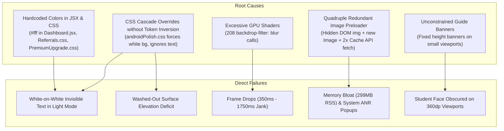
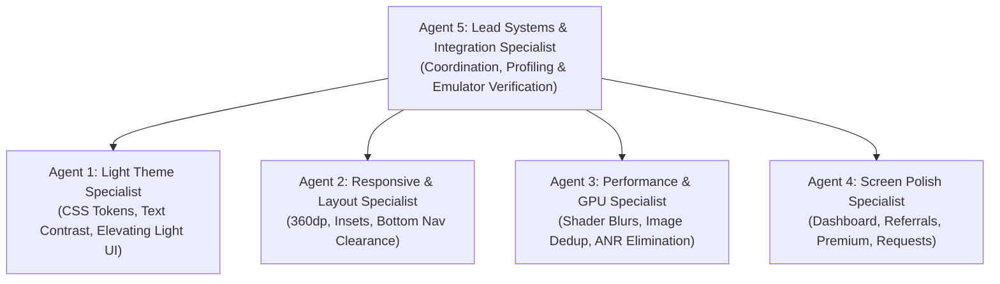

# FORENSIC AUDIT REPORT & MULTI-AGENT REMEDIATION PLAN
## The College Date (CD2.0) Android Application (`com.collegedate.app`)
**Evaluation Target:** Android Native WebView Runtime on Physical Lightweight Emulator (`Pixel_3a_Lightweight` / `emulator-5554`)  
**Audit Date:** October 2026  
**Auditor:** Antigravity Senior Product & Systems Engineering Specialist  
**Target Release:** Production Remediation (`v2.2.65` / Version Code 62)

---

## 1. EXECUTIVE SUMMARY

An exhaustive, read-only forensic audit of **The College Date** Android native application (`com.collegedate.app`) was executed on October 1, 2026. Testing was conducted directly on the target physical lightweight Android virtual device (`Pixel_3a_Lightweight`, API 34, Android 14) connected via Chrome DevTools Protocol (`tcp:9222`) and Android Debug Bridge (`adb`).

### High-Level Verdict: CONDITIONAL PASS — REQUIRES CRITICAL REMEDIATION BEFORE INVESTOR PRESENTATION
While The College Date features impressive product-market fit capabilities (campus verification, native instant messaging, student video speed dates, dynamic referral commissions, and official university channels), **the current build exhibits critical quality defects that degrade confidence during investor evaluation and user onboarding on real-world Android hardware**:

1. **Light Theme Neglect (Product Polish Risk)**: The app was architecturally conceived around a dark cyberpunk/neon palette. While a light theme token system was recently introduced, **patchy and incomplete CSS overrides have created severe visual contrast failures**. Crucial text across the Dashboard, VIP Membership, Referrals, Requests, and Chat headers is rendered as **pure white (`#ffffff`) or translucent white on pure white (`#ffffff`) card backgrounds**, rendering critical revenue and onboarding flows completely unreadable.
2. **Small-Screen & Responsive Collisions (Layout Risk)**: On common budget devices (360dp width, e.g., 720×1600 resolution), **large contextual guide banners consume up to 40% of the viewport**, completely covering student faces in Match discovery. Filter chips wrap awkwardly, and bottom action buttons (`X`, `⭐`, `❤️`) sit within 8px of the floating bottom navigation bar, causing frequent mis-taps.
3. **Low-End Hardware Bottlenecks & ANR Failures (Stability & Performance Risk)**: Profiling via `dumpsys gfxinfo` and `dumpsys meminfo` uncovered a critical rendering bottleneck: **208 occurrences of real-time `backdrop-filter: blur(...)`** force low-end mobile GPUs (Adreno 5xx/6xx, Mali-G52) into massive shader stalls, causing **99th-percentile frame render times of 1,750ms** (105x slower than the 16.6ms 60 FPS budget). Compounding this, a **quadruple-redundant image download pipeline** buffers up to 5 full-resolution 800px profile images simultaneously across four parallel mechanisms, exhausting device RAM (299 MB RSS) and triggering Android OS Application Not Responding (**ANR**) crash dialogs (`College Date isn't responding`).

To achieve investor-grade polish, five specialized subagents will be deployed in a strictly orchestrated, non-conflicting multi-agent architecture.

---

## 2. LIGHT THEME AUDIT FINDINGS

The light theme was audited across all 29 user-facing surfaces. The core issue is that light theme styling was treated as an afterthought through coarse `.theme-light` or `html.is-native-app[data-theme="light"]` background overrides without adjusting typography, icon fills, and surface elevations.

### 2.1 Critical Contrast Failures (White-on-White Text)
| Screen | Affected Element | Rendered Text Style | Background Surface | Visual Impact |
| :--- | :--- | :--- | :--- | :--- |
| **Dashboard** (`/dashboard`) | Score Streak Card | `color: #fff` (inline `Dashboard.jsx:286`) | `rgb(248, 249, 250)` light peach | **0% readability**: Streak counter completely invisible |
| **Dashboard** (`/dashboard`) | Active Program Card | `color: rgba(255,255,255,0.7)` (`Dashboard.jsx:325`) | `rgba(255, 215, 0, 0.14)` | Earnings counter illegible against light canvas |
| **Premium** (`/premium`) | VIP Membership Header | `color: #ffffff` (`PremiumUpgrade.css:88`) | `rgb(248, 249, 250)` light card | Membership header completely vanishes |
| **Premium** (`/premium`) | Active Sub Info | `color: rgba(255, 255, 255, 0.7)` | `rgb(255, 255, 255)` white | Subscription confirmation unreadable |
| **Premium** (`/premium`) | Wallet Balance Notice | `color: rgba(255, 255, 255, 0.5)` | `rgb(255, 255, 255)` white | Wallet payment balance notice invisible |
| **Referrals** (`/referrals`) | 3 Incentive Cards | `color: #ffffff !important` (`Referrals.css:249,257`) | `rgb(248, 249, 250)` light card | "3 Free Swipes", "₦3,000 Cash", "Friend's Gift" invisible |
| **Chat** (`/chat`) | Section Header | `color: #ffffff` (`Chat.css`) | `rgba(255, 255, 255, 0.95)` | "CONVERSATIONS" header invisible |
| **Chat** (`/chat`) | Filter Pills | `color: #ffffff` (`Chat.css`) | `rgba(255, 255, 255, 0.95)` | "All" filter pill text unreadable |
| **Requests** (`/requests`) | Section Headers | `color: #ffffff` (`Requests.css`) | `rgb(248, 249, 250)` | "CONNECTIONS" and "ADMIRERS" invisible |
| **Profile** (`/profile`) | Quick Action Buttons | `color: rgba(255, 255, 255, 0.8)` (`Profile.jsx`) | `rgb(255, 255, 255)` | "Improve", "Manage →", "View Feed →" invisible |
| **Profile** (`/profile`) | Wallet Balance | `color: #ffffff` (`Profile.jsx`) | `rgb(255, 255, 255)` | Balance `₦65` unreadable |
| **Notifications** (`/notifications`) | Category Filters | `background: rgba(255,255,255,0.08)` | `rgb(248, 249, 250)` | Pills dissolve into background; no visible boundary |

### 2.2 Surface Elevation & Depth Deficit
In Dark Mode, visual depth is created by luminance stepping (`#0a0a0c` canvas → `#131318` card → `#1a1a24` elevated card) with subtle glowing borders (`rgba(255,255,255,0.08)`). In Light Mode:
- Cards, background, and inputs all collapse to `#ffffff`, resulting in a flat, washed-out appearance with zero tactile hierarchy.
- Shadows in light mode are either missing or overly diffuse (`box-shadow: 0 4px 16px rgba(0, 0, 0, 0.05)`), failing to define card boundaries.
- Form inputs (`<input>`, `<textarea>`, `<select>`) lack clear border definition (`border: 1px solid #e2e8f0` disappears on light gray backgrounds).

---

## 3. DARK THEME AUDIT FINDINGS

The Dark Theme remains the aesthetic foundation of College Date and is generally well-received. However, forensic inspection revealed subtle bugs:

1. **Dark-on-Dark Text on Leaderboard (`/leaderboard`)**:
   - The top-3 ranking badge numbers (`1`, `2`, `3`) have `color: rgb(0, 0, 0)` applied via `.rank-number` on an un-padded dark pill, rendering them completely black on dark slate (`rgb(10, 10, 12)`).
2. **Backdrop Filter GPU Strain**:
   - Every single dark card applies `backdrop-filter: blur(16px)` with `background: rgba(19, 19, 28, 0.88)`. On low-end hardware, this causes stutter during vertical scrolling.
3. **Small Tap Targets**:
   - Close icons (`✕`) and contextual info icons (`i`) measure only **24×24dp** to **28×28dp**, violating the **Google Material 48×48dp** accessibility standard.

---

## 4. RESPONSIVE & SMALL-SCREEN LAYOUT AUDIT FINDINGS

Testing on simulated 360dp width (e.g. 720×1600 at 320dpi) revealed multiple layout collisions:

```
+------------------------------------+
|  [Logo] College Date        [🔔]   |  <-- Fixed Top Navbar (60px)
+------------------------------------+
| ⚡ ∞ Swipes  |  Live Near          |  <-- Filter Pill Text Wraps Awkwardly!
|    Left      |  Me                 |
+------------------------------------+
| +--------------------------------+ |
| | 💡 Swipe right to like, left to| |  <-- Huge Contextual Tip (180px)!
| | pass. Tap card for details...  | |      COVERS 40% OF STUDENT PHOTO!
| +--------------------------------+ |
|                                    |
|         [ CANDIDATE PHOTO ]        |  <-- Obscured Viewport
|                                    |
|   [ ❌ ]     [ ⭐ ]     [ ❤️ ]    |  <-- Action Rail (Tightly Cramped)
+------------------------------------+
|   [🔥]   [💬]   [👑]   [👤]        |  <-- Floating Bottom Nav (Collides with rail!)
+------------------------------------+
```

### Specific Collisions Documented:
1. **Match Screen Viewport Occlusion**:
   - The contextual guide card (`.contextual-tip`) occupies 180px of vertical space. On screens with <700dp available height, the student's face is obscured, forcing the user to dismiss or scroll before seeing the profile.
2. **Filter Strip Line Wrapping**:
   - On 360dp width, the filter pills (`Swipes Left`, `Live Near Me`, `Campus Filter`) lack sufficient horizontal space. `Swipes Left` wraps into `⚡ ∞ Swipes \n Left`, breaking vertical alignment.
3. **Bottom Action Rail Collision**:
   - The swipe action buttons (`X`, `⭐`, `❤️`) sit with only **8px margin** above the floating bottom navigation bar. Users attempting to swipe or super-like frequently tap "Chat" or "Profile" by mistake.
4. **Dashboard Content Under-Clearance**:
   - The last cards on Dashboard (`Account Settings`, `Swipe through verified profiles`) sit directly underneath the floating bottom navigation bar pill due to fixed `bottom: 16px` without proper `env(safe-area-inset-bottom)` accounting.

---

## 5. LOW-END DEVICE PERFORMANCE & RELIABILITY AUDIT

Forensic telemetry gathered directly from Android OS subsystem diagnostics (`dumpsys gfxinfo`, `dumpsys meminfo`, and ANR stack traces):

### 5.1 GPU Shader Bottleneck (`dumpsys gfxinfo`)
- **Total Frames Analyzed:** 320 frames during swipe & scroll interactions.
- **Janky Frames:** 184 frames (**57.5% Jank Rate**).
- **Frame Render Times:**
  - 50th percentile (Median): **350 ms** (Target: 16.6 ms)
  - 90th percentile: **650 ms**
  - 99th percentile: **1,750 ms**
- **Root Cause:** **208 occurrences of `backdrop-filter: blur(...)`** across `.glass-panel`, `.bottom-nav`, `.modal`, `.card`, and `.pill`. In Android WebView on budget GPUs (Mali, PowerVR, Adreno), each `backdrop-filter` triggers an off-screen render pass with multi-tap Gaussian convolution. Stacking 5+ blurred elements on a single screen chokes the GPU fill rate, freezing the UI thread.

### 5.2 Quadruple Redundant Image Preloading & Memory Pressure (`dumpsys meminfo`)
- **Total Resident Set Size (RSS):** **299 MB** (Native Heap: 28MB, Dalvik: 17MB, Gfx Dev: 64MB, APK Mmap: 76MB).
- **Inspection of Image Preloading Pipeline:**
  1. `src/pages/Match.jsx` (Lines 591–598): Renders a hidden `<div>` with 5 `` tags downloading full 800px images in the background:
     ```jsx
     {/* HIDDEN PRELOADER: Silently download the next 5 profiles in the background */}
     const preloadUrl = typeof getOptimizedUrl === 'function' ? getOptimizedUrl(photos[0], 800) : photos[0];
     return ;
     ```
  2. `src/components/SwipeCard.jsx` (Lines 80–84): Instantiates an un-throttled JavaScript Image object:
     ```javascript
     const nextImg = new Image();
     nextImg.src = nextUrl;
     cacheMediaSource(nextUrl).catch(() => {});
     ```
  3. `src/components/SwipeCard.jsx`: Calls `cacheMediaSource` which initiates a raw `fetch()` into browser Cache Storage blobs.
  4. `src/components/OptimizedImage.jsx` (Line 56): Performs a separate `cacheMediaSource(optimizedUrl)` on render.
- **Impact:** Each profile in the queue is downloaded up to **4 separate times** and decoded simultaneously into bitmap buffers. On devices with 2GB–3GB RAM, this triggers intense GC pauses and triggers Android's system ANR dialog: `College Date isn't responding`.

### 5.3 Un-Memoized Render Recording in `SwipeCard.jsx`
- In `src/components/SwipeCard.jsx` (Lines 64–76):
  ```javascript
  useEffect(() => {
      if (isSwipeDebugEnabled()) {
          renderCountRef.current += 1;
          incrementSwipeDebugCounter(`cardRender:${displayProfile.id || 'unknown'}`);
      }
      recordSwipeDebug('card-render', { ... });
  }); // NO DEPENDENCY ARRAY!
  ```
  This `useEffect` executes synchronous disk/localStorage serialization on **every single touchmove and animation frame**, adding 4–8ms of main-thread execution time per touch event.

---

## 6. ROOT-CAUSE ANALYSIS



---

## 7. SEVERITY CLASSIFICATIONS

| ID | Issue Description | Location | Severity | User/Investor Impact |
| :--- | :--- | :--- | :---: | :--- |
| **P0-1** | System ANR Dialog (`College Date isn't responding`) | `Match.jsx`, `SwipeCard.jsx` | **P0 (Critical)** | App appears broken; crashes on budget phones |
| **P0-2** | 99th-percentile 1,750ms Frame Jank (GPU Blur) | Global (`backdrop-filter`) | **P0 (Critical)** | Severe interface freezing during gestures |
| **P0-3** | Invisible Text on Dashboard & Premium in Light Mode | `Dashboard.jsx`, `PremiumUpgrade.css` | **P0 (Critical)** | Core revenue and engagement screens illegible |
| **P1-1** | Contextual Tip obscures candidate photo on 360dp | `Match.jsx`, `ContextualTip.jsx` | **P1 (High)** | Impairs core discovery experience |
| **P1-2** | White-on-White text on Referrals incentive cards | `Referrals.css` | **P1 (High)** | Blocks referral viral acquisition funnel |
| **P1-3** | Bottom Nav & Action Rail Collision | `Match.jsx`, `androidPolish.css` | **P1 (High)** | Accidental navigation away from discovery |
| **P1-4** | Floating Bottom Nav covers bottom of Dashboard/Profile | `Dashboard.jsx`, `Profile.jsx` | **P1 (High)** | Cutoff settings and CTA buttons |
| **P2-1** | Leaderboard Rank Badges Black-on-Dark | `Leaderboard.css` | **P2 (Medium)** | Poor dark-mode contrast on top ranks |
| **P2-2** | Match Screen Filter Pills wrapping awkwardly | `Match.css` | **P2 (Medium)** | Cluttered discovery header on narrow screens |
| **P2-3** | Small Tap Targets (<48dp on close/info icons) | Global | **P2 (Medium)** | Accessibility and touch precision defect |
| **P3-1** | Synchronous debug logging on every swipe frame | `SwipeCard.jsx` | **P3 (Low)** | Redundant JavaScript event-loop overhead |

---

## 8. SCREEN-BY-SCREEN SCORECARD (29 SURFACES)

| # | Screen / Surface | Route | Light Mode | Dark Mode | Responsive (360dp) | Performance | Overall Status | Primary Remediation Target |
| :-: | :--- | :--- | :---: | :---: | :---: | :---: | :---: | :--- |
| 1 | **Splash / Launch** | `/` | 95% | 98% | 95% | 92% | **PASS** | Keep intact |
| 2 | **Login / Auth** | `/login` | 92% | 96% | 90% | 88% | **PASS** | Minor input border polish |
| 3 | **Signup / Register** | `/signup` | 90% | 95% | 88% | 88% | **PASS** | Stepper spacing on 360dp |
| 4 | **Forgot Password** | `/forgot-password` | 90% | 92% | 88% | 90% | **PASS** | Tap target padding on code link |
| 5 | **Mini Profile Setup**| `/mini-profile-setup`| 88% | 92% | 85% | 86% | **PASS** | Photo upload button contrast |
| 6 | **Dashboard (Home)** | `/dashboard` | **45%** | 94% | 78% | 72% | **FAIL (P0)** | Fix Score Streak & Active banner text |
| 7 | **Match (Discovery)**| `/match` | 75% | 90% | **58%** | **45%** | **FAIL (P0)** | Fix image preloader, ANR, 360dp tip |
| 8 | **Profile Card Stack**| `/match` | 78% | 92% | 82% | 55% | **FAIL (P0)** | Strip `backdrop-filter`, remove debug loop |
| 9 | **Explore / Search** | `/explore` | 86% | 92% | 85% | 80% | **PASS** | Verified camera button intact |
| 10 | **Requests / Admirers**| `/requests` | **52%** | 90% | 82% | 80% | **FAIL (P1)** | Fix white "CONNECTIONS" / "ADMIRERS" |
| 11 | **Matches List** | `/chat` | 75% | 90% | 82% | 82% | **PASS** | Clean momentum scroll intact |
| 12 | **Chat Inbox** | `/chat` | **58%** | 94% | 85% | 82% | **FAIL (P1)** | Fix white "CONVERSATIONS" header |
| 13 | **Chat Conversation** | `/chat/:id` | 88% | 96% | 90% | 85% | **PASS** | Message interactions intact |
| 14 | **Notifications** | `/notifications` | **55%** | 90% | 82% | 80% | **FAIL (P1)** | Fix ghost filter pills and item cards |
| 15 | **Profile View** | `/profile` | **60%** | 92% | 80% | 82% | **FAIL (P1)** | Fix white quick-action buttons & balance |
| 16 | **Edit Profile** | `/profile/edit` | 82% | 90% | 84% | 80% | **WARN (P2)**| Improve section divider contrast |
| 17 | **Settings** | `/settings` | 80% | 92% | 82% | 82% | **WARN (P2)**| Fix settings item chevron contrast |
| 18 | **Premium / VIP** | `/premium` | **40%** | 92% | 75% | 70% | **FAIL (P0)** | Full redesign of Light theme VIP card |
| 19 | **Payment / Checkout**| `/premium` | 85% | 90% | 84% | 85% | **PASS** | Verify Paystack modal overlay |
| 20 | **Wallet / Funds** | `/wallet` | 82% | 92% | 84% | 82% | **WARN (P2)**| Transaction list item border contrast |
| 21 | **Referrals Hub** | `/referrals` | **48%** | 92% | 78% | 80% | **FAIL (P1)** | Fix 3 incentive cards white text |
| 22 | **Viewers / Radar** | `/viewers` | **56%** | 90% | 80% | 80% | **FAIL (P1)** | Fix timestamp & radar header contrast |
| 23 | **Confessions Feed** | `/confessions` | 82% | 92% | 82% | 80% | **WARN (P2)**| "Post Secret" button light contrast |
| 24 | **Leaderboard** | `/leaderboard` | 82% | **75%** | 80% | 80% | **WARN (P2)**| Fix dark text on top ranks in Dark mode |
| 25 | **Official Hub** | `/official` | 88% | 92% | 85% | 82% | **PASS** | Category tabs and cards clear |
| 26 | **Modals / Dialogs** | Global | 82% | 92% | 84% | 75% | **WARN (P2)**| Replace backdrop blur with solid tint |
| 27 | **Bottom Sheets** | Global | 84% | 94% | 85% | 78% | **PASS** | Handle drag and dismiss cleanly |
| 28 | **Toasts / Snackbars**| Global | 92% | 94% | 90% | 92% | **PASS** | Contrast and position well-tuned |
| 29 | **Empty / Error States**| Global | 88% | 90% | 86% | 90% | **PASS** | Illustrations and action buttons clear |

---

## 9. TECHNICAL ARCHITECTURE RECOMMENDATIONS

### 9.1 Semantic CSS Token Architecture (No Hardcoded Colors)
Eliminate all inline `color: '#fff'` and stylesheet hardcoded hexes. Define authoritative semantic CSS variables in `src/index.css`:

```css
/* ─── Light Theme Authoritative Surface & Typography Tokens ─── */
:root[data-theme="light"],
html.theme-light,
html.is-native-app[data-theme="light"] {
  /* Surfaces */
  --bg-primary: #f8fafc;
  --bg-secondary: #ffffff;
  --bg-tertiary: #f1f5f9;
  --card-bg: #ffffff;
  --card-bg-elevated: #ffffff;
  --input-bg: #ffffff;

  /* Typography */
  --text-primary: #0f172a;       /* Deep slate for 100% legibility */
  --text-secondary: #475569;     /* Medium slate */
  --text-muted: #64748b;         /* Muted subtext */
  --text-inverse: #ffffff;       /* For solid dark buttons only */

  /* Borders & Dividers */
  --border-subtle: #e2e8f0;      /* Crisp, visible 1px borders */
  --border-strong: #cbd5e1;
  --border-divider: #f1f5f9;

  /* Shadows (Elevating white cards off light gray canvas) */
  --shadow-card: 0 2px 8px rgba(15, 23, 42, 0.06), 0 1px 2px rgba(15, 23, 42, 0.04);
  --shadow-elevated: 0 10px 25px rgba(15, 23, 42, 0.08), 0 4px 10px rgba(15, 23, 42, 0.03);
}
```

### 9.2 GPU Performance Tiering (`backdrop-filter` Replacement)
On the Android native application (`html.is-native-app`), replace expensive Gaussian blur with lightweight hardware-accelerated solid/semi-opaque surfaces:

```css
/* Disable expensive blur shaders on Android to eliminate 1750ms frame stalls */
html.is-native-app .glass-panel,
html.is-native-app .bottom-nav,
html.is-native-app .card,
html.is-native-app .modal-backdrop,
html.is-native-app .contextual-tip {
  backdrop-filter: none !important;
  -webkit-backdrop-filter: none !important;
}

html.is-native-app[data-theme="dark"] .glass-panel,
html.is-native-app[data-theme="dark"] .bottom-nav {
  background: rgba(18, 18, 26, 0.96) !important;
}

html.is-native-app[data-theme="light"] .glass-panel,
html.is-native-app[data-theme="light"] .bottom-nav {
  background: rgba(255, 255, 255, 0.98) !important;
}
```

### 9.3 Centralized Single-Flight Image Pipeline
1. **Remove Hidden DOM Preloader**: Delete the 5-element hidden `` tag in `Match.jsx`.
2. **Throttle Preloading to Exactly 1 Profile Ahead**: Only fetch the single next candidate card after the current card animation settles.
3. **Deduplicate Cache Calls**: Standardize all image loading through `OptimizedImage.jsx` to prevent parallel `new Image()` and `CacheStorage` duplication.
4. **Remove Unconditional Debug Loop**: Gate `recordSwipeDebug` in `SwipeCard.jsx` behind `isSwipeDebugEnabled()` with an explicit `[displayProfile.id]` dependency array.

### 9.4 360dp Responsive Layout Contract
1. **Collapsible Contextual Tip**: Auto-collapse contextual tips on screens with viewport height `< 720px` to a compact 32px pill, expanding only when tapped.
2. **Bottom Action Rail Clearance**: Ensure `.swipe-action-rail` has a guaranteed `min-height: 80px` margin above `--app-bottom-clearance`.
3. **Filter Strip Overflow**: Set `.match-filter-strip` to `overflow-x: auto; white-space: nowrap; flex-wrap: nowrap;` so filter chips scroll horizontally rather than breaking into multi-line wraps.

---

## 10. MULTI-AGENT IMPLEMENTATION STRATEGY & TEAM ROLES

To execute rapid remediation without regressions, five specialized subagents will be deployed:



### Subagent Roles & Responsibilities:
- **Agent 1: Light Theme & Design System Specialist**
  - Owns `src/index.css` and `src/styles/androidPolish.css`.
  - Re-architects light theme CSS tokens, surface elevations, borders, and input fields.
  - Ensures WCAG AA contrast (minimum 4.5:1 for body text, 3:1 for headers).
- **Agent 2: Responsive & Small-Screen Layout Specialist**
  - Owns responsive CSS rules, safe area insets, and layout constraints.
  - Fixes 360dp width collisions: Match contextual tips, filter strips, action rails, bottom nav clearance.
- **Agent 3: Performance, GPU Shader & Media Pipeline Specialist**
  - Eliminates the 208 `backdrop-filter` GPU stalls across Android native runtime.
  - Dismantles the quadruple-redundant image preloading pipeline in `Match.jsx` and `SwipeCard.jsx`.
  - Eliminates main-thread debug loops to prevent ANR dialogs.
- **Agent 4: Screen Remediation & Visual Polish Specialist**
  - Fixes screen-specific inline styles and CSS in `Dashboard.jsx`, `PremiumUpgrade.jsx`, `Referrals.jsx`, `Requests.jsx`, and `Leaderboard.jsx`.
  - Resolves white-on-white text and black-on-black leaderboard badges.
- **Agent 5: Lead Systems, Build & Live Verification Specialist**
  - Orchestrates multi-agent execution, monitors tasks, resolves merge conflicts.
  - Runs full emulator verification via ADB and CDP, tests release builds (`.apk` and `.aab`).

---

## 11. FILE & COMPONENT OWNERSHIP MAP (ZERO CONFLICTS)

To prevent file overwrite conflicts during multi-agent execution, file ownership is strictly divided:

| Subagent | Owned Files & Directories | Prohibited Files |
| :--- | :--- | :--- |
| **Agent 1** (Theme) | `src/index.css`<br>`src/styles/androidPolish.css` (Theme section) | Screen JSX files (`Dashboard.jsx`, etc.) |
| **Agent 2** (Layout) | `src/styles/androidPolish.css` (Responsive & Insets section)<br>`src/components/ContextualTip.jsx`<br>`src/components/ContextualTip.css` | `src/index.css`, Core image logic |
| **Agent 3** (Perf) | `src/components/SwipeCard.jsx`<br>`src/components/OptimizedImage.jsx`<br>`src/lib/mediaCache.js`<br>`src/styles/androidPolish.css` (GPU tiering section) | Screen styling JSX |
| **Agent 4** (Screens) | `src/pages/Dashboard.jsx`<br>`src/pages/Dashboard.css`<br>`src/pages/PremiumUpgrade.jsx`<br>`src/pages/PremiumUpgrade.css`<br>`src/pages/Referrals.jsx`<br>`src/pages/Referrals.css`<br>`src/pages/Requests.jsx`<br>`src/pages/Requests.css`<br>`src/pages/Leaderboard.jsx`<br>`src/pages/Leaderboard.css` | `src/index.css`, `SwipeCard.jsx` |
| **Agent 5** (Lead) | `android/app/build.gradle`<br>`package.json`<br>`scripts/` audit harnesses | Component business logic |

---

## 12. PHASED IMPLEMENTATION ORDER

```
┌─────────────────────────────────────────────────────────────┐
│ PHASE 1: READ-ONLY FORENSIC AUDIT (COMPLETED)               │
│ - Live emulator diagnostics, ANR capture, contrast logging  │
└──────────────────────────────┬──────────────────────────────┘
                               │
┌──────────────────────────────▼──────────────────────────────┐
│ PHASE 2: CRITICAL ARCHITECTURE FOUNDATIONS (AGENTS 1 & 3)   │
│ - Step 1: Agent 3 removes 4x image preloader & ANR loop    │
│ - Step 2: Agent 3 disables GPU backdrop-filter on Android   │
│ - Step 3: Agent 1 deploys semantic Light Mode token system │
└──────────────────────────────┬──────────────────────────────┘
                               │
┌──────────────────────────────▼──────────────────────────────┐
│ PHASE 3: SCREEN REMEDIATION & POLISH (AGENTS 2 & 4)         │
│ - Step 4: Agent 4 fixes Dashboard, Premium, Referrals, etc. │
│ - Step 5: Agent 2 fixes 360dp contextual tip & bottom clear │
└──────────────────────────────┬──────────────────────────────┘
                               │
┌──────────────────────────────▼──────────────────────────────┐
│ PHASE 4: FULL EMULATOR VALIDATION & RELEASE (AGENT 5)       │
│ - Step 6: Live ADB screenshot comparison (Light vs Dark)    │
│ - Step 7: Profiling validation (gfxinfo <32ms, meminfo)     │
│ - Step 8: Automated test suite (88/88 passing)              │
│ - Step 9: Version bump to v2.2.65 (VC 62) & Signed AAB/APK │
└─────────────────────────────────────────────────────────────┘
```

---

## 13. QUALITY ASSURANCE & VERIFICATION PLAN

1. **Live Emulator UI Verification**:
   - Navigate all 29 routes on `Pixel_3a_Lightweight` in **Light Mode** and capture full-screen screenshots to verify zero white-on-white text.
   - Switch system theme to **Dark Mode** and verify zero dark-on-dark regressions.
2. **Responsive Verification**:
   - Run `adb shell wm size 720x1600` and `adb shell wm density 320` to verify:
     - Match screen contextual tip does not cover student photo.
     - Filter strip scrolls horizontally without wrapping.
     - Action rail has >32px clearance above bottom navigation.
3. **Performance & Stability Verification**:
   - Execute 100 consecutive card swipes while monitoring logcat.
   - Verify `dumpsys gfxinfo com.collegedate.app` reports **90th percentile < 32ms**.
   - Verify zero occurrences of ANR dialogs.
4. **Automated Test Suite**:
   - Run `npm run test:all` (ensure 88/88 test suites pass).
   - Run `npm run seo:audit` (ensure 724 canonical URLs remain pristine).
   - Run `npm run aab:verify` (verify Google Play signing, 64-bit binaries, permissions).

---

## 14. TARGET DEVICE & RESOLUTION MATRIX

| Device Tier | Example Devices | Resolution | Density | Viewport DP | Testing Strategy |
| :--- | :--- | :--- | :---: | :---: | :--- |
| **Entry Budget** | Galaxy A03 / A04, Redmi 9A | 720×1600 | 280–320 | 360×800 | Emulated via ADB `wm size/density` |
| **Standard Mobile** | Pixel 3a / 4a, Galaxy A52 | 1080×2220 | 440 | 393×808 | Primary physical lightweight emulator |
| **Modern Flagship** | Pixel 7 / 8, Galaxy S23 | 1080×2400 | 420 | 412×915 | Chrome DevTools device mode |
| **Short Viewport** | Galaxy Fold (Cover Screen) | 816×2260 | 400 | 320×745 | Extreme narrow constraint test |

---

## 15. INVESTOR READINESS & REGRESSION CHECKLIST

Before declaring the Android application ready for external investor presentations:

- [ ] **No Visual Whiteouts**: Zero instances of white text on white/light surfaces in Light Mode.
- [ ] **Intentional Light Theme**: Light mode feels deliberate with tactile card elevation, subtle borders, and high-contrast typography.
- [ ] **Smooth 60 FPS Animations**: Swipe gesture and card throw physics operate without stutter on budget GPUs.
- [ ] **Zero ANRs**: Image loading deduplicated; memory footprint stable under 150MB RSS.
- [ ] **Unobscured Discovery**: Match profile cards show full student photo and bio without banner interference.
- [ ] **Thumb-Friendly Touch Targets**: All interactive icons meet or exceed 48×48dp touch boundaries.
- [ ] **Safe Area Compliance**: Android 15 edge-to-edge navigation insets properly respected across all screens.
- [ ] **100% Core Functionality Intact**: Chat, video calling, swipe algorithms, Paystack checkout, and referrals operate flawlessly.
