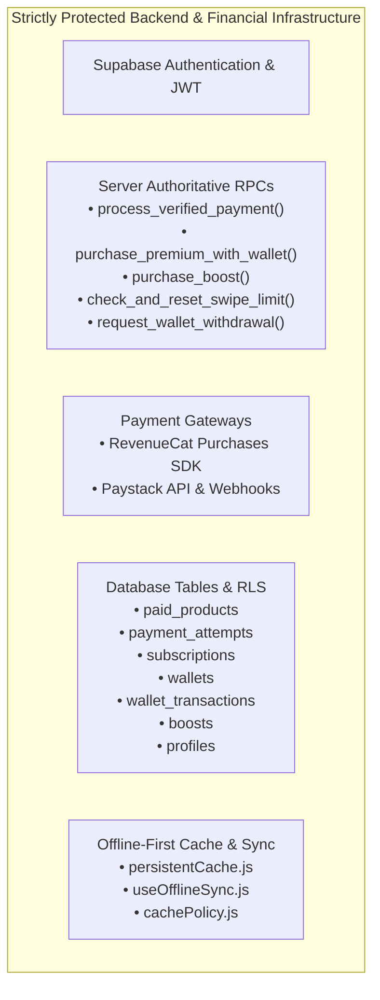
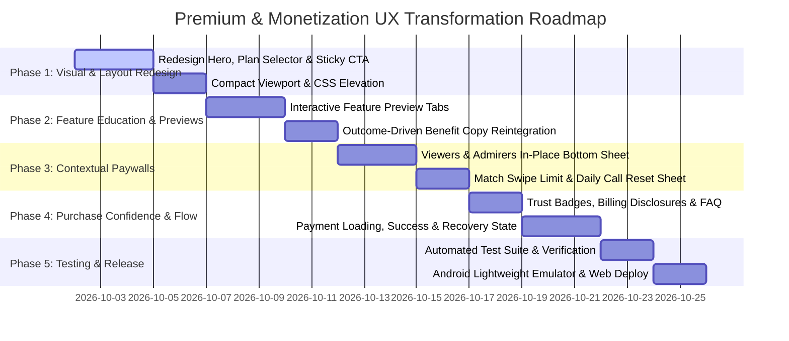

# MONETIZATION & PREMIUM UX TRANSFORMATION PLAN
**Document**: Phased Implementation Roadmap & Technical Safeguards  
**Project**: The College Date (CD2.0)  
**Target Release**: Web & Android (`v2.2.65` / Version Code 62)  
**Governance**: Non-destructive, server-authoritative, zero breaking changes to existing payment infrastructure.

---

## 1. Strictly Protected Systems & Inviolable Guardrails

Before touching any frontend or orchestration code, the following subsystems are declared **strictly protected and immutable**:

### Inviolable Rules
1. **No Gateway Replacement**: Do NOT replace or modify RevenueCat or Paystack backend configurations.
2. **No RPC Modifications**: All financial transactions, wallet debits, and subscription entitlement grants must continue using the existing, verified Supabase RPCs.
3. **No Pricing Alterations**: Tier pricing (`₦2,900`, `₦7,200`, `₦31,800`) and power-up costs (`₦1,000`, `₦500`) remain identical to existing `paid_products` rows.
4. **No Disruption to Free Users**: Free matching, messaging, 20 daily free swipes, and 20 daily call minutes must remain intact.
5. **No Blind Code Execution**: Implementation will only begin after this plan is reviewed and approved.

---

## 2. Phased Transformation Roadmap

---

## 3. Phase-by-Phase Technical Specifications

### PHASE 1 — Premium Visual & Layout Redesign (The Core Surface)
**Objective**: Transform the 3,419px text-heavy page into an elegant, high-preceived-value, compact mobile experience.

1. **Header & Hero Section**:
   - Remove the unpolished 64px `💎` emoji and the static `2,500+ students` banner.
   - Introduce an authoritative brand emblem: A sleek verified crown icon with subtle ambient glow.
   - Headline: *"College Date Elite"* with subhead: *"The Ultimate Campus Dating Edge. Get seen first, unlock admirers, and connect with top students across your university."*
2. **Horizontal Plan Selector Grid**:
   - Replace the stacked, text-wrapping cards with an ergonomic 3-column segmented card selector:
     - **1 Month**: `₦2,900 / mo` | `₦2,900 total`
     - **3 Months**: `₦2,400 / mo` | `₦7,200 quarterly` (Default selected, `🔥 Save ₦1,500` badge)
     - **12 Months**: `₦2,650 / mo` | `₦31,800 yearly` (`👑 Best Value`)
   - Fix all CSS overlapping bugs on mobile screens (`< 480px`).
3. **Fixed Sticky Action Dock**:
   - Pinned to the bottom of the mobile viewport, guaranteeing that the primary CTA is **always reachable without scrolling**.
   - Dynamic CTA label: *"Upgrade to Premium — ₦2,400 / mo"* (updates instantly when switching tiers).
   - Micro-billing disclosure directly below: *"Billed quarterly at ₦7,200 · Cancel anytime"*.
   - One-tap wallet payment shortcut when wallet balance is sufficient.

### PHASE 2 — Premium Education & Interactive Previews
**Objective**: Help users understand what they are paying for in seconds without reading boring text walls.

1. **Re-activate Orphaned Benefit Details**:
   - Bring back the rich, well-written feature copy from the currently unused `premiumFeatures` array in `PremiumUpgrade.jsx`.
   - Reframe every benefit around **student life outcomes** (refer to `PREMIUM_REDESIGN_SPEC.md`).
2. **Interactive Feature Preview Tabs**:
   - Introduce 3 interactive preview pills:
     - `[ 👀 Secret Admirers ]` $\rightarrow$ Interactive preview showing unblurred profile cards and match shortcut.
     - `[ 🚀 Campus Spotlight ]` $\rightarrow$ Visual mock of user's profile card crowned at the top of their faculty feed.
     - `[ 🎬 10s Live Video ]` $\rightarrow$ Video introduction card showing audio soundwave and verified student badge.

### PHASE 3 — Contextual Monetization (Momentum-Driven In-Place Paywalls)
**Objective**: Stop dumping users onto a generic `/premium` page; present contextual paywalls at peak moments of intent.

1. **Viewers Surface (`Viewers.jsx`)**:
   - Tapping any blurred admirer card opens a **Contextual Bottom Sheet**:
     - Headline: *"Reveal 14 Secret Admirers at UNILAG"*.
     - Blurred avatar teaser carousel.
     - 1-tap button to unlock immediately.
2. **Match Surface (`Match.jsx`)**:
   - When 20 daily free swipes are exhausted:
     - Replace the full-screen card with an in-place bottom sheet showing:
       - Countdown to free reset (e.g., *"Free swipes reset in 4h 12m"*).
       - Button: *"Unlock Unlimited Swipes Now — ₦2,400 / mo"*.
3. **Voice/Video Calls (`VoiceCallRoom.jsx`)**:
   - At 18 minutes: Gentle non-intrusive warning chime + banner allowing quick upgrade to prevent call cutoff.
4. **Chat DM Attachment (`Chat.jsx`)**:
   - Tapping 10s Video or Live Location opens an in-chat explanation sheet rather than hard-navigating out of the chat.

### PHASE 4 — Purchase Confidence, Error Recovery & Post-Purchase Onboarding
**Objective**: Eliminate payment hesitation, bank anxiety, and post-purchase disorientation.

1. **Trust & Security Layer**:
   - Add CBN-licensed Paystack badge, Google Play Protect badge, and 256-bit SSL encryption indicator.
   - Embed a 4-item interactive FAQ accordion addressing auto-renewal, cancellation, wallet payments, and payment verification.
   - Add a visible *"Restore Purchases"* button at the top right of the page.
2. **Purchase Processing Experience**:
   - Modernized loading states: *"Securing session with Paystack..."* $\rightarrow$ *"Activating student benefits..."*.
3. **Dedicated Post-Purchase Welcome Surface**:
   - When payment succeeds, render a celebration screen with confetti.
   - Display active expiration date (`Active until: December 15, 2026`).
   - 3 direct action cards:
     - `[ 👀 Reveal Your Admirers Now ]`
     - `[ 🎬 Set Up Your 10s Video Profile ]`
     - `[ ⚡ Start Unlimited Swiping ]`
4. **Constructive Payment Recovery**:
   - If a payment declines or times out:
     - Clear explanation: *"Your bank could not complete the transaction. No funds were debited."*
     - Button: *"Verify with Paystack"* (checks transaction reference in case bank debited).
     - Direct WhatsApp button with pre-filled transaction reference for 2-minute support resolution.

### PHASE 5 — Verification, Testing & Production Release
**Objective**: Rigorous verification across Android native and web environments before public release.

1. **Automated Verification**:
   - Create a dedicated automated test suite: `test/monetization-ux-transformation.test.mjs`.
   - Verify plan tier prices, duration days, savings calculations, fallback logic, and entitlement contracts.
   - Run full regression suite: `npm run test:all` (must pass 100%).
2. **Android Emulator Verification**:
   - Test on physical lightweight emulator (`Pixel_3a_Lightweight`).
   - Verify viewport height, sticky CTA visibility, bottom navigation clearance, touch targets, and scrolling smoothness.
3. **Production Web Verification**:
   - Build production bundle: `npm run build`.
   - Run SEO audit: `npm run seo:audit`.
   - Deploy to Netlify and verify live over HTTPS.

---

## 4. Rollback & Risk Mitigation Strategy

| Potential Risk | Severity | Detection | Mitigation / Rollback Protocol |
| :--- | :---: | :--- | :--- |
| **RevenueCat Offering Empty on Android** | Low | Package list returns `[]` | Existing automated fallback immediately directs user to secure Paystack card checkout. |
| **Paystack Card Decline / Network Timeout** | Medium | Error toast or webhook delay | User is shown the "Verify & Restore" button which invokes `verify-paystack-status` Edge function. |
| **Sticky CTA Obscuring Screen Content** | Low | UI visual inspection on small screens | Sticky container uses `padding-bottom: env(safe-area-inset-bottom, 80px)` ensuring no overlap with bottom nav. |
| **Client-Side Cache Out-of-Sync** | Low | Profile doesn't reflect premium immediately | `PaymentCallback.jsx` explicitly awaits `fetchProfile(currentUser.id)` and invalidates `profileCache`. |

---

## 5. Approval Gate

> [!IMPORTANT]
> **Status**: The complete Phase 0 Audit, Benchmark, Touchpoint Map, Trust Analysis, Redesign Spec, and Implementation Plan are complete.
> **Next Step**: Awaiting user review and explicit authorization to proceed with Phase 1 implementation. Zero production code, payment logic, or database schemas have been altered during this audit.
