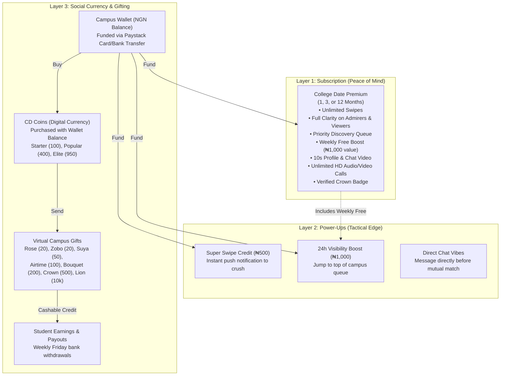
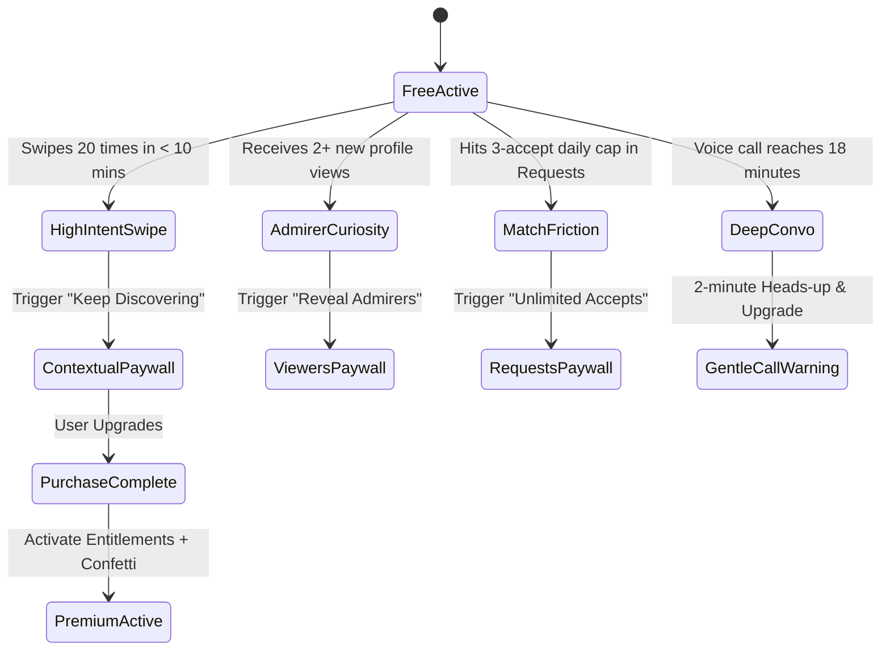

# MONETIZATION TOUCHPOINT MAP & ECOSYSTEM ARCHITECTURE
**Product**: The College Date (CD2.0)  
**Scope**: Comprehensive mapping of all existing and proposed monetization surfaces, user segmentation logic, high-intent behavioral triggers, and feature-to-currency relationships.

---

## 1. Unified Monetization Ecosystem Matrix

The College Date monetization ecosystem consists of three complementary layers: **Subscriptions (Time-based peace of mind)**, **Micro-Transactions (Instant tactical power-ups)**, and **Social Currency (Interactive peer-to-peer expression)**.

---

## 2. Complete Inventory of Current Monetization Touchpoints

| # | Surface / Screen | Exact Code Reference | Trigger / User Intent | Current Presentation | Current Flaw | Target Optimization |
| :---: | :--- | :--- | :--- | :--- | :--- | :--- |
| **1** | **Match (Daily Swipe Limit)** | [Match.jsx#L674](file:///C:/college-date/src/pages/Match.jsx#L674) | Free user exhausts 20 daily swipes (`checkSwipeLimit`) | Overlay card: *"Unlock Unlimited Swipes - ₦2,900 Premium"* | Abrupt wall. Hardcodes ₦2,900 without displaying 3-month savings or reset countdown. | Show visual countdown to free reset + contextual 1-tap upgrade sheet. |
| **2** | **Match (10th Swipe Nudge)** | [Match.jsx#L367](file:///C:/college-date/src/pages/Match.jsx#L367) | User completes 10 swipes in one session | Popup overlay: *"You are on a roll! Upgrade to Premium for infinite swipes..."* | Fires in the middle of active swiping momentum, jarring user flow. | Replace modal with subtle non-blocking banner at top rail after 10th swipe. |
| **3** | **Match (Super Swipe)** | [Match.jsx#L374](file:///C:/college-date/src/pages/Match.jsx#L374) | User taps ⭐ star button on high-interest profile | Prompts or deducts 1 credit (₦500) | If user has 0 credits, triggers purchase without explaining the high response rate. | Show mini-sheet: *"Make an unforgettable impression. Guaranteed instant alert."* |
| **4** | **Match (Out of Profiles)** | [Match.jsx#L694](file:///C:/college-date/src/pages/Match.jsx#L694) | User swipes through all local profiles in university | Card: *"Boost Your Visibility!"* with button to `/profile/edit` | Mismatched CTA! Tells user to complete profile instead of offering Boost or radius expander. | Fix CTA to offer 24h Boost or switch campus radius filter. |
| **5** | **Viewers (Blurred Viewers)** | [Viewers.jsx#L102](file:///C:/college-date/src/pages/Viewers.jsx#L102) | User opens "Who Viewed You" tab | List of blurred circular avatars with "Hidden Viewer" text | Blurred cards have no tap feedback. Tapping card does nothing. | Tapping any blurred admirer opens an instant contextual reveal paywall. |
| **6** | **Viewers (Sticky Upsell)** | [Viewers.jsx#L122](file:///C:/college-date/src/pages/Viewers.jsx#L122) | Sticky bar at bottom of viewers list | *"Unlock X Secret Admirers! [Get Premium] [🚀 Boost]"* | Both buttons simply navigate to `/premium` with zero context passed. | Pass `origin=viewers` and pre-select "Secret Admirers" preview tab on paywall. |
| **7** | **Requests (Quota Limit)** | [Requests.jsx#L220](file:///C:/college-date/src/pages/Requests.jsx#L220) | Free user views incoming match requests | Banner: *"Free accounts get 3 daily accepts. Upgrade to Unlimited 👑"* | User feels artificially blocked from talking to someone who already liked them. | Frame positively: *"Accept all campus matches instantly without waiting."* |
| **8** | **Requests (Locked Admirer)** | [Requests.jsx#L288](file:///C:/college-date/src/pages/Requests.jsx#L288) | Incoming request from non-mutual swipe | Blurred photo + *"Unlock with Premium 👑"* button | Navigates away from the list to `/premium`, causing navigation friction. | In-place bottom sheet paywall with direct 1-tap checkout. |
| **9** | **Chat (10s Daily Video)** | [Chat.jsx#L1233](file:///C:/college-date/src/pages/Chat.jsx#L1233) | Free user taps video attachment in DM | Toast: *"👑 10s Chat Video is an exclusive Premium benefit. Upgrade to unlock!"* | Disorienting redirect to `/premium` while user was in the middle of typing a message. | Open a lightweight video preview modal inside chat with "Unlock 10s Video" CTA. |
| **10** | **Chat (Live Location)** | [Chat.jsx#L1436](file:///C:/college-date/src/pages/Chat.jsx#L1436) | Free user attempts to share campus live location | Toast: *"Live location sharing is an Elite feature..."* $\rightarrow$ redirects to `/premium` | Inconsistent naming ("Elite" vs "Premium"). Interrupts conversation flow. | Show in-chat safety & convenience explanation modal with upgrade trigger. |
| **11** | **Chat (Virtual Gifting)** | [Chat.jsx#L2603](file:///C:/college-date/src/pages/Chat.jsx#L2603) | User taps Gift icon in chat attachment tray | Opens `GiftStore.jsx` (20 to 10,000 CD Coins) | If user has 0 coins, they must fund wallet $\rightarrow$ buy coins $\rightarrow$ return to chat. | Provide seamless 1-tap checkout for gift directly if wallet has Naira balance. |
| **12** | **Calls (20m Daily Limit)** | [VoiceCallRoom.jsx#L66](file:///C:/college-date/src/pages/VoiceCallRoom.jsx#L66) | Free user exceeds 20 minutes of voice/video call | Full-screen limit card: *"Daily Limit Reached - Freemium students get 20 mins..."* | Abruptly terminates call and forces user to exit without quick resume option. | 30s gentle warning chime + quick-upgrade sheet allowing uninterrupted call continuation. |
| **13** | **Edit Profile (10s Video)** | [EditProfile.jsx#L201](file:///C:/college-date/src/pages/EditProfile.jsx#L201) | User selects video file for profile showcase | Card: *"Unlock 10s Video Profile [Upgrade 👑]"* | Functional, but lacks visual preview of how video profiles look on Explore feed. | Add 3-second animated sample video showing the badge and engagement lift. |
| **14** | **Dashboard (Action Card)** | [Dashboard.jsx#L227](file:///C:/college-date/src/pages/Dashboard.jsx#L227) | User views campus command center | Card: *"Upgrade Premium: Unlock unlimited swipes and priority features"* | Standard navigation card; lacks dynamic personalization (e.g. "X students liked you today"). | Dynamically display real pending engagement counter on the card. |
| **15** | **Settings (Visibility Status)**| [Settings.jsx#L342](file:///C:/college-date/src/pages/Settings.jsx#L342) | User checks account & privacy settings | Menu item: *"👑 Get Premium - Unlock Super Swipes and more visibility"* | Feels like a settings configuration rather than an exciting product tier. | Add visual status badge (e.g., `STANDARD` vs `PREMIUM ELITE`). |
| **16** | **Wallet (Campus Currency)** | [Wallet.jsx#L22](file:///C:/college-date/src/pages/Wallet.jsx#L22) | User visits Wallet tab | Top-up buttons (₦1,000 to ₦10,000) via Paystack | Wallet is isolated from Premium; users don't realize wallet balance can pay for subscriptions. | Add banner in Wallet: *"Use wallet balance to subscribe to Premium at 10% off."* |

---

## 3. High-Intent User Behavioral Triggers

Rather than interrupting users at random intervals, monetization prompts must be governed by **Meaningful Behavioral Milestones**:

### High-Intent Event Matrix
1. **The "High-Velocity Swiper"**:
   - **Signal**: User exhausts 20 free swipes in under 15 minutes of app open.
   - **Intent**: High romantic motivation, peak engagement session.
   - **Trigger**: Bottom sheet modal showing how many active students are online right now on their campus.
2. **The "Secret Admirer"**:
   - **Signal**: User receives 3 or more incoming views or pending requests in 24 hours.
   - **Intent**: High ego validation and social curiosity.
   - **Trigger**: Push notification: *"3 students at UNILAG checked out your profile today."* Tapping opens Viewers with blurred previews and 1-tap reveal sheet.
3. **The "Connection Builder"**:
   - **Signal**: Voice call reaches 18 minutes (out of 20 free minutes).
   - **Intent**: Deep conversational chemistry established.
   - **Trigger**: Non-intrusive in-call banner: *"Call will conclude in 2 minutes. Upgrade to Premium to keep talking without interruption."*
4. **The "Profile Optimizer"**:
   - **Signal**: User reaches 85%+ profile strength and uploads 4+ photos.
   - **Intent**: Serious about dating, willing to invest effort.
   - **Trigger**: Prompt on Edit Profile: *"Your profile is in the top 10% on campus. Add a 10s Live Video to double your match rate."*

---

## 4. User Segmentation & Timing Engine Rules

| User Segment | Criteria | Monetization Strategy | Prohibited Anti-Patterns |
| :--- | :--- | :--- | :--- |
| **1. Brand New User (< 24h)** | Created account < 24h ago; < 5 swipes completed. | **Zero intrusive paywalls.** Focus 100% on profile completion, photo verification, and initial discovery value. | Never show paywall on first login or during initial onboarding. |
| **2. Activated Free User (Day 2–7)** | Has swiped 15+ times; has 1+ match or conversation. | **Contextual education.** Introduce Premium benefits only when a natural boundary is reached (swipe limit, blurred view). | Do not show floating discount popups or countdown timers. |
| **3. Power Free User (Day 7+)** | Returns daily; repeatedly hits swipe or call quotas. | **Value anchoring.** Show savings on 3-month plan (`₦2,400/mo`). Highlight weekly free Boost (`₦4,000` monthly value). | Avoid locking basic text chat or blocking mutual matches. |
| **4. Active Premium Member** | `hasActivePremium(userProfile) === true`. | **Benefit utilization.** Prompt to claim weekly free boost, upload 10s video, or check newly arrived secret admirers. | Never show upgrade buttons or pricing cards in the main feed or chat. |
| **5. Expired Premium User** | `current_period_end < now()` within 14 days. | **Reactivation reassurance.** *"Your secret admirers are waiting. Reactivate your Elite standing with one tap."* | Do not delete profile history or revoke earned badges permanently. |
| **6. Coin / Gifting User** | Has funded wallet or purchased coins. | **Cross-monetization.** Highlight that wallet funds can be used for subscriptions or boosts with zero payment fees. | Do not confuse CD Coins with Premium subscription duration. |
