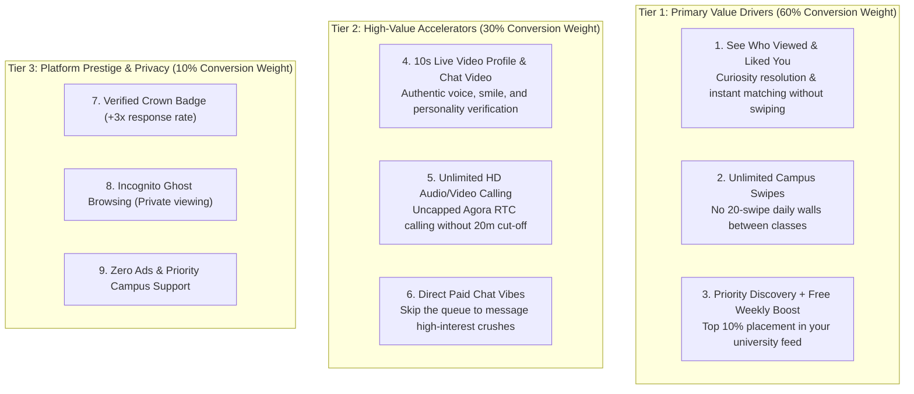
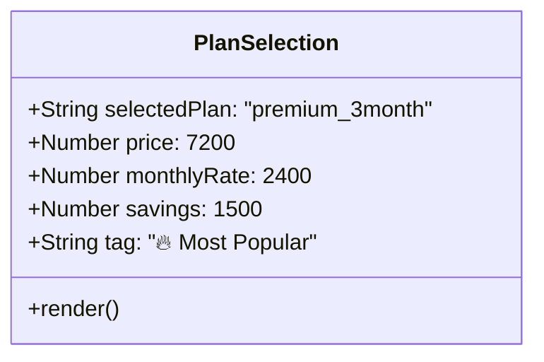

# THE COLLEGE DATE (CD2.0) — PREMIUM REDESIGN SPECIFICATION
**Role**: Senior Mobile Product Designer, Monetization UX Specialist & Android Engineer  
**Objective**: Redesign the Premium experience from a basic, low-trust 3,400px text checklist into a high-perceived-value, high-conversion, campus-authentic mobile product surface.

---

## 1. Design Direction & Brand Aesthetics

The redesigned Premium experience must balance **sophistication, campus relatability, and uncompromising trust**. It must feel like an integral, elite tier of a major African consumer tech application (akin to PiggyVest, Kuda, or Spotify Student), not a superficial clone of Western dating apps.

### Color Tokens & Material System

```css
/* Premium Color Tokens */
:root {
    /* Brand Foundation */
    --cd-premium-amethyst: #6366f1;       /* Primary brand purple */
    --cd-premium-amethyst-dark: #4f46e5;  /* Deep interactive state */
    --cd-premium-gold: #f59e0b;           /* Warm Saharan gold (prestige & crowns) */
    --cd-premium-gold-light: #fef3c7;     /* Soft gold container tint */
    --cd-premium-emerald: #10b981;        /* Savings & security green */
    
    /* Dark Surface (Primary Mobile Experience) */
    --cd-surface-base: #0b0f19;           /* Pure deep canvas */
    --cd-surface-card: #131b2e;           /* Elevated container card */
    --cd-surface-card-subtle: #1e293b;    /* Border & secondary layer */
    --cd-text-primary: #f8fafc;           /* High-contrast heading */
    --cd-text-secondary: #94a3b8;         /* Subtext & descriptions */
    --cd-text-muted: #64748b;             /* Micro-copy & legal */
    
    /* Light Surface (Clean Editorial Contrast) */
    --cd-surface-light-card: #ffffff;
    --cd-surface-light-bg: #f8fafc;
    --cd-border-light: #e2e8f0;
}
```

### Aesthetic Rules
1. **No Oversized Emojis**: Replace raw 64px emojis (`💎`, `👑`) with custom SVG iconography and verified visual elements.
2. **No Blinding Glows**: Replace radioactive neon box-shadows with subtle, multi-layered elevation shadows (`box-shadow: 0 12px 32px -8px rgba(99, 102, 241, 0.25)`).
3. **African Campus Authenticity**: Frame features in the context of Nigerian university life (faculties, halls of residence, departmental matches, campus privacy).
4. **Viewport Disciplined**: The primary value proposition, plan switcher, and CTA must fit comfortably in the first **1.2 viewports** (under 1,000px total height), with supporting FAQs and Power-Ups cleanly organized below.

---

## 2. Premium Value Hierarchy (3-Tiered Taxonomy)

Not all benefits are created equal. The redesign groups features into a clear psychological hierarchy:



---

## 3. Feature-to-Outcome Transformation Matrix

| Existing Feature | Real Campus Student Problem | Tangible Benefit | Concrete Desired Outcome |
| :--- | :--- | :--- | :--- |
| **Unlimited Swipes** | Getting cut off with "Daily limit reached (20 swipes)" right when finding interesting students in your faculty. | Continuous browsing with zero artificial limits. | *"Keep discovering students across your university without running out of opportunities between lectures."* |
| **See Who Viewed & Liked You** | Swiping endlessly hoping a campus crush happens to swipe back, wondering who actually likes you. | Full photo clarity and instant matching with admirers who already expressed interest. | *"Skip the guessing game. See the exact list of students who liked you and match with them in 1 tap."* |
| **Priority Discovery Queue** | New profiles get buried under hundreds of older inactive accounts in dense universities. | Your profile is served to the top 10% of active feeds across your faculty and campus. | *"Be seen first by the most active, verified students around your campus community."* |
| **Free Weekly Boost (₦1,000 value)** | Paying ₦1,000 every time you want a visibility surge before Friday social events. | An automatic 24h boost credited to your account every 7 days (₦4,000 monthly value). | *"Get 10x more eyes on your profile before the weekend with zero extra cost."* |
| **10s Profile Video Showcase** | Static photos look filtered or fake, causing hesitation and fear of catfishing. | A live, authentic 10-second video clip introducing yourself. | *"Stand out with your real voice, smile, and energy — proven to double your match rate."* |
| **10s Daily Chat Video** | Text conversations go dry or feel impersonal; students hesitate to give out WhatsApp numbers early. | Share authentic 10-second video moments directly in chat once per day. | *"Build rapid trust and chemistry safely inside College Date before sharing personal social handles."* |
| **Unlimited HD Audio & Video Calling** | Getting disconnected mid-conversation at the 20-minute freemium limit while having a great late-night chat. | Unlimited crystal-clear voice and video calling via Agora RTC. | *"Have uninterrupted, deep conversations without watching a 20-minute countdown timer."* |
| **Verified Crown Badge** | Profiles blend into the feed; students wonder who is truly serious about dating on campus. | Distinct golden crown badge on profile card, chat header, and discovery stack. | *"Command immediate respect and attention on campus as an authentic, dedicated dater."* |
| **Incognito Ghost Browsing** | Worrying that roommates, course mates, or exes will see that you viewed their profile. | Complete invisibility in the "Who Viewed You" lists of others. | *"Browse your campus community freely and privately without showing up in anyone's view history."* |

---

## 4. Screen Architecture & Wireframe Blueprint

### Screen Structure (Total Height: ~1,100px vs Current 3,419px)

```
┌────────────────────────────────────────────────────────┐
│ [←] Back         💎 College Date Elite      [Restore]  │ Top Bar (Clean, uncluttered)
├────────────────────────────────────────────────────────┤
│                                                        │
│             👑 COLLEGE DATE ELITE                      │
│        The Ultimate Campus Dating Edge                 │
│   Get seen first, unlock admirers, and connect         │
│   with top students across your university.            │ Hero Section (~140px)
│                                                        │
├────────────────────────────────────────────────────────┤
│  [ 👀 Admirers ]   [ 🚀 Spotlight ]   [ 🎬 Video ]     │ Interactive Feature Preview
│ ┌────────────────────────────────────────────────────┐ │ Tabs (Switches live mockups)
│ │  Interactive visual mock showing unblurred grid    │ │ (~180px)
│ │  "14 students checked you out at UNILAG today"     │ │
│ └────────────────────────────────────────────────────┘ │
├────────────────────────────────────────────────────────┤
│                 CHOOSE YOUR MEMBERSHIP                 │
│ ┌───────────────┐ ┌───────────────┐ ┌────────────────┐ │ 3-Duration Segmented Selector
│ │    1 MONTH    │ │   3 MONTHS    │ │   12 MONTHS    │ │ (~110px)
│ │    ₦2,900     │ │    ₦2,400/mo  │ │    ₦2,650/mo   │ │ (Pre-selects 3 Months)
│ │  ₦2,900/mo    │ │  🔥 POPULAR   │ │  👑 BEST VALUE │ │
│ └───────────────┘ └───────────────┘ └────────────────┘ │
│                                                        │
│  💰 Billed quarterly at ₦7,200 (You save ₦1,500)       │ Dynamic Price Explainer
│  🛡️ Paystack / Google Play Secure • Cancel anytime    │
├────────────────────────────────────────────────────────┤
│ [ ⚡ UPGRADE TO PREMIUM — ₦2,400 / MO                ] │ Fixed Sticky Action Dock
│   Pay ₦7,200 with Card, Bank Transfer, or Wallet (₦X)   │ (Always visible on mobile)
├────────────────────────────────────────────────────────┤
│  ▼ Frequently Asked Questions (4 Expandable Items)     │ Trust & FAQ Accordion
│  • Will my card be charged automatically?              │ (~200px)
│  • Can I cancel anytime?                               │
│  • What happens after I pay?                           │
│  • Can I pay with my campus wallet balance?            │
├────────────────────────────────────────────────────────┤
│  ⚡ Single Power-Ups (24h Boost & Super Swipe)         │ Secondary A-la-Carte Section
│  Questions? Chat with Student Support on WhatsApp      │ (~160px)
└────────────────────────────────────────────────────────┘
```

---

## 5. Interactive Feature Preview System

Instead of a boring checklist table, the redesign introduces **3 Interactive Preview Pills**:

### Tab 1: "Secret Admirers" (Selected by default)
- **Visual**: A compact preview showing 3 student profile cards with unblurred photos, course names, and a glowing green *"New Like"* pill.
- **Copy**: *"See who liked you before swiping. Match instantly with students who already want to meet."*

### Tab 2: "Priority Spotlight"
- **Visual**: A mockup of the campus discovery stack with the user's profile card floating at the very top, crowned with a golden badge and a *"10x More Views"* indicator.
- **Copy**: *"Jump to the top of everyone's feed in your faculty. Get noticed by the most attractive students first."*

### Tab 3: "10s Live Video"
- **Visual**: A mini video player mockup showing a verified student greeting with a soundwave overlay and a *"Verified Voice & Smile"* badge.
- **Copy**: *"Upload an authentic 10-second clip to showcase your real voice and vibe. Proven to increase matches by 3x."*

---

## 6. Plan Selector & Pricing Presentation



### The 3 Plan Cards (Clean Horizontal Grid on Mobile)
1. **1 Month Plan**:
   - Title: `1 Month`
   - Monthly Rate: `₦2,900`
   - Subtext: `₦2,900 total`
   - Badge: None
2. **3 Months Plan (Default Selection)**:
   - Title: `3 Months`
   - Monthly Rate: `₦2,400 / mo`
   - Subtext: `₦7,200 billed quarterly`
   - Badge: `🔥 Save ₦1,500` (Positioned on top border, zero wrapping errors)
   - Styling: Golden border highlight (`border: 2px solid var(--cd-premium-gold)`)
3. **12 Months Plan**:
   - Title: `12 Months`
   - Monthly Rate: `₦2,650 / mo`
   - Subtext: `₦31,800 billed yearly`
   - Badge: `👑 Best Value (Save ₦3,000)`

---

## 7. Purchase Confidence & Trust Signals

### Fixed Sticky Action Dock (Bottom of Mobile Viewport)
```html
<div class="premium-sticky-cta">
    <button class="btn-primary-upgrade" onClick="handleSubscribe()">
        <span class="btn-title">Upgrade to Premium — ₦2,400 / mo</span>
        <span class="btn-subtext">Billed quarterly (₦7,200) • Instant Activation</span>
    </button>
    <div class="cta-wallet-toggle">
        <button class="wallet-pay-link" onClick="handlePayWithWallet()">
            Or pay ₦7,200 from Wallet (Balance: ₦{wallet.balance})
        </button>
    </div>
    <div class="cta-trust-strip">
        <span class="trust-item">🔒 256-bit Encryption</span>
        <span class="trust-item">🛡️ CBN-Licensed Paystack</span>
        <span class="trust-item">⚡ 1-Tap Cancel</span>
    </div>
</div>
```

### Trust Accordion (Directly Below Selector)
1. **"Will I be billed automatically?"**  
   *Answer*: Card subscriptions auto-renew at the end of your billing period so your benefits never lapse. You can turn off auto-renewal anytime in Settings with 1 tap. Wallet payments never renew automatically unless you explicitly choose to.
2. **"Can I cancel anytime?"**  
   *Answer*: Yes, absolutely. You can cancel your subscription at any time with zero hassle from your Account Settings or Google Play Store. Your premium benefits remain active until the end of your prepaid period.
3. **"What if my payment is deducted but Premium doesn't activate?"**  
   *Answer*: All transactions are linked to your university account via Paystack and Google Play. If a network timeout occurs, simply tap "Restore Purchases" at the top of this screen, or chat directly with our WhatsApp support for instant manual verification.
4. **"Can I pay with bank transfer or USSD?"**  
   *Answer*: Yes. Paystack securely supports all Nigerian debit cards (Mastercard, Visa, Verve), direct bank transfers, USSD (*737#, *919#, etc.), and campus wallet balance.

---

## 8. Post-Purchase Experience (Activation Celebration)

When `PaymentCallback.jsx` confirms successful subscription, the user is navigated to `/premium?welcome=true`. 

Instead of showing the sales page again, the screen renders an **Exclusive Member Celebration Dashboard**:

1. **Celebration Animation**: `canvas-confetti` explosion with soft sound/haptic feedback.
2. **VIP Status Banner**:
   - `👑 You are a Verified College Date Elite Member`
   - Subtitle: `Active until: October 15, 2026 (90 Days Remaining)`
3. **Action Hub (Immediate Value Consumption)**:
   - Card 1: `👀 Reveal 14 Secret Admirers →` (Deep-links to `/viewers`)
   - Card 2: `🎬 Set Up Your 10s Video Profile →` (Deep-links to `/profile/edit`)
   - Card 3: `⚡ Start Unlimited Swiping →` (Deep-links to `/match`)
4. **Subtle Extend Link**: A quiet text link at the very bottom: *"Need to change plans or extend your membership? Manage subscription"*, keeping the interface focused entirely on value delivery.
