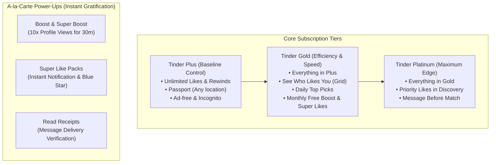

# TINDER PREMIUM BENCHMARK & UX PRODUCT PRINCIPLES
**Research Scope**: Publicly observable monetization architecture, feature paywalls, and behavioral design patterns in Tinder (Plus, Gold, Platinum).  
**Source Baseline**: Official Tinder Help Center ([Tinder Subscriptions](https://www.help.tinder.com/hc/en-us/articles/115004487406-Tinder-subscriptions)), public product teardowns, and mobile monetization behavioral research.  
**Application Goal**: Extract architectural principles, cognitive patterns, and mobile UX benchmarks to elevate The College Date without copying Tinder's proprietary brand, copy, or visual assets.

---

## 1. Tinder's Subscription Architecture Teardown

Tinder does not present a single undifferentiated list of features. Instead, it organizes its monetization into three progressive outcome-based tiers, complemented by a-la-carte consumables:

### Core Product Positioning Strategy
1. **Plus (Utility & Control)**: Solves the frustration of hitting limits. Aimed at casual swipers who want peace of mind.
2. **Gold (Efficiency & Time Savings)**: Solves the waiting game. Instead of swiping hundreds of times, users can see the exact grid of admirers who already said "yes". This is Tinder's primary cash-cow tier.
3. **Platinum (Competitive Advantage)**: Solves the rejection/visibility problem in high-density competitive environments. Ensures your profile is seen first.

---

## 2. Key Product Design Principles Extracted

### Principle 1: Outcome-Led Value Communication (Not Spec Sheets)
- **Tinder's Approach**: Tinder never says "Database query optimization for profile queue". It says: *"Prioritized Likes — See and be seen faster."* It never says "Binary swipe counter reset". It says: *"Unlimited Likes — Never miss a match."*
- **Application for The College Date**:
  Instead of technical bullet points like *"10s Profile Video Showcase"* or *"Priority Discovery Queue"*, frame each feature around its immediate student life benefit:
  - **Unlimited Swipes** $\rightarrow$ *"Never run out of campus connections between lectures."*
  - **See Who Viewed & Liked You** $\rightarrow$ *"Skip the guessing game — instantly see campus admirers who checked you out."*
  - **Priority Discovery** $\rightarrow$ *"Stand out at the very top of your university's feed."*
  - **10s Campus Video** $\rightarrow$ *"Show your real voice, vibe, and personality before matching."*

### Principle 2: Dynamic & Contextual Paywalls (Momentum-Driven)
- **Tinder's Approach**: Over 70% of Tinder's subscription upgrades occur **outside the main settings page**. They are triggered dynamically at peak moments of intent:
  1. **The Curiosity Gap**: User opens the "Likes You" tab $\rightarrow$ Sees blurred photos with a counter badge (e.g., *"14 people like you"*) $\rightarrow$ Taps card $\rightarrow$ A modal slides up explaining that Gold unlocks the grid immediately.
  2. **The Limit Wall**: User exhausts daily free likes $\rightarrow$ A bottom sheet appears with a countdown timer to reset, paired with an immediate 1-tap button to unlock unlimited swiping.
  3. **The Power-Up Trigger**: User hasn't received a match in 48 hours $\rightarrow$ Boost prompt offers an instant 10x visibility spike.
- **Application for The College Date**:
  The College Date currently routes almost every contextual moment (swipe limits, requests quota, blurred viewers, 10s chat video) to the static `/premium` page.
  Instead, we must implement **context-aware paywall modals** that open in-place:
  - If triggered from **Viewers/Admirers**: Modal headline is *"Reveal Your Secret Admirers"*, featuring the count and blurred teaser avatars.
  - If triggered from **Swipe Exhaustion**: Modal headline is *"Keep Discovering Students"*, showing how many hours until free reset vs. instant unlimited access.
  - If triggered from **Chat Video / Live Location**: Modal headline is *"Share Authentic Campus Moments"*.

### Principle 3: Choice Architecture & Plan Framing
- **Tinder's Approach**:
  - Always highlights **one default plan** (typically 3 or 6 months) as "Most Popular" or "Best Value".
  - Breaks total cost into a digestible monthly rate (e.g., `₦2,400 / mo` rather than only showing `₦7,200`).
  - Anchors the savings clearly with high-contrast pills (`Save 35%`).
  - Ensures the primary CTA button dynamically updates with the selected plan's exact price and term (`Continue with 3 Months`).
- **Application for The College Date**:
  The current 3-tier selector on The College Date has severe CSS wrapping bugs on mobile (`Save ₦1,500 3 Months/mo`).
  We should redesign this into an ultra-clean, segmented selector:
  - 1 Month: `₦2,900 / mo` (Flexible, standard)
  - 3 Months: `₦2,400 / mo` — **Billed quarterly at ₦7,200** (Highlighted as "Most Popular", Save ₦1,500)
  - 12 Months: `₦2,650 / mo` — **Billed annually at ₦31,800** (Full academic year)
  - The CTA button must remain pinned at the bottom of the viewport so the user never has to search for how to pay.

### Principle 4: Purchase Transparency & Trust Engineering
- **Tinder's Approach**:
  - Clear billing term disclosure directly below the CTA: *"Recurring billing, cancel anytime in Google Play Store settings."*
  - Reassurance that purchases can be restored across devices with a one-tap *"Restore Purchases"* button.
  - Zero ambiguity about what happens after clicking the button.
- **Application for The College Date**:
  To eliminate the hesitation reported to customer support:
  1. Add explicit platform trust badges: **Secured by Paystack (CBN Licensed)** and **Google Play Verified Billing**.
  2. Clearly clarify: *"One-time or recurring billing with no hidden fees. Cancel or extend anytime with one tap."*
  3. Include an inline *"Restore Purchase"* button that invokes the existing `verifyAndRestorePremium()` backend function.
  4. Display a student-friendly FAQ accordion addressing the top 4 hesitation questions directly on the page.

### Principle 5: The Post-Purchase "Dopamine & Activation" Loop
- **Tinder's Approach**: When a user purchases Tinder Gold, they are not dropped back into settings. They receive an animated celebration, followed immediately by opening the newly unblurred "Likes You" grid so they can start matching in seconds.
- **Application for The College Date**:
  Replace the abrupt redirect to `/premium` with a high-fidelity **"Welcome to Premium" Celebration Modal**:
  - Confetti burst animation.
  - 3 instant action cards:
    - *"Reveal who viewed your profile $\rightarrow$"*
    - *"Upload your 10s Live Campus Video $\rightarrow$"*
    - *"Jump into Unlimited Discovery $\rightarrow$"*
  - Eliminates buyer's remorse and immediately delivers the promised value.

---

## 3. Principles vs. Brand Boundaries: What to Adopt vs. What to Avoid

| Product Dimension | Tinder Pattern (Benchmark) | What The College Date Will Adopt (Principle) | What The College Date Will STRICTLY AVOID |
| :--- | :--- | :--- | :--- |
| **Tier Structure** | Plus / Gold / Platinum split | Clear hierarchy of benefits (Primary, Secondary, Supporting) | Do NOT create artificial complexity; keep 1 authoritative Premium tier with flexible 1/3/12-month billing. |
| **Visual Design** | Neon coral/flame gradients | Authentic African campus colors (deep navy, royal amethyst, warm gold accents) | Do NOT use Tinder's fire icon, pink gradients, or proprietary card styling. |
| **Copywriting** | High-energy Western dating slang | Relatable, respectful Nigerian university student vernacular (faculties, lodges, campus crushes) | Do NOT copy Tinder's marketing slogans or tone of voice. |
| **Paywall UX** | Modal carousel with swipeable benefit cards | Interactive feature preview tabs with real interface mocks | Do NOT hide pricing behind multi-step forced swipes before the user can see costs. |
| **CTA Strategy** | Dynamic sticky button with micro-billing terms | Fixed bottom sheet CTA with clear Naira breakdown and wallet toggle | Do NOT use countdown timers, fake scarcity, or deceptive dark patterns. |
| **Trust Badges** | App Store / Play Store trust seals | Paystack + Google Play + Student Data Privacy guarantee | Do NOT display generic stock security shields without technical legitimacy. |
