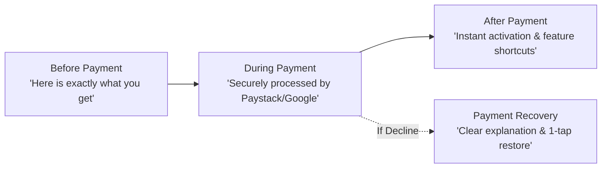

# PREMIUM TRUST ANALYSIS & PURCHASE ANXIETY DIAGNOSIS
**Focus**: Investigating why interested users contacted customer support wanting Premium, but hesitated to finalize payment.  
**Auditor**: Monetization UX Specialist, Conversion Architect & Mobile Product Designer  
**Context**: Nigerian higher education student demographic (UNILAG, UNIBEN, UNN, UNIPORT, OAU, ABU, Covenant, Babcock, etc.).

---

## 1. The Core Behavioral Paradox

### The Feedback Signal
Multiple users demonstrated clear purchase intent:
1. They navigated to the Premium screen.
2. They reviewed features.
3. They took the time and effort to message customer support via WhatsApp or email asking about Premium.
4. **Yet they hesitated or failed to complete the checkout transaction.**

### The Co-Founder's Observation
The co-founder independently noted that the current Premium page looks **"too basic"** and gives the impression of a **lower-quality application**.

### The Forensic Diagnosis
The barrier to purchase is **not purchasing power or price**. At `₦2,900` per month (`₦2,400` on the 3-month plan), the subscription costs less than a single campus canteen meal with drinks, an interstate cab ride, or a standard 10GB monthly data bundle. 

The barrier is **Perceived Product Risk and Lack of Payment Transparency**:
```
User Hesitation = (Perceived Risk + Cognitive Friction + Lack of Clarity) > Perceived Immediate Value
```
When an application looks unpolished at the moment of payment, users mentally equate visual unreliability with technical unreliability:
> *"If the payment screen looks basic, will the payment gateway work? Will my debit card be repeatedly charged? Will my money disappear into a database void without Premium activating? Who do I hold accountable if it fails?"*

---

## 2. Forensic Analysis of the 9 Core Hesitation Questions

### 1. *"Is this app legitimate and actively maintained?"*
- **Current Presentation Failure**:
  - The hero section displays an isolated 64px 💎 emoji with a dark-glow gradient box.
  - The static pill *"2,500+ students upgraded to Premium this week"* feels artificial and generated rather than credible.
  - The comparison checklist is a wall of 11 text rows with ❌ and ✅ icons, resembling an unfinished prototype or a basic settings screen rather than a flagship dating service.
- **Student Mindset**: University students are hyper-vigilant about digital scams, fake apps, and fly-by-night student platforms. An unpolished UI immediately triggers suspicion.
- **The Solution**: Professional, modern card layouts; authentic campus photography; real verified student testimonials; explicit company backing (The College Date, registered brand, official contact channels).

### 2. *"Will my payment actually work, or will it deduct my money and fail?"*
- **Current Presentation Failure**:
  - The only payment reassurance on the entire page is a single tiny line of text: `🛡️ Secure Payment via Paystack / Google Play`.
  - When tapping "Upgrade", the screen either attempts a background RevenueCat package call (which can silently fail to Paystack fallback with an unexpected toast: *"Redirecting to secure card checkout..."*), or launches an external browser popover.
  - There is no explanation of the payment steps: *Step 1: Select Plan $\rightarrow$ Step 2: Bank / Card Authorization $\rightarrow$ Step 3: Instant Activation*.
- **Student Mindset**: Failed digital transactions with Nigerian debit cards (Mastercard, Visa, Verve) are a common everyday headache. Students dread debit alerts where value is not instantly credited.
- **The Solution**: 
  - Prominently feature official security partner seals: **Paystack (Licensed by Central Bank of Nigeria)** and **Google Play Protect / Billing**.
  - Add an explicit guarantee: *"Instant automated activation. If any network issue occurs, tap 'Restore Purchases' anytime or message our 24/7 campus support team for immediate resolution."*

### 3. *"Will Premium activate immediately, or do I have to wait days?"*
- **Current Presentation Failure**:
  - The UI does not state whether activation is instant or manual.
  - Because many campus services operate on manual bank transfer and manual screenshot verification, users wonder if they will have to wait for manual admin approval.
- **The Solution**: Display a prominent badge next to the checkout button: **⚡ Instant Activation Guaranteed**.

### 4. *"What exactly am I paying for right now?"*
- **Current Presentation Failure**:
  - The 11 checklist rows are abstract: *"Priority Discovery Queue"*, *"10s Profile Video Showcase"*, *"Incognito Ghost Browsing"*.
  - None of these features have visual previews or demonstrations.
  - The detailed explanations inside `premiumFeatures` (lines 303–381 of `PremiumUpgrade.jsx`) were completely omitted from the rendered JSX!
- **The Solution**:
  - Re-introduce feature education with interactive visual tabs:
    - **Admirers Tab**: Shows what the unblurred grid looks like.
    - **Video Profile Tab**: Shows how a 10s video appears on the student feed.
    - **Priority Queue Tab**: Shows how the profile badge and top placement look.
  - Replace technical jargon with practical campus benefits.

### 5. *"Will it automatically renew and drain my account without warning?"*
- **Current Presentation Failure**:
  - The tier switcher shows: `₦2,900 billed monthly`, `₦7,200 billed quarterly`, `₦31,800 billed yearly`.
  - Below the price is a terse sentence: *"Cancel anytime."*
  - It does not explain:
    - How do I cancel?
    - Will you charge my card automatically at the end of 30 days?
    - If I pay via wallet or card, does it auto-renew?
- **Student Mindset**: Subscription anxiety is intense among students with finite allowances. They fear recurring billing traps where a card is charged during exam periods or holidays when they aren't using the app.
- **The Solution**:
  - Radical transparency: *"No unexpected charges. For card payments, you can cancel renewal anytime in 1 tap from Settings or Google Play. For wallet payments, it never auto-renews unless you explicitly choose to."*

### 6. *"Can I cancel easily, or is it trapped?"*
- **Current Presentation Failure**:
  - There is no link, explanation, or button showing where cancellation happens.
- **The Solution**:
  - Add a dedicated micro-section in the FAQ accordion: *"How do I cancel?" $\rightarrow$ "Go to Settings > Subscriptions > Cancel, or manage it directly in your Google Play Store subscriptions. No questions asked."*

### 7. *"Will I actually get more matches and responses?"*
- **Current Presentation Failure**:
  - Claims like *"Proven to increase match rate by 3x"* (line 345) are hidden in unrendered code comments or small subtext, without social proof from real campus students.
- **The Solution**:
  - Add 2–3 authentic, relatable campus micro-reviews:
    - *"I found my boyfriend in UNILAG Faculty of Law within 2 weeks of getting Premium." — Chidinma, 300L*
    - *"Being able to see who checked out my profile saved me so much time between classes." — Femi, 400L OAU*

### 8. *"What happens after I pay? Where do I go?"*
- **Current Presentation Failure**:
  - Upon successful payment, `PaymentCallback.jsx` navigates to `/premium`.
  - The page reloads and simply says: *"You are a Premium Member. Extend or renew your membership below with student savings:"* and displays the payment buttons again!
  - The user is left confused: *"Did it work? Why is it asking me to pay again? Where are my unlocked features?"*
- **The Solution**:
  - Post-purchase state must **completely replace** the sales page with a **Welcome Celebration Surface**:
    - Animated confetti.
    - Status pill: **💎 College Date Elite — Active until [Date]**.
    - 3 one-tap shortcuts to immediately consume value:
      1. `[ 👀 See Who Viewed You Now ]`
      2. `[ 🎬 Upload Your 10s Video Profile ]`
      3. `[ ⚡ Start Unlimited Swiping ]`

### 9. *"What if payment fails? What happens to my money?"*
- **Current Presentation Failure**:
  - If Paystack or RevenueCat fails, `PaymentCallback.jsx` renders an unstyled white card with raw error text: *"Payment Needs Attention"* and a single button *"Back to Premium"*.
  - It does not offer a retry button, does not check bank reversal status, and does not provide an immediate WhatsApp support trigger.
- **The Solution**:
  - Dedicated Failure Resolution State:
    - Explains common causes (e.g., bank network downtime, card 3DS OTP timeout).
    - Checks whether funds were deducted and provides an instant one-tap **"Verify & Restore"** button.
    - Direct **"Chat with Support"** button pre-populated with the exact Paystack transaction reference for immediate reconciliation.

---

## 3. The 4-Phase Purchase Confidence Framework



### Phase A: Before Payment ("Absolute Clarity & Value Certainty")
1. **Interactive Feature Previews**: User can tap to preview "Who Viewed Me", "Priority Discovery", and "10s Video".
2. **Transparent Plan Matrix**: Selected plan shows exact duration, monthly breakdown, total billing amount, and exact savings.
3. **No-Surprise Disclosure**: Clear statement that renewal can be paused or cancelled anytime.
4. **Security Seals**: Paystack CBN-licensed partner logo + Google Play Verified logo.

### Phase B: During Payment ("Authoritative Security & Progress")
1. **Dedicated Loading Experience**: When tapping CTA, show active state progression:
   - *"Connecting to secure payment gateway..."*
   - *"Securing student transaction with 256-bit encryption..."*
2. **Platform-Appropriate Flow**:
   - On Android: Native Google Play sheet opens seamlessly, or in-app custom browser with College Date branding.
   - On Web: Centered, branded Paystack modal.

### Phase C: After Payment ("Celebration, Gratification & Activation")
1. **Confetti Burst**: Instant visual feedback that the upgrade succeeded.
2. **Authoritative Expiry Date**: Shows exact end date (e.g., *"Active until December 15, 2026"*).
3. **Guided Onboarding Steps**: Steers the user directly into their new superpowers.

### Phase D: If Payment Fails ("Frictionless Recovery & Reassurance")
1. **Constructive Error Diagnosis**: E.g., *"Your bank declined the transaction or the OTP timed out. No funds were debited."*
2. **One-Tap Verification**: A button to check transaction status against the backend RPC in case the bank actually charged them.
3. **Direct Concierge WhatsApp Help**: Opens WhatsApp with pre-filled message: *"Hi, my payment reference is TCD-12345. It showed an error and I'd like help confirming my Premium activation."*
