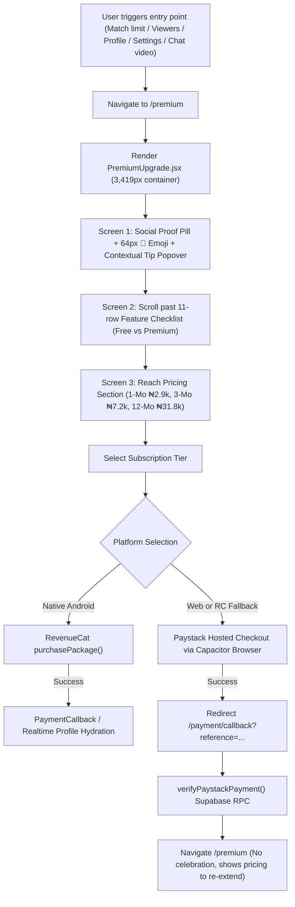

# THE COLLEGE DATE (CD2.0) — PREMIUM UX AUDIT
**Auditor**: Senior Mobile Product Designer, Monetization UX Specialist & System Architect  
**Evaluation Date**: October 2026  
**Target Environment**: Android App (`v2.2.64` / VC 61 on `Pixel_3a_Lightweight`) & Production Web (`www.thecollegedate.com`)  
**Scope**: Complete end-to-end audit of current Premium presentation, checkout flows, monetization touchpoints, and technical entitlements.

---

## 1. Executive Summary & Core Diagnosis

The College Date has built a solid, technically sound payment engine:
- Server-authoritative Supabase RPCs (`process_verified_payment`, `purchase_premium_with_wallet`, `purchase_boost`, `check_and_reset_swipe_limit`).
- Dual payment gateway integration (Google Play Billing via RevenueCat on Android with graceful automated fallback to Paystack hosted card checkout).
- Resilient offline-first state caching and atomic database transactions.

**However, the frontend presentation of Premium fails to reflect this technical caliber.** Direct user feedback received by customer support revealed that students who were actively interested in Premium and contacted support still hesitated to pay. Simultaneously, the co-founder noted that the page looks *"too basic"* and conveys the impression of a *"lower-quality application."*

Our forensic audit confirms this diagnosis:
1. **Severe Value Mismatch**: The Premium page (`PremiumUpgrade.jsx`) is **3,419 pixels tall** on a standard 807-pixel viewport (over 4.2 full screens of scrolling). The primary call-to-action (CTA) and plan pricing are buried ~1,800 pixels down the page, hidden behind a long 11-row text table with red ❌ and green ✅ icons.
2. **Orphaned Feature Education**: A detailed, well-written `premiumFeatures` array (defining 11 specific features with icons, titles, and explanations) exists in lines 303–381 of `src/pages/PremiumUpgrade.jsx`, but **it is never rendered in the JSX**. Users only see an abstract, static checklist.
3. **Promise vs. Reality Discrepancies**:
   - The checklist promises *"Advanced Filters (Dept, Level)"*, but `Match.jsx` and `Explore.jsx` only contain a binary gender filter (`All`, `Male`, `Female`).
   - The checklist lists *"Unlimited HD Audio/Video Calls (Free: 5m limit)"*, but `VoiceCallRoom.jsx` enforces a 20-minute daily limit.
   - `Match.jsx` (line 570) states *"Monthly Subscription: Get 100 free standard swipes!"*, whereas the Premium page promises *"Unlimited Swipes"*.
4. **Weak Trust Signals & Anxiety Points**: The page offers only a single text line with an emoji (`🛡️ Secure Payment via Paystack / Google Play`). It fails to explain what happens after paying, whether renewal is automatic or manual, how cancellation works, or how to restore purchases.
5. **Wallet Top-Up Dead End**: If a user attempts to pay via wallet but has insufficient funds, the system shows a red error toast, but provides no button or deep-link to fund the wallet.
6. **No Post-Purchase Onboarding**: Upon completing payment, the user is redirected back to `/premium`, which simply swaps the headline to *"You are a Premium Member"* and immediately shows the pricing cards again (*"Extend or renew your membership below"*), offering zero celebration, zero feature walkthrough, and no direct shortcuts into newly unlocked features.

---

## 2. Complete End-to-End User Journey Audit



### Detailed Screen-by-Screen Journey Breakdown

| Stage | What the User Experiences | Critical Flaws & Friction Points | Evidence |
| :--- | :--- | :--- | :--- |
| **1. Trigger / Discovery** | Taps *"Get Premium"* in Profile/Settings, hits 20-swipe limit in Match, taps blurred Admirer in Requests/Viewers, or attempts 10s chat video. | Context is completely lost. Whether coming from 10s video, blurred admirers, or swipe limit, the user lands on the exact same generic page with no reference to the action they just attempted. | [Profile.jsx#L673](file:///C:/college-date/src/pages/Profile.jsx#L673), [Requests.jsx#L321](file:///C:/college-date/src/pages/Requests.jsx#L321) |
| **2. Hero Section** | Yellow pill: *"2,500+ students upgraded to Premium this week."*, a large 64px 💎 emoji, headline: *"Unlock Your Full Potential"* or *"You have the Elite Edge"*. | Feels like a generic marketing landing page rather than a native mobile feature. The social proof number feels artificial and static. The large emoji looks unpolished. | `screen_premium_real_1_top.png` |
| **3. Contextual Popover** | An intrusive guide box appears: *"VIP MEMBERSHIP - College Date Premium"* with *"Learn More"* and *"Got It 👍"*. | Blocks the comparison table and adds visual clutter before the user even understands what Premium offers. | `screen_premium_real_1_top.png` |
| **4. Feature Checklist** | An 11-row table with red ❌ and green ✅ icons comparing Free vs. Premium. | Takes up **850 vertical pixels**. Forces users to read dry bullet points before seeing plans or pricing. Detailed feature descriptions (`premiumFeatures`) are completely abandoned in code. | `screen_premium_real_2_checklist.png`, [PremiumUpgrade.jsx#L303](file:///C:/college-date/src/pages/PremiumUpgrade.jsx#L303) |
| **5. Plan Selection** | 3 options: 1 Month (₦2,900), 3 Months (₦7,200), 12 Months (₦31,800). | On mobile, the 3 plans stack into full-width cards. Green badges (`Save ₦1,500`) wrap awkwardly against duration text (`3 Months/mo`), causing text truncation and overlapping. | `screen_premium_real_3_pricing.png` |
| **6. Pricing Card & CTA** | Giant typography: `₦7,200 /3 months`, button: `Extend for ₦7,200` or `Upgrade for ₦2,900`. | The CTA is buried at ~1,800px. On smaller Android devices, the button is pushed completely off-screen below the bottom navigation bar. | `screen_premium_real_5_cta.png` |
| **7. Wallet Option** | Button or text: `Wallet Balance: ₦0 (Fund wallet to pay with balance)`. | If wallet balance is insufficient, there is no action link to fund the wallet. The user must manually navigate to the Wallet tab. | [PremiumUpgrade.jsx#L546](file:///C:/college-date/src/pages/PremiumUpgrade.jsx#L546) |
| **8. Trust Elements** | Single line: `🛡️ Secure Payment via Paystack / Google Play`. | No security logos (SSL, CBN-licensed Paystack badge, Google Play badge), no billing frequency terms, no cancellation policy, no refund terms, no FAQ. | `screen_premium_real_6_bottom.png` |
| **9. Microtransactions** | `⚡ Power-Ups` section offering 24h Boost (₦1,000) and Super Swipe (₦500). | Placed at the very bottom of the subscription page, confusing the purchase hierarchy (subscription vs. one-time power-up). | `screen_premium_real_6_bottom.png` |
| **10. Payment Handoff** | Native RevenueCat sheet opens, or Capacitor Browser opens Paystack hosted checkout. | If user cancels or card declines, user is dumped back on the page with minimal constructive recovery guidance. | [paymentService.js#L295](file:///C:/college-date/src/services/paymentService.js#L295) |
| **11. Post-Purchase** | `PaymentCallback.jsx` navigates to `/premium`. | The page re-renders with `"You are a Premium Member"` and immediately displays the pricing box asking to re-extend! No celebration modal, no feature quick-links. | [PaymentCallback.jsx#L48](file:///C:/college-date/src/pages/PaymentCallback.jsx#L48) |

---

## 3. Product-Quality & Visual Hierarchy Diagnosis

### A. Vertical Rhythm and Layout Bloat
- **Scroll Height**: 3,419px. On a standard 6-inch phone (e.g. Pixel 3a / 4a / 6 / Samsung A-series) with an 807px viewport height, the user must perform **4 to 5 aggressive flick gestures** just to reach the bottom.
- **The "Fold" Problem**: The first viewport contains only:
  1. Top app bar (College Date + notification bell)
  2. Social proof pill
  3. 64px 💎 emoji
  4. Header text ("You have the Elite Edge")
  5. Contextual guide tip box
  6. The top 2 rows of the comparison table
- **Zero Monetization in First Screen**: No plan selection, no pricing, and no upgrade button are visible on initial render without scrolling. This violates fundamental mobile monetization design principles (e.g., Duolingo, Tinder, Bumble, Hinge, Spotify).

### B. Typography & Microcopy
- **Inconsistent Naming**: The product alternates between:
  - *"Premium"* (in Navbar, Settings, and Profile)
  - *"Elite"* (in `3 Months Elite Plan` and `You have the Elite Edge`)
  - *"VIP Membership"* (in ContextualTip popover)
  - *"College Date Elite"* (in chat live location toast)
  - This fragments user trust. Users do not know if "Elite" is a separate tier or the same as "Premium".
- **Feature vs. Outcome Mismatch**: The checklist uses dry, technical labels:
  - *"10s Profile Video Showcase"* instead of *"Show your authentic self with live campus video"*.
  - *"Priority Discovery Queue"* instead of *"Be seen first by the most active students on campus"*.
  - *"Incognito Ghost Browsing"* instead of *"Browse profiles privately without leaving a trace"*.

### C. Color & Visual Dressing
- The current page relies on heavy CSS glows (`box-shadow: 0 0 20px rgba(109, 40, 217, 0.5)`), dark purple gradients (`linear-gradient(145deg, rgba(30, 27, 75, 0.6)...)`), and floating emojis (`💎`, `👑`, `⚡`, `🚀`).
- In light mode (`html[data-theme="light"]`), the glass panel switches to plain white with gray borders, which feels sterile and disconnected from the rest of the app's clean campus branding.
- This creates the exact "too basic" aesthetic observed by the co-founder: it looks like an early-stage template rather than a premium, modern African campus product.

---

## 4. Technical Entitlement & Payment Architecture Audit

### Authoritative Architecture (Must Be Protected)
1. **Database Schema & RPCs**:
   - `paid_products`: Stores `product_id`, `amount`, `duration_days`, `entitlements`, `platforms`.
   - `payment_attempts`: Maintains idempotent audit logs of all initialized transactions.
   - `subscriptions`: Authoritative record of user tier, `current_period_end`, `status`.
   - `process_verified_payment()`: Authoritative PL/pgSQL function verifying Paystack signatures and granting entitlements.
   - `purchase_premium_with_wallet()`: Atomic RPC deducting wallet balance and extending `subscriptions`.
2. **Dual-Rail Payment Flow**:
   - **Android Native**: Primary path is Google Play Billing via `@revenuecat/purchases-capacitor`. If offerings are empty or initialization fails, it gracefully falls back to Paystack card payment via `@capacitor/browser`.
   - **Web**: Direct Paystack hosted checkout via `startPaystackPayment()` and `openHostedPaystackCheckout()`.
   - **Wallet**: Instant atomic debit via `payWithWallet()`.
3. **Entitlement Checking**:
   - Centralized in `src/utils/premium.js` via `hasActivePremium(source)`:
     ```js
     export function hasActivePremium(source) {
         if (!source) return false;
         const hasPremiumFlag = source.is_premium === true;
         const hasPremiumPlan = source.plan_type === 'Premium' && source.status === 'active';
         const expiry = source.premium_expires_at || source.current_period_end;
         if (!hasPremiumFlag && !hasPremiumPlan) return false;
         if (!expiry) return true;
         return new Date(expiry).getTime() > Date.now();
     }
     ```
   - Supported across offline persistent cache via `profileCache` and `auth-wallet`.

### Critical Architecture Gaps Identified
- **No Dynamic Product Fetching**: Pricing on `PremiumUpgrade.jsx` is hardcoded in `SUBSCRIPTION_TIERS` (lines 17–51). If the backend updates `paid_products.amount`, the UI becomes out of sync until a code deploy.
- **Paystack Reference Recovery**: If an Android user completes Paystack checkout in the in-app browser and closes the browser before the callback executes, the webhook handles activation on Supabase, but the client does not automatically re-sync without a manual app restart or pull-to-refresh.
- **Wallet Top-Up Disconnect**: `CoinStoreModal.jsx` and `PremiumUpgrade.jsx` both check `wallet.available_balance`, but neither provides an inline funding prompt when the balance is insufficient.

---

## 5. Premium UX Scorecard

| Dimension | Current State | Evidence | Core Problem | UX / Conversion Opportunity |
| :--- | :---: | :--- | :--- | :--- |
| **1. Visual Quality** | **Poor (3/10)** | `screen_premium_real_1_top.png` | Floating 64px emoji, excessive empty space, intrusive guide popover, dark glow aesthetics. | Modern editorial card design, polished typography, authentic campus aesthetics, zero artificial clutter. |
| **2. Value Communication** | **Fair (4/10)** | `screen_premium_real_2_checklist.png` | Sells features ("20/day vs Unlimited") rather than emotional outcomes and connection speed. | Outcome-led hierarchy: "Get Noticed", "Browse Without Limits", "Connect Instantly". |
| **3. Trust & Security** | **Poor (2/10)** | `screen_premium_real_6_bottom.png` | Only 1 line: `🛡️ Secure Payment via Paystack / Google Play`. No cancellation/renewal clarity. | Visual trust badges (Paystack CBN-licensed, Google Play verified), clear renewal explanation, FAQ drawer. |
| **4. Pricing Clarity** | **Moderate (5/10)** | `screen_premium_real_3_pricing.png` | Stacks 3 full cards on mobile. Green savings badge wraps awkwardly into text. | Elegant 3-column pill switcher with pre-selected "Best Value", clear monthly breakdown (`₦2,400/mo`). |
| **5. Feature Education** | **Very Poor (2/10)** | [PremiumUpgrade.jsx#L303](file:///C:/college-date/src/pages/PremiumUpgrade.jsx#L303) | `premiumFeatures` array is completely unused in JSX. 0 interactive previews, 0 screenshots. | Visual preview carousels/sheets showing what "Who Viewed Me", "Boost", and "10s Video" actually look like. |
| **6. CTA Clarity & Reach** | **Poor (3/10)** | `screen_premium_real_5_cta.png` | CTA is at 1,800px down. Completely hidden below the fold on mobile viewports. | Sticky bottom action bar with dynamic price label, one-tap trigger, and wallet quick-toggle. |
| **7. Purchase Friction** | **Moderate (5/10)** | `PaymentCallback.jsx` | Fallback works, but requires leaving the app for Paystack. Wallet pay has no inline top-up. | Clear step-by-step processing states ("Securing session...", "Activating benefits..."), inline top-up. |
| **8. Contextual Offers** | **Poor (2/10)** | `Match.jsx#L674`, `Viewers.jsx#L126` | Dumps users onto generic `/premium` URL without preserving context or pre-selecting feature intent. | Context-aware modals: "Out of Swipes", "Unlock 14 Secret Admirers", "Boost Profile" with deep-linked tabs. |
| **9. Mobile UX (Android)** | **Poor (3/10)** | `screen_premium_real_1_top.png` | 3,419px vertical scroll, overlapping text on tier cards, buried CTA, no sticky actions. | Compact mobile-first viewport fit: hero + plan switcher + sticky CTA within 1.2 viewports. |
| **10. Web UX** | **Fair (5/10)** | CSS Grid desktop layout | Desktop layout is functional but inherits the same feature checklist bloat and weak trust signals. | Responsive 2-column layout: Left column = Benefit story & preview; Right column = Pricing & checkout. |
| **11. Performance** | **Good (8/10)** | Instant render via cached profile | Fast rendering with Framer Motion fade-in, but bloated DOM with 11 comparison rows. | Lightweight DOM, zero layout shift, smooth transitions, instant local hydration. |
| **12. Post-Purchase UX** | **Very Poor (1/10)** | [PaymentCallback.jsx#L48](file:///C:/college-date/src/pages/PaymentCallback.jsx#L48) | Redirects to `/premium` which tells the user to extend/buy again! No celebration, no onboarding. | High-energy confetti celebration modal ("Welcome to Premium!"), feature tour, and "Start Swiping" button. |

---

## 6. Audit Conclusion & Go-Forward Imperatives

The hesitation expressed by paying students is **not primarily a pricing objection (₦2,900/mo is considered accessible by university students relative to night outings, data plans, or cafeteria meals)**. 

The hesitation is rooted in:
1. **Perceived Legitimacy & Product Maturity**: When a user considers entering card details or authorizing payment, an unpolished page with floating emojis, text wrapping bugs, and no security seals creates doubt: *"Is this app abandoned? Will my money disappear? Will I actually get what I paid for?"*
2. **Confusion on What Is Being Purchased**: The buried CTA and dry 11-row checklist fail to make the value obvious in 5 seconds.
3. **Lack of Post-Purchase Reassurance**: Users fear subscription traps, hidden renewals, and lack of customer support.

Resolving these issues does not require altering payment gateways, database tables, or backend RPCs. It requires a world-class, trust-maximizing mobile product redesign that respects the existing technical architecture.
