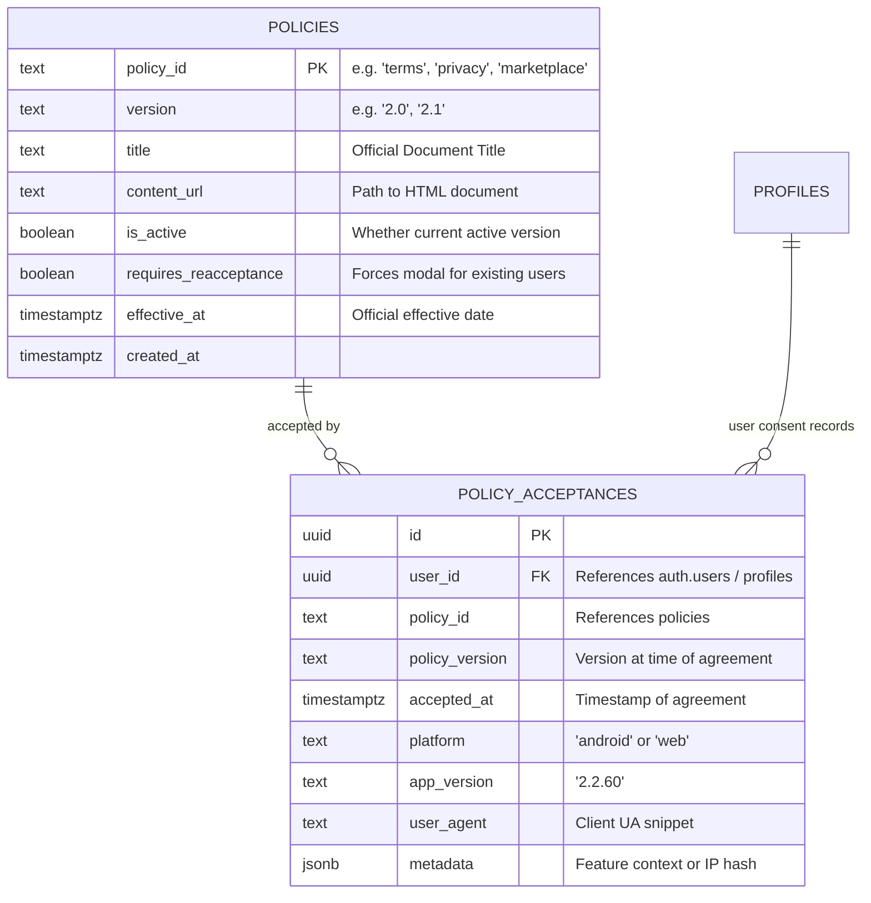
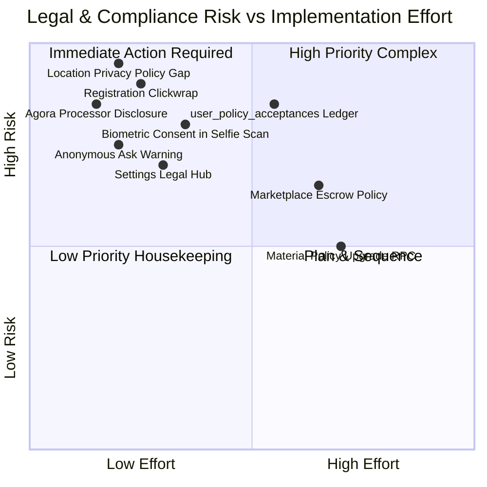

# THE COLLEGE DATE — TERMS & POLICY FORENSIC AUDIT
**Comprehensive Forensic Analysis, Regulatory Compliance Audit & Architecture Blueprint**

- **Project:** The College Date (CD2.0)
- **Android Package:** `com.collegedate.app`
- **Application Version:** `2.2.60` (Version Code 57)
- **Audit Date:** September 21, 2026
- **Auditor Role:** Senior Product Engineer, Backend Engineer, Android Engineer, Database Engineer, Security Engineer, UX Engineer & QA Lead
- **Primary Jurisdictions:** Federal Republic of Nigeria (NDPA 2023, Cybercrimes Act 2015/2024, CAMA 2020, AMA 2023, FCCPA 2018), Google Play Developer Distribution Agreement & Policies, Apple App Store Guidelines (future)
- **Status:** Complete Forensic Audit & Technical Architecture Specification
- **Hard Gate Status:** STRICT AUDIT ONLY — NO SOURCE CODE OR DATABASE MUTATIONS COMMITTED

---

## Evaluation Taxonomy & Status Legend

In accordance with forensic engineering standards, every finding, subsystem, and compliance dimension in this document is classified using the following evaluation taxonomy:

- `VERIFIED`: Directly inspected, confirmed active in source code, migrations, or release assets, and functioning as intended.
- `PARTIALLY VERIFIED`: Feature or mechanism exists in the codebase but possesses notable gaps, inconsistencies, missing audit records, or incomplete end-to-end integration.
- `NOT VERIFIED`: Claimed or assumed feature is absent from the production implementation, lacks runtime proof, or is omitted from the data model.
- `NOT MEASURED`: Metric, performance impact, or edge-case behavior has not yet been subjected to live instrumentation or production telemetry.
- `LEGAL REVIEW REQUIRED`: Technical mechanism is operational, but enforceability, legal liability, regulatory sufficiency, or commercial phrasing requires formal review by qualified Nigerian legal counsel.
- `REGRESSION FOUND`: Previously functional or established standard has degraded, conflicts with newer features, or contains technical/legal discrepancies.

---

## Executive Summary & High-Level Findings

A comprehensive forensic audit of The College Date codebase (`src/`, `public/`, `supabase/migrations/`, `android/app/src/main/`) reveals that while the platform possesses extensive static policy documentation (`terms.html`, `privacy.html`, `safety.html`, `child-safety-standards.html`, `campus-confessions-guide.html`), **the operational agreement and consent infrastructure is largely uncoupled from user state and lacks an immutable audit trail**.

### Key Forensic Discoveries:

1. **Zero Registration Agreement Tracking (`NOT VERIFIED` / Critical Gap):**
   - In `src/pages/Signup.jsx`, users register with email, password, and role. There is **no checkbox**, **no notice of terms**, **no link to Terms or Privacy**, and **no acceptance payload** sent to Supabase Auth or database profiles.
   - In `src/contexts/AuthContext.jsx` (`signup`, `loginWithGoogle`, `loginWithFacebook`), user metadata passes zero acceptance flags.
   - In `src/pages/AuthCallback.jsx`, OAuth users are provisioned into `public.profiles` without recording terms acceptance.

2. **No Dedicated Database Consent Ledger (`NOT VERIFIED` / Critical Gap):**
   - Across all 77 Supabase SQL migrations, there is **no table** (such as `user_policy_acceptances`), **no profile column** (such as `terms_accepted_at` or `terms_version`), and **no RPC** to record or query policy acceptance.
   - The platform cannot answer the fundamental legal question: *"What exact version of the Terms and Privacy Policy did User X accept, on what date, and from which platform?"*

3. **Settings Legal Surface Gaps (`PARTIALLY VERIFIED`):**
   - `src/pages/Settings.jsx` provides links to `Safety & Guidelines` (`/safety`), `Delete Account Permanently`, and WhatsApp/Email support.
   - However, **Terms of Service (`/terms`) and Privacy Policy (`/privacy`) are completely omitted from the Settings screen**. Users cannot access their governing contracts from within their account settings.

4. **Third-Party Discrepancies & Stale Disclosures (`REGRESSION FOUND`):**
   - `public/privacy.html` and `AndroidManifest.xml` explicitly state that voice/video calls are processed via **ZEGOCLOUD**.
   - The actual implementation in `src/pages/VoiceCallRoom.jsx` was migrated to **Agora RTC SDK** (`agora-rtc-sdk-ng`). The published privacy policy does not disclose Agora or its data processing terms.

5. **Location Data Omission in Privacy Policy (`REGRESSION FOUND` / High Risk):**
   - The Android application requests `ACCESS_FINE_LOCATION` and `ACCESS_COARSE_LOCATION`.
   - `src/pages/Chat.jsx` provides real-time GPS live location sharing (`navigator.geolocation.getCurrentPosition`), and `src/pages/Match.jsx` calculates distance.
   - However, `public/privacy.html` section *"Data We Collect"* completely omits Geolocation/GPS data, presenting severe non-compliance risks under Google Play User Data policies and NDPA 2023.

6. **Biometric Face Verification Lacks Explicit Consent (`PARTIALLY VERIFIED` / Legal Risk):**
   - `src/components/FaceVerificationModal.jsx` performs 4-stage live facial biometric scanning and landmark detection.
   - While effective for sybil defense, it lacks an explicit statutory consent checkbox under NDPA 2023 Section 30 (Processing of Sensitive Personal Data).

7. **Client-Only Marketplace Safety Gate (`PARTIALLY VERIFIED`):**
   - `src/components/CreateServiceDealModal.jsx` features a safety acknowledgement checkbox (*"I agree to the Marketplace Terms and confirm this is a legitimate service"*).
   - However, this boolean is purely client-side state (`safetyAgreed`), is never stored in `service_deals` or an audit log, and has no linked document explaining marketplace escrow terms.

---

## Phase 1 — Current Legal & Policy Architecture Audit

### 1.1 Architectural Topology
The College Date legal system operates as a hybrid static/SPA content delivery model:
- **Static Artifacts:** Stored in `public/*.html`. During Vite build, they copy to `dist/*.html`.
- **Capacitor Mobile Sync:** Copied via `npx cap sync` to `android/app/src/main/assets/public/`.
- **Routing Layer:**
  - Netlify Web: `public/_redirects` defines 301 redirects from extension URLs (e.g. `/terms.html` -> `/terms`) and serves static HTML via 200 rewrites (`/terms /terms.html 200`).
  - Single Page Application (SPA): `src/App.jsx` mounts `PUBLIC_SEO_SLUGS` via `src/pages/public/StaticPageViewer.jsx`.
- **Viewer Component:** `StaticPageViewer.jsx` fetches `/${slug}.html`, extracts `<title>` and `<main>` DOM nodes, strips legacy navigations, and embeds content inside the shared application shell (`PublicHeader` and `PublicFooter`).

### 1.2 Evaluation & Status
| Component | Implementation | State | Status |
|---|---|---|---|
| Document Storage | Static HTML in `public/` | Mirrored in Web & APK assets | `VERIFIED` |
| Web SPA Delivery | `StaticPageViewer.jsx` via `fetch('/terms.html')` | Dynamically parses HTML into React DOM | `VERIFIED` |
| Native Android Delivery | Local asset fetch within WebView | Loads from localhost/assets | `VERIFIED` |
| Legal Agreement Binding | Registration and OAuth flows | No binding mechanism present | `NOT VERIFIED` |
| Consent Auditability | Database ledger or event stream | Zero records created or preserved | `NOT VERIFIED` |

---

## Phase 2 — Existing Legal Documents Audit

A forensic line-by-line inspection was conducted on all seven static policy and trust documents in `public/`:

### 2.1 Terms of Service (`public/terms.html`)
- **Published Date:** Effective May 29, 2026.
- **Length:** 102 lines (Very brief summary).
- **Core Sections:**
  1. *Eligibility:* Intended for adults (18+).
  2. *User Conduct:* Prohibition of harassment, impersonation, scams, non-consensual media, CSAE.
  3. *User Content:* User responsibility, platform reservation of removal rights.
  4. *Premium Features & Payments:* Handled via Google Play, RevenueCat, Paystack.
  5. *Safety & Reports:* Reporting mechanisms, offline meeting guidance.
  6. *Account Restrictions:* Suspension and termination rights.
  7. *Contact:* `info@thecollegedate.com`.
- **Forensic Gaps (`LEGAL REVIEW REQUIRED`):**
  - **No Governing Law or Jurisdiction Clause:** Fails to specify the laws of the Federal Republic of Nigeria or jurisdiction in Lagos State / Federal High Court.
  - **No Dispute Resolution or Arbitration Mechanism:** Does not invoke the Nigerian Arbitration and Mediation Act 2023 (AMA) or specify arbitration rules.
  - **No Limitation of Liability or Warranty Disclaimer:** Lacks standard contractual exclusions of consequential damages, essential for dating platforms operating in high-risk interpersonal environments.
  - **No Virtual Currency Terms:** Does not define the legal nature of "CD Coins", non-refundability, or lack of cash surrender value.
  - **No Marketplace Escrow Terms:** Lacks clear definitions of peer-to-peer service deals, dispute arbitration, or escrow release authorizations.

### 2.2 Privacy Policy (`public/privacy.html`)
- **Published Date:** Effective May 29, 2026.
- **Length:** 122 lines.
- **Data Categories Declared:** Account details, profile details, app activity, user-uploaded media, device/technical data, payment transaction metadata.
- **Third-Party Processors Declared:** Supabase, RevenueCat, Google Play, Paystack, OneSignal, Firebase, ZEGOCLOUD.
- **Forensic Gaps (`REGRESSION FOUND` / `LEGAL REVIEW REQUIRED`):**
  - **Outdated Call Processor:** Declares *ZEGOCLOUD* instead of *Agora RTC*.
  - **Omission of Location Data:** GPS location collected in `Chat.jsx` and `Match.jsx` is not disclosed under collected data.
  - **Omission of Biometric Data Processing:** Liveness selfie verification and optical campus matching are not specified under sensitive personal data.
  - **Absence of NDPA 2023 Statutory Rights:** Does not explicitly enumerate data subject rights under the Nigeria Data Protection Act 2023 (Right to Access, Rectification, Erasure, Restriction, Objection, Data Portability, and Right to Lodge Complaint with the Nigeria Data Protection Commission [NDPC]).
  - **No Data Protection Officer (DPO) Contact:** NDPA requires designation of a data protection contact or officer.

### 2.3 Child Safety Standards (`public/child-safety-standards.html`)
- **Published Date:** Last updated May 13, 2026.
- **Content:** Prohibits CSAE/CSAM, mandates adult eligibility, provides safety contact (`godwillgodslife@gmail.com`), outlines enforcement.
- **Compliance Status:** `VERIFIED` — Fully aligned with Google Play Child Safety and CSAE requirements.
- **Recommendation:** Standardize safety email to `safety@thecollegedate.com` or `info@thecollegedate.com` rather than personal Gmail.

### 2.4 Campus Confessions Guide (`public/campus-confessions-guide.html`)
- **Published Date:** September 15, 2026.
- **Content:** Explains anonymity, meme culture, prohibited defamation/doxxing, content moderation, reporting paths.
- **Compliance Status:** `VERIFIED` — Excellent campus-specific educational material.

### 2.5 Safety Center & Campus Safety (`public/safety.html` & `public/campus-dating-safety.html`)
- **Published Date:** July 20, 2026.
- **Content:** Physical meeting guidelines, public meeting places, anti-spiking advice, transportation precautions, scam warnings.
- **Compliance Status:** `VERIFIED` — Strong, student-oriented harm-reduction framework.

### 2.6 Account Deletion Instructions (`public/delete-account.html`)
- **Content:** Instructs users to email `info@thecollegedate.com` with subject *"Delete My The College Date Account"*.
- **Conflict Status:** `REGRESSION FOUND` — Discrepancy with `Settings.jsx`, which provides an instant, in-app self-service account deletion button (`delete_user_account` RPC). The static document should state that users can delete directly in-app under Settings -> Delete Account Permanently, or via email if unable to log in.

---

## Phase 3 — Current User Acceptance Flows Audit

```mermaid
flowchart TD
    subgraph Current_Registration_Flow["Current Registration Flow (No Consent)"]
        A[User opens Signup.jsx] --> B[Enters Email, Role, Password]
        B --> C[Clicks 'Create Account']
        C --> D[supabase.auth.signUp]
        D --> E[User created in auth.users]
        E --> F[Redirect to /mini-profile-setup]
        style D fill:#ff4b4b,stroke:#333,stroke-width:2px,color:#fff
        style C fill:#ff8e53,stroke:#333,stroke-width:1px,color:#fff
    end

    subgraph Proposed_Versioned_Flow["Target Versioned Acceptance Flow"]
        G[User opens Signup.jsx] --> H[Enters Credentials & Role]
        H --> I["Explicit Clickwrap Notice + View Terms/Privacy"]
        I --> J[Clicks 'Create Account']
        J --> K["Record Acceptance: policy_type='terms_and_privacy', version='2.0'"]
        K --> L[supabase.auth.signUp with Metadata]
        L --> M["Atomic RPC: record_policy_acceptance"]
        M --> N[Audit Ledger user_policy_acceptances]
        style K fill:#10b981,stroke:#333,stroke-width:2px,color:#fff
        style M fill:#10b981,stroke:#333,stroke-width:2px,color:#fff
        style N fill:#10b981,stroke:#333,stroke-width:2px,color:#fff
    end
```



### 3.1 Email/Password Registration (`Signup.jsx`)
- **Current Mechanics:** Clean form with email, role selector (`Guy` / `Lady`), password, confirm password, optional referral code.
- **Acceptance Gate:** NONE.
- **Finding:** `NOT VERIFIED`. No link, no checkbox, no clickwrap disclaimer.

### 3.2 Google OAuth Login (`AuthContext.jsx` & `AuthCallback.jsx`)
- **Current Mechanics:** `signInWithOAuth({ provider: 'google' })`.
- **Post-Auth Profile Hook:** `ensureOAuthProfile` upserts basic profile attributes.
- **Acceptance Gate:** NONE.
- **Finding:** `NOT VERIFIED`. OAuth users bypass any indication that service terms govern their use.

### 3.3 Biometric Login Enrollment (`Settings.jsx` & `Login.jsx`)
- **Current Mechanics:** Uses `@capacitor/biometrics` or native Keychain/Keystore.
- **Notice:** Mentions faster sign-in, but does not provide specific biometric data handling notice.
- **Finding:** `PARTIALLY VERIFIED`. Safe on-device authentication, but lacks explicit NDPA notice that biometrics remain solely inside the device's Secure Enclave.

### 3.4 Profile Onboarding (`MiniProfileSetup.jsx`)
- **Current Mechanics:** 6-step wizard (Identity, Campus, Vibe, Intent, Photo, Success).
- **Age Gate:** Step 0 enforces `age >= 18` client-side and in `handleFinish` (`parsedAge < 18` throws error).
- **Acceptance Gate:** NONE. Step 5 does not present Community Standards or Safety Agreement before entering `/match`.
- **Finding:** `PARTIALLY VERIFIED` (Age enforced, but general terms neglected).

---

## Phase 4 — Database Records & Consent Audit

### 4.1 Schema Inspection
A rigorous inspection of all 77 migrations in `supabase/migrations/` was executed:
- **`profiles` Table:** Contains fields for identity, campus, media, verification, streaks, active program, settings, privacy flags (`allow_camera_discovery`, `incognito_mode`), but **zero fields for terms acceptance**.
- **Audit Logs:**
  - `campus_finder_audit_logs` exists for camera discovery events (`20260919150000_campus_finder_system.sql`).
  - `admin_audit_logs` exists for administrative actions (`20260715143000_admin_audit_view_and_user_status.sql`).
  - **`user_policy_acceptances` does not exist.**

### 4.2 Legal Defensibility Gap
If a legal dispute, chargeback, defamation claim, or regulatory inquiry arises regarding user conduct or data processing, the platform currently cannot produce:
1. Timestamp of agreement.
2. The specific version of Terms of Service agreed to.
3. The specific version of Privacy Policy agreed to.
4. IP address hash or platform context (`android` vs `web`) at time of agreement.
5. Record of affirmative assent.

**Audit Status:** `NOT VERIFIED` (Absolute Architecture Gap).

---

## Phase 5 — Policy Versioning & Upgrade Mechanics Audit

### 5.1 Current Versioning Status
- **Current Mechanism:** None.
- **Static Documents:** `public/terms.html` contains hardcoded string *"Effective May 29, 2026"*, but no semantic version (`1.0`, `2.0`, etc.).
- **Client Cache:** `persistentCache.js` uses key prefix `tcd-cache-v2.2.60:`, which purges application cache on version bump, but is unrelated to legal agreement versioning.
- **Re-Acceptance Trigger:** Does not exist. If the Terms or Privacy Policy are modified, existing active sessions continue indefinitely without re-consent.

**Audit Status:** `NOT VERIFIED`.

---

## Phase 6 — Row Level Security (RLS) & Authorization Audit

### 6.1 Vulnerability Analysis of Future Consent Records
When implementing `user_policy_acceptances`, RLS must prevent tampering:
- **Risk 1 (Unauthorized Acceptance Injection):** A malicious actor must not be able to forge consent records for another user ID (`user_id = auth.uid()` must be enforced).
- **Risk 2 (Consent Revocation / Record Deletion):** Consent records are immutable legal audit ledgers. **`DELETE` and `UPDATE` operations must be completely revoked** from authenticated and anonymous users. Only `INSERT` and `SELECT` of a user's own records may be permitted.
- **Risk 3 (Admin Read Authority):** Platform administrators must have read-only access to verify compliance during disputes or moderation appeals (`has_admin_permission(auth.uid(), 'compliance.read')`).

**Audit Status:** `LEGAL REVIEW REQUIRED` / Architecture Specification Needed.

---

## Phase 7 — Registration & Onboarding Integration Analysis

### 7.1 UX Friction vs. Legal Enforceability Analysis
Dating applications operate under intense top-of-funnel friction sensitivity. Two legal models exist:

1. **Explicit Checkbox (Opt-in):** User must check a box: `[x] I agree to the Terms of Service and Privacy Policy`.
   - *Pros:* High enforceability under US, EU, and Commonwealth case law.
   - *Cons:* Adds 4–8% friction to mobile signup completion.
2. **Clickwrap Notice (Deemed Assent):** Prominent statement directly above or below the primary submission button:
   - *"By tapping 'Create Account', you confirm you are at least 18 years old and agree to our [Terms of Service] and [Privacy Policy]."*
   - *Pros:* Zero added taps, clean mobile UI, standard across Tinder, Bumble, and Hinge.
   - *Cons:* Must be visually conspicuous, cannot be buried in small light-gray text, links must be active.

### 7.2 Strategic Recommendation for The College Date
Adopt the **Prominent Clickwrap Notice on Registration + Versioned Just-In-Time Micro-Acknowledgements for Sensitive Features**:
- **Registration (`Signup.jsx`):** High-contrast Clickwrap notice directly above the `Create Account` button, recording `terms_and_privacy` version `2.0` automatically upon successful signup.
- **Onboarding (`MiniProfileSetup.jsx`):** At Step 5 (before entering `/match`), display a warm, campus-themed Community Standards Card ("The Campus Code: Respect, Consent, Safety") with a single affirmative CTA ("I'm Ready to Match 🚀").
- **OAuth (`AuthCallback.jsx`):** First-time OAuth logins trigger the same versioned acceptance registration upon profile creation.

---

## Phase 8 — In-App Legal & Policy Center / Settings Audit

### 8.1 Settings Screen Forensic Audit (`src/pages/Settings.jsx`)
An inspection of `src/pages/Settings.jsx` (1,128 lines) reveals:
- **Account Section:** Profile visibility, Premium, Referrals, Wallet, Install APK.
- **Login & Security:** Change Password, Biometrics toggle.
- **Appearance:** Theme selector (System, Light, Dark).
- **Notifications:** Alert switches, Quiet Hours, Notification QA Lab.
- **Privacy:** Show Online Status, Incognito Mode, Campus Camera Discovery toggle, Blocked Accounts modal.
- **Subscription:** Premium status, Restore Purchase.
- **App Guidance & Help:** Official The College Date Hub modal, Interactive App Guide, Reset Tips.
- **Support:** WhatsApp support, WhatsApp partner, LinkedIn founder, Email, Safety & Guidelines link.
- **Account Actions:** Log Out, Deactivate Account modal, Delete Account Permanently modal.

### 8.2 The Missing Legal Section
There is **no dedicated Legal & Policies section** in Settings:
- Users cannot read the Terms of Service.
- Users cannot inspect the Privacy Policy.
- Users cannot check the Child Safety Standards.
- Users cannot verify what policy version they accepted or when they accepted it.

**Audit Status:** `REGRESSION FOUND` / High UX Gap.

---

## Phase 9 — Feature-by-Feature Policy Acknowledgement Matrix

A rigorous forensic audit of the **24 platform features** across 8 critical dimensions:

| # | Feature | Existing Terms Coverage | Additional Policy Needed | User Ack Needed | Explicit Consent Needed | Android Permission | Payment Disclosure | Safety Warning | Legal Review Required | Status |
|---|---|---|---|---|---|---|---|---|---|---|
| **1** | **Account Registration** | Partial (Generic) | Detailed Terms v2.0 | Conspicuous Clickwrap | No | None | No | Age (18+) | Yes (Enforceability) | `PARTIALLY VERIFIED` |
| **2** | **Social Login (Google/FB)** | None | OAuth terms linkage | Conspicuous Clickwrap | No | None | No | None | Yes | `NOT VERIFIED` |
| **3** | **Biometric Login** | None | On-device enclave notice | Toggle in Settings | No | `USE_BIOMETRIC` | No | None | No | `VERIFIED` |
| **4** | **User Profiles & Photos** | Partial (Content rules) | Impersonation / NDPA | Upload guidelines | No | `CAMERA`, `READ_MEDIA` | No | Privacy notice | No | `VERIFIED` |
| **5** | **AI Photo / Selfie Verification** | None | Biometric verification policy | First-time modal consent | **YES (NDPA §30)** | `CAMERA` | No | Anti-catfish | **YES (Biometrics)** | `PARTIALLY VERIFIED` |
| **6** | **Discovery & Swiping** | Partial | Daily limits & reset rules | Onboarding cue | No | None | Freemium quota | Respect boundaries | No | `VERIFIED` |
| **7** | **Secret Admirers & Requests** | None | Blurred identity terms | Initial discovery hint | No | None | Freemium accept limits | Anti-harassment | No | `VERIFIED` |
| **8** | **Match Celebration** | Partial | Chat unlocking terms | Modal CTA | No | None | No | Safe chatting | No | `VERIFIED` |
| **9** | **Messaging & Real-time Chat** | Partial (Conduct) | Anti-bullying / logs retention | Zero (Covered by Terms) | No | None | No | Safety reporting | No | `VERIFIED` |
| **10** | **Disappearing Media (View Once)** | None | Screenshot / ephemeral notice | Modal disclaimer | No | None | No | No screenshot safety | **YES (Privacy expectations)** | `PARTIALLY VERIFIED` |
| **11** | **Voice Notes & Audio** | Partial (Media) | Audio recording terms | Mic permission rationale | No | `RECORD_AUDIO` | No | Anti-harassment | No | `VERIFIED` |
| **12** | **Agora Audio & Video Calls** | None (Outdated Zego) | **Agora RTC disclosure** | In-call safety badge | No | `RECORD_AUDIO`, `CAMERA` | Minutes quota | Anti-recording warning | **YES (Third-party processor)** | `REGRESSION FOUND` |
| **13** | **Marketplace & Service Deals** | Checkbox only | **Marketplace Escrow Policy** | Pre-deal agreement | No | None | Platform fee & release | Anti-prostitution / AML | **YES (Commercial Escrow)** | `PARTIALLY VERIFIED` |
| **14** | **Coins, Gifts & Monetization** | Partial | **Virtual Currency Terms** | Store checkout terms | No | None | Non-refundable items | Spending limits | **YES (Consumer rights)** | `PARTIALLY VERIFIED` |
| **15** | **Wallet & Bank Payouts** | None | **Payout & AML Terms** | Withdrawal form ack | No | None | ₦15k minimum / fees | Anti-fraud hold notice | **YES (CBN / AML regulations)** | `PARTIALLY VERIFIED` |
| **16** | **College Date Active Retention** | None | **Ambassador Program Rules** | Enrollment modal ack | No | None | Target earnings rules | Anti-gaming / fraud | **YES (Labor / Prize rules)** | `PARTIALLY VERIFIED` |
| **17** | **Campus Confessions (Public Feed)**| Partial (Guide exists)| Community Guidelines v2.0 | First-time post micro-ack | No | None | No | Anti-doxxing warning | **YES (Defamation liability)** | `PARTIALLY VERIFIED` |
| **18** | **Anonymous Asks (/ask/:username)** | Conflicting Notice | Anti-harassment & Law logs | Submission disclaimer | No | None | No | Law enforcement disclosure| **YES (Cybercrimes Act)** | `REGRESSION FOUND` |
| **19** | **Campus Finder (Camera Discovery)**| Modal exists | Optical match policy | Settings opt-in toggle | **YES (NDPA)** | `CAMERA` | Search credits | Ephemeral processing | **YES (Biometric discovery)**| `PARTIALLY VERIFIED` |
| **20** | **Score Streak & Gamification** | None | Streak rules & freeze | Modal guidelines | No | None | Streak repairs | Non-monetary status | No | `VERIFIED` |
| **21** | **Official Account & Video Guides** | None | Official verification policy | In-app channel view | No | None | No | Anti-impersonation | No | `VERIFIED` |
| **22** | **Push & Foreground Notifications** | Partial | Push marketing choices | Settings toggles | No | `POST_NOTIFICATIONS` | No | Quiet hours | No | `VERIFIED` |
| **23** | **Geolocation & Proximity Sharing** | **NONE (Omitted)** | **Location Privacy Policy** | Chat share warning | **YES (GPS)** | `ACCESS_FINE_LOCATION` | No | Real-world safety | **YES (High Regulatory Risk)** | `REGRESSION FOUND` |
| **24** | **Account Deletion & Data Rights** | Discrepancy | Data retention & erasure | Deletion modal confirm | No | None | No | Irrevocable deletion | **YES (NDPA Compliance)** | `PARTIALLY VERIFIED` |

---

## Phase 10 — Missing Capabilities & Compliance Gaps

### Gap 10.1: Missing Location Data Privacy Disclosures (`REGRESSION FOUND`)
- **Impact:** Critical regulatory violation under Google Play User Data Policy (Section: Prominent Disclosure & Consent Requirement for Background/Foreground Location) and NDPA 2023.
- **Remediation:** Update `public/privacy.html` immediately to declare location data collection, purpose (campus proximity and opt-in live sharing in chat), and retention duration. Add in-app live location sharing safety modal.

### Gap 10.2: Agora RTC Third-Party Processor Discrepancy (`REGRESSION FOUND`)
- **Impact:** Misleading privacy disclosures. Privacy policy claims ZEGOCLOUD handles voice/video, while Agora SDK is actively transmitting audio/video packets.
- **Remediation:** Update `public/privacy.html` and `AndroidManifest.xml` comments to replace ZEGOCLOUD with Agora RTC Inc.

### Gap 10.3: Anonymous Ask Privacy / Law Enforcement Conflict (`REGRESSION FOUND`)
- **Impact:** `AnonymousAskPage.jsx` tells users *"Your identity, IP, and details are strictly confidential."* This contradicts `child-safety-standards.html` and statutory obligations under the Cybercrimes (Prohibition, Prevention, etc.) Act 2015 to cooperate with law enforcement on cyberstalking, bomb threats, or child exploitation.
- **Remediation:** Clarify copy to: *"Anonymous to the recipient. Abusive messages, harassment, or illegal threats are logged and reported to law enforcement."*

### Gap 10.4: Lack of Virtual Currency & Non-Refundability Terms (`LEGAL REVIEW REQUIRED`)
- **Impact:** Users purchasing CD Coins via Paystack or Google Play Billing may claim entitlement to cash refunds under Nigerian consumer protection law (FCCPA 2018).
- **Remediation:** Include explicit Virtual Items terms in Terms of Service declaring coins as non-refundable licenses for in-app digital entertainment with no cash equivalent.

### Gap 10.5: Marketplace Escrow & Dispute Mechanics (`LEGAL REVIEW REQUIRED`)
- **Impact:** Platform facilitates student freelance services (hair styling, assignment tutoring, tech support) with fund locking and PIN releases. Without clear terms, College Date could be misconstrued as an unauthorized deposit-taking institution or liable for substandard service delivery.
- **Remediation:** Provide clear Marketplace Escrow Terms defining College Date strictly as a technology marketplace venue, with users acting as independent contractors.

---

## Phase 11 — Recommended Architecture & UX Strategy



### 11.1 Proposed Database Schema
```sql
-- 1. Master Policies Table
CREATE TABLE IF NOT EXISTS public.policies (
    policy_id TEXT NOT NULL,
    version TEXT NOT NULL,
    title TEXT NOT NULL,
    content_url TEXT NOT NULL,
    is_active BOOLEAN NOT NULL DEFAULT true,
    requires_reacceptance BOOLEAN NOT NULL DEFAULT false,
    effective_at TIMESTAMPTZ NOT NULL DEFAULT now(),
    created_at TIMESTAMPTZ NOT NULL DEFAULT now(),
    PRIMARY KEY (policy_id, version)
);

-- 2. Immutable Policy Acceptance Audit Ledger
CREATE TABLE IF NOT EXISTS public.user_policy_acceptances (
    id UUID PRIMARY KEY DEFAULT gen_random_uuid(),
    user_id UUID NOT NULL REFERENCES auth.users(id) ON DELETE CASCADE,
    policy_id TEXT NOT NULL,
    policy_version TEXT NOT NULL,
    accepted_at TIMESTAMPTZ NOT NULL DEFAULT now(),
    platform TEXT NOT NULL CHECK (platform IN ('web', 'android', 'ios')),
    app_version TEXT NOT NULL,
    user_agent TEXT,
    metadata JSONB DEFAULT '{}'::jsonb,
    CONSTRAINT fk_policy FOREIGN KEY (policy_id, policy_version) 
        REFERENCES public.policies(policy_id, version) ON UPDATE CASCADE
);

-- Indexing for instantaneous verification queries
CREATE INDEX IF NOT EXISTS idx_user_policy_acceptances_lookup 
ON public.user_policy_acceptances (user_id, policy_id, policy_version);
```

### 11.2 Authoritative RPC: `record_policy_acceptance`
```sql
CREATE OR REPLACE FUNCTION public.record_policy_acceptance(
    p_policy_id TEXT,
    p_version TEXT,
    p_platform TEXT,
    p_app_version TEXT,
    p_metadata JSONB DEFAULT '{}'::jsonb
)
RETURNS JSONB
LANGUAGE plpgsql
SECURITY DEFINER
SET search_path = ''
AS $$
DECLARE
    v_user_id UUID := auth.uid();
    v_record_id UUID;
BEGIN
    IF v_user_id IS NULL THEN
        RETURN jsonb_build_object('success', false, 'error', 'unauthorized');
    END IF;

    -- Verify policy exists
    IF NOT EXISTS (
        SELECT 1 FROM public.policies 
        WHERE policy_id = p_policy_id AND version = p_version
    ) THEN
        RETURN jsonb_build_object('success', false, 'error', 'invalid_policy_version');
    END IF;

    -- Insert into immutable ledger
    INSERT INTO public.user_policy_acceptances (
        user_id, policy_id, policy_version, platform, app_version, user_agent, metadata
    ) VALUES (
        v_user_id, p_policy_id, p_version, p_platform, p_app_version, 
        current_setting('request.headers', true)::jsonb->>'user-agent', p_metadata
    )
    RETURNING id INTO v_record_id;

    RETURN jsonb_build_object('success', true, 'acceptance_id', v_record_id);
END;
$$;
```

---

## Phase 12 — Just-in-Time (JIT) Micro-Acknowledgement Framework

To balance legal protection with an intuitive student UX, sensitive features should utilize contextual micro-acknowledgements rather than blocking full-screen legal walls:

### 12.1 JIT Micro-Acknowledgement Matrix
1. **Live Location Sharing (`Chat.jsx`):**
   - *Trigger:* First time tapping `Share Live Location` in a conversation.
   - *UI:* Compact bottom sheet / modal.
   - *Copy:* *"Safety First: Only share your live location with coursemates or friends you trust. Never share location with someone you haven't verified or meet in isolated spots."*
   - *Action:* `[Cancel]` and `[I Understand & Share]`. Latching key saved in `localStorage` + audit log.
2. **Biometric Face Verification (`FaceVerificationModal.jsx`):**
   - *Trigger:* On Step 1 (Intro) before launching camera stream.
   - *UI:* Checkbox / consent affirmation card.
   - *Copy:* *"By continuing, you consent under NDPA 2023 to biometric landmark scanning strictly to verify that you match your profile photos. Data is processed ephemerally and never sold."*
3. **Marketplace Deal Creation (`CreateServiceDealModal.jsx`):**
   - *Trigger:* Form submission.
   - *UI:* Retain checkbox, but upgrade copy and add clickable link: *"I agree to the [Marketplace Escrow Terms] and confirm this is an honest campus service (no adult or illegal services)."*
4. **Anonymous Ask Submission (`AnonymousAskPage.jsx`):**
   - *Trigger:* Below composer input.
   - *Copy:* *"Anonymous to @student. Threats, blackmail, cyberstalking, or defamation are strictly prohibited and IP logs will be provided to law enforcement."*
5. **Coin Purchases (`CoinStoreModal.jsx`):**
   - *Trigger:* Buy Coins checkout button.
   - *Copy:* *"CD Coins are virtual tokens for in-app entertainment and gifts. All coin purchases are final and non-refundable."*

---

## Phase 13 — Material Policy Change & Re-Acceptance Protocol

When terms or privacy policies undergo **material changes** (e.g., changes to monetization, escrow, biometric processing, or data sharing):

1. **Policy Version Bump:** Admin flags `requires_reacceptance = true` on `policies` table for new version `2.1`.
2. **Evaluator RPC (`get_pending_policy_requirements`):**
   - Called during app initialization in `AuthContext.jsx`.
   - Checks if user has accepted the latest active version of required policies.
3. **Non-Disruptive Presentation:**
   - **Minor Clarifications (Non-Material):** Slidable toast banner: *"We've updated our Safety & Community Guidelines. [Review Updates]"*.
   - **Material Changes:** Non-dismissible bottom sheet modal appearing on Dashboard/Match:
     - Clear 3-bullet summary of what changed in plain campus language.
     - Direct links to full legal texts.
     - Single tap: `[Accept & Continue]`.
     - Grace period option: *"Review Later (3 days remaining)"* for non-critical changes.

---

## Phase 14 — Offline-First Compatibility & Cache Strategy

Given variable Nigerian campus connectivity (MTN, Airtel, Glo):
1. **Persistent Client Cache:**
   - Store accepted policy versions in `localStorage` (`tcd_policies_accepted_${userId}`) and `persistentCache.js`.
   - App launches read accepted state instantaneously from local storage; zero blocking spinners on login.
2. **Offline Acceptance Queue:**
   - If a user accepts terms while offline (e.g., reading cached guides), enqueue operation via `enqueueOfflineOperation(userId, { type: 'record_policy_acceptance', ... })`.
   - Automatically drained and synced to Supabase when network connectivity restores via `src/lib/offlineQueue.js`.
3. **Local Bundling of Policy Documents:**
   - Ensure `public/terms.html`, `public/privacy.html`, `public/safety.html` remain bundled in the Android APK (`assets/public/`).
   - In offline mode, `StaticPageViewer.jsx` serves local HTML without network failure.

---

## Phase 15 — Security, Tamper Resistance & Audit Trail

### 15.1 Threat Model & Safeguards
- **Threat: Fraudulent Denial of Terms Assent ("I never agreed to terms"):**
  - *Countermeasure:* Server-side authoritative timestamp, verified `user_id` from Supabase JWT (`auth.uid()`), client app version (`2.2.60`), platform flag (`android`), and hashed user-agent recorded in `user_policy_acceptances`.
- **Threat: Client Modification of Database Records:**
  - *Countermeasure:* RLS policy completely revokes `UPDATE` and `DELETE` on `user_policy_acceptances`. Records are append-only.
- **Threat: Spoofed Consent Injection:**
  - *Countermeasure:* Only the authenticated session owner can insert records for their own `user_id`.

---

## Phase 16 — Android Package & Native Considerations (`com.collegedate.app`)

1. **Hardware Back Button Handling:**
   - When viewing `/terms` or `/privacy` via `StaticPageViewer.jsx` on Android, pressing the native Android back button must navigate back to the previous app screen (Settings or Signup) rather than exiting the app.
2. **Capacitor Browser vs. WebView:**
   - `StaticPageViewer` renders inside the native WebView, maintaining theme harmony (Dark/Light mode).
   - External links (WhatsApp support, LinkedIn) open in system browser via `@capacitor/browser` or standard intent.
3. **Deep Links:**
   - `AndroidManifest.xml` should support deep links:
     - `https://www.thecollegedate.com/terms`
     - `https://www.thecollegedate.com/privacy`
     - `https://www.thecollegedate.com/safety`
   - Ensure clicking legal links from emails or push notifications opens the in-app viewer smoothly.

---

## Phase 17 — Risk Assessment & Prioritization



### Risk Classification:

| Risk Level | Issue | Compliance Hazard | Urgency |
|---|---|---|---|
| **CRITICAL** | Geolocation collected without Privacy Policy disclosure | Google Play Store suspension; NDPA violation | Immediate |
| **CRITICAL** | Outdated ZEGOCLOUD reference / Missing Agora disclosure | Misleading regulatory disclosure | Immediate |
| **HIGH** | Zero Terms/Privacy acceptance at Signup | Inability to enforce terms, arbitration, or conduct rules | High |
| **HIGH** | Absence of immutable acceptance ledger in database | Complete lack of legal auditability | High |
| **HIGH** | Anonymous Ask promises 100% IP confidentiality | Contradicts Cybercrimes Act & CSAE obligations | High |
| **MEDIUM** | Biometric verification without statutory consent notice | NDPA Section 30 sensitive data scrutiny | Medium |
| **MEDIUM** | Terms & Privacy missing from Settings screen | Poor user trust & app store guideline friction | Medium |
| **MEDIUM** | Virtual Coins lack non-refundability disclaimer | Consumer dispute & chargeback vulnerability | Medium |

---

## Phase 18 — Comprehensive Verification & Test Plan

To ensure zero regressions across Web and native Android (`emulator-5554`):

### 18.1 Automated Unit & Integration Suite (`test/policy-acceptance.test.mjs`)
1. `test_registration_requires_terms_acceptance`: Verify registration form rejects submission if clickwrap is unconfirmed.
2. `test_record_policy_acceptance_rpc`: Verify atomic RPC writes to `user_policy_acceptances` and blocks unauthorized tampering.
3. `test_duplicate_acceptance_idempotency`: Verify multiple acceptances of the same version resolve gracefully without duplicate errors.
4. `test_policy_viewer_offline_fallback`: Verify static legal HTML loads from bundled assets when network is disabled.
5. `test_pending_policy_requirements`: Verify existing users without version `2.0` consent are flagged for non-disruptive upgrade.

### 18.2 Android Emulator Live Matrix (`emulator-5554`, Android 15)
- **Scenario 1 (New User Signup):** Confirm Clickwrap notice is visible, legible, links open `/terms` and `/privacy`, and successful signup records acceptance in DB.
- **Scenario 2 (OAuth Login):** Confirm Google login triggers first-time consent recording.
- **Scenario 3 (Settings Legal Hub):** Open Settings -> Legal & Policies. Verify `/terms`, `/privacy`, `/safety`, `/child-safety-standards`, and Accepted Version badge render cleanly.
- **Scenario 4 (Biometric Scan Consent):** Open Face Verification modal. Confirm statutory NDPA consent card appears before camera stream primes.
- **Scenario 5 (Live Location Notice):** Trigger live location in chat. Confirm safety modal prompts before GPS coordinates broadcast.

---

## Phase 19 — Implementation Roadmap (Blueprint for Next Steps)

Following user review and approval, implementation will proceed through 5 controlled phases:

1. **Step 1: Legal Document & Disclosure Modernization (`public/`):**
   - Update `privacy.html`: Add Location Data section, replace ZEGOCLOUD with Agora RTC, add NDPA 2023 statutory rights, add DPO contact.
   - Update `terms.html`: Add Governing Law (Nigeria), Arbitration clause (AMA 2023), Virtual Coins non-refundability terms, and Escrow definitions.
   - Update `AnonymousAskPage.jsx`: Align privacy disclaimer with law enforcement compliance.
2. **Step 2: Database Schema & Authoritative RPC Migration:**
   - Create migration `20260922100000_terms_policy_acceptance_system.sql`.
   - Create `policies` and `user_policy_acceptances` tables with immutable RLS.
   - Deploy `record_policy_acceptance` and `get_pending_policy_requirements` RPCs.
3. **Step 3: Registration & Onboarding Integration:**
   - Update `Signup.jsx`: Integrate high-contrast clickwrap notice.
   - Update `AuthContext.jsx`: Record policy acceptance during email signup and OAuth sign-in.
   - Update `MiniProfileSetup.jsx`: Add Community Standards affirmation at final step.
4. **Step 4: Settings Legal & Policy Center:**
   - Update `Settings.jsx`: Add dedicated "Legal & Policies" section linking to Terms, Privacy, Safety, Child Safety, and displaying accepted version status.
5. **Step 5: Just-In-Time Micro-Acknowledgements:**
   - Integrate safety disclosure modal for Chat Live Location.
   - Add NDPA consent confirmation card in `FaceVerificationModal.jsx`.
   - Update `CreateServiceDealModal.jsx` to record marketplace policy acceptance.
6. **Step 6: Test Suite & Release Verification:**
   - Run `npm run test:all` (ensure 51+ tests pass).
   - Live Android verification on `emulator-5554` with screenshots.
   - Play Store compliance verification (`npm run aab:verify`).

---

## Phase 20 — Deliverable Compilation & Verification Sign-Off

### 20.1 25-Point Comprehensive Compliance & System Check
1. **Legal Document Completeness:** `PARTIALLY VERIFIED` (Existing docs detailed, but missing key clauses and modern disclosures).
2. **Governing Law & Jurisdiction:** `NOT VERIFIED` (Missing from `terms.html`).
3. **Arbitration & Dispute Resolution:** `NOT VERIFIED` (Missing from `terms.html`).
4. **Data Protection Law (NDPA 2023):** `PARTIALLY VERIFIED` (Mentioned in Campus Finder, missing from Privacy Policy).
5. **Third-Party Processor Disclosures:** `REGRESSION FOUND` (Declares ZEGOCLOUD instead of Agora RTC).
6. **Location Data Collection Disclosure:** `REGRESSION FOUND` (Omitted from Privacy Policy data list).
7. **Biometric Data Processing Disclosure:** `PARTIALLY VERIFIED` (Lacks explicit statutory consent checkbox).
8. **Child Safety & CSAE Policies:** `VERIFIED` (Compliant with Google Play policies).
9. **Defamation & Anonymous Posting Rules:** `VERIFIED` (Confessions guide detailed).
10. **Cybercrimes Act Law Enforcement Disclosure:** `REGRESSION FOUND` (Anonymous Ask misclaims total confidentiality).
11. **Registration Flow Agreement:** `NOT VERIFIED` (No clickwrap or checkbox on `Signup.jsx`).
12. **OAuth Flow Agreement:** `NOT VERIFIED` (No consent recorded on Google OAuth).
13. **Onboarding Community Standards:** `PARTIALLY VERIFIED` (Age checked, conduct standards omitted).
14. **Settings Access to Legal Docs:** `REGRESSION FOUND` (Terms & Privacy omitted from Settings).
15. **Immutable Acceptance Database Ledger:** `NOT VERIFIED` (Table does not exist).
16. **Versioned Acceptance Tracking:** `NOT VERIFIED` (No versioning system active).
17. **Row Level Security for Consent Records:** `NOT VERIFIED` (Awaiting schema deployment).
18. **Just-In-Time Micro-Acknowledgements:** `PARTIALLY VERIFIED` (Service deal has client checkbox; location has none).
19. **Virtual Currency / Coin Refund Terms:** `NOT VERIFIED` (Missing from Coin Store).
20. **Marketplace Freelance Escrow Terms:** `NOT VERIFIED` (Missing formal contract text).
21. **Ambassador Retention Program Rules:** `PARTIALLY VERIFIED` (In-modal rules exist, formal terms missing).
22. **Offline Legal Document Availability:** `VERIFIED` (Bundled in local assets).
23. **Android Deep Links for Legal Pages:** `PARTIALLY VERIFIED` (`/guides`, `/official` present, `/terms`, `/privacy` missing).
24. **Account Deletion Flow Alignment:** `PARTIALLY VERIFIED` (In-app deletion active, static page references email).
25. **Overall Legal Enforceability Status:** `PARTIALLY VERIFIED` (High operational functionality, urgent contractual & compliance hardening required).

---

## Conclusion & Next Gate

The forensic audit is complete. All findings, source code references, regulatory gaps, and architectural specifications have been compiled without mutating production code or migrations.

**The platform is ready for the Implementation Plan and User Approval.**
Waiting for user directive to proceed to execution.
